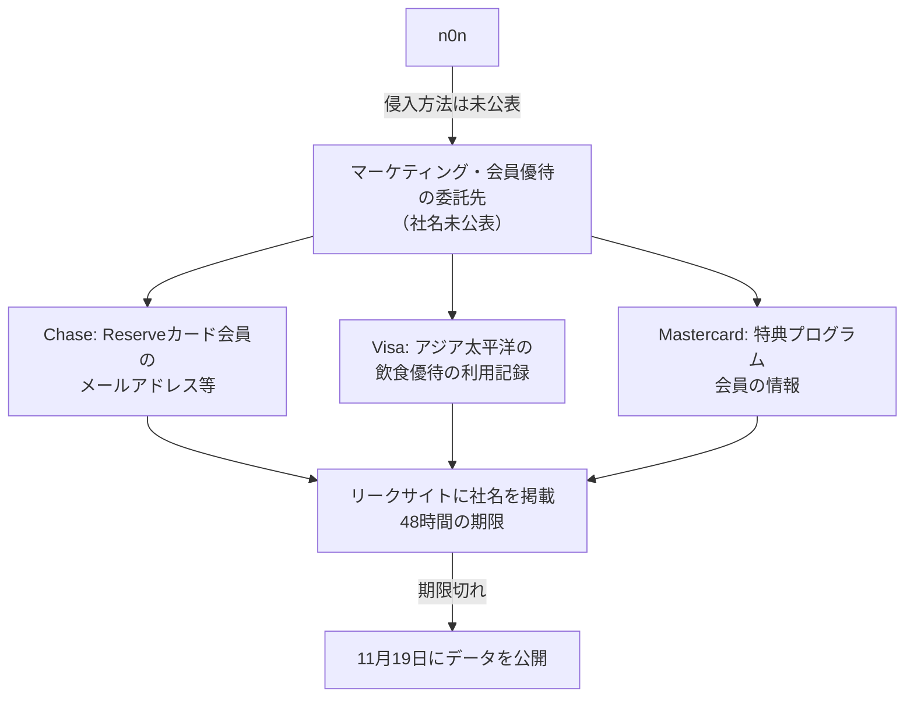

# Chase・Visa・Mastercard ― 委託先からカード会員のマーケティング情報が流出

## 要点

### 影響を受けるもの

- JPMorgan Chase：委託先が持っていたマーケティングデータ。顧客の氏名やメールアドレスが含まれる可能性があるとChaseが発表した（[Chase公式X](https://x.com/Chase/status/2123405210445857009)）。Cybernewsが確認した公開データは、招待制のReserveカード会員の約1万6,000件のメールアドレス、一部の電話番号とChaseのアカウントID、行員のメールアドレス124件だった（[Cybernews](https://cybernews.com/security/jpmorgan-chase-data-leak-non-ransomware-gang/)）。
- Visa：アジア太平洋地域のサービス提供会社での事案。Visaのシステムは関係しておらず、カード番号などの決済データは含まれないとしている（[The Next Web](https://thenextweb.com/news/jpmorgan-chase-visa-mastercard-vendor-breach-n0n-leak)）。Cybernewsは、上位カード向けの飲食優待プログラムに関する6,000人超のデータを確認した（[Cybernews](https://cybernews.com/security/visa-card-data-breach/)）。
- Mastercard：特定の特典プログラムに登録した一部の会員の情報が、委託先で漏れた。決済ネットワークへの影響はなく、漏えいは封じ込めたとしている（[Cybernews](https://cybernews.com/security/n0n-ransomware-leaks-alleged-mastercard-customers-data/)）。公開されたデータは約2,000件で、形式が崩れておりテストデータの可能性もあるとCybernewsは見ている（同）。
- 3社とも委託先の名前と、通知する人数を明らかにしていない（[The Next Web](https://thenextweb.com/news/jpmorgan-chase-visa-mastercard-vendor-breach-n0n-leak)）。

### 今すぐやること

- 対象のカード会員は、Chase・Visa・Mastercardや優待プログラムを名乗るメール、SMS、電話に注意する。漏れたとされるのは連絡先と「どのカード・どの優待を使っているか」の情報で、本物らしい問い合わせを装う材料になる（考察）。
- 金融機関・カード会社でマーケティングや会員優待を外部に委託している場合は、委託先に渡している顧客データの項目、保存期間、委託先の認証方式（MFA、VPNの認証情報、クラウドのキー）を確認する（考察）。
- 委託先から事故の連絡が来たときに、どのデータを渡していたかすぐ答えられるよう、委託先ごとの提供データの一覧を作っておく（考察）。

## 概要

- n0nは2026年9月中旬から確認されている新しいランサムウェア（恐喝）グループで、支払いの期限（48時間）が過ぎた後にJPMorgan Chaseのデータを公開した（[Cybernews](https://cybernews.com/security/jpmorgan-chase-data-leak-non-ransomware-gang/)）。
- 3社はいずれも「自社システムは侵害されていない」「決済データは含まれない」と説明し、攻撃されたのは外部の委託先だとしている（[The Verge](https://www.theverge.com/tech/1037695/jpmorgan-chase-cyberattack)、[The Next Web](https://thenextweb.com/news/jpmorgan-chase-visa-mastercard-vendor-breach-n0n-leak)）。
- 3つのデータは同じファイル構成・書式で、同じ委託先から取られたように見えるとCybernewsの研究者は話しているが、どの会社も確認していない（[Ransomnews](https://ransomnews.com/n0n-visa-mastercard-jpmorgan-data-leak-2026/)）。

> この記事では、各社の発表と報道で確認できた内容を「事実」、筆者の推測や意見を「考察」として分けて書いています。

## 何が起きたか（時系列）

日付は報道の現地日付。

| 日付 | 出来事 |
| --- | --- |
| 2026年9月中旬 | n0nが確認され始める（[Cybernews](https://cybernews.com/security/visa-card-data-breach/)） |
| 10月28日 | SOCRadarが、n0nが公開状態で置いていた作業サーバーの分析を公表（[SOCRadar](https://socradar.io/blog/n0n-ransomware-ai-assisted-extortion/)、[本サイトの記事](/security-notes/notes/2026-11-01-n0n-ransomware-exposed-workspace-credential-only-ai-agent/)） |
| 11月17日 | Visaが「アジア太平洋の委託先での事案」とCybernewsに回答（[Ransomnews](https://ransomnews.com/n0n-visa-mastercard-jpmorgan-data-leak-2026/)） |
| 11月19日 | n0nがChase・Visa・Mastercardのデータを公開。Chaseが公式Xで委託先への攻撃を発表し、11月16日の障害（ソフトウェアの不具合が原因と説明）とは無関係だとした（[Chase公式X](https://x.com/Chase/status/2123405210445857009)、[The Next Web](https://thenextweb.com/news/jpmorgan-chase-visa-mastercard-vendor-breach-n0n-leak)） |

## 技術的な問題点（根本原因）

**事実**

- 委託先にどうやって侵入されたかは、どの会社も公表していない（[The Next Web](https://thenextweb.com/news/jpmorgan-chase-visa-mastercard-vendor-breach-n0n-leak)）。
- Visaのデータには`campaign_directory.csv`というファイルがあり、キャンペーン名、イベント数、初回・最終の日時が記録されていた。ファイル内には「Visa Elite Dining」「Dining Reminder」などの名前と、韓国、インド、シンガポール、マレーシア、フィリピン、オーストラリア、タイ、ベトナムが出てくる（[Cybernews](https://cybernews.com/security/visa-card-data-breach/)）。Cybernewsは、飲食優待の利用状況を追うマーケティング基盤から取られた可能性が高いとしている（同）。
- n0nは事前に、会員の氏名・メールアドレス・携帯電話番号、発行銀行とBIN（カード番号の先頭の発行者識別番号）単位のデータ、2つの地域プログラムの数十万件の利用履歴、上位会員の旅行・飲食の予約を公開すると脅していた。実際に公開されたMastercardのデータは280KBで、主張より大幅に少なかった（[Cybernews](https://cybernews.com/security/n0n-ransomware-leaks-alleged-mastercard-customers-data/)）。
- SOCRadarの分析では、n0nが記録していた侵入はすべて、FortiGate SSL-VPNへの認証情報の総当たり、漏れたAWSキー、弱いRDPのパスワードなど、認証情報を使ったものだった（[SOCRadar](https://socradar.io/blog/n0n-ransomware-ai-assisted-extortion/)）。今回の侵入経路が同じかは分かっていない。

**考察**

- 決済データは守られていても、マーケティングの委託先には「誰が上位カードを持ち、どの優待を使ったか」という、詐欺の標的選びに役立つデータが集まる。Chaseのデータは純資産の大きい顧客向けのReserveカードに限られていたとされ、件数は少なくても標的としての価値は高い。
- 3社のデータの書式が同じだという指摘が正しければ、カード会社や銀行が共通して使うマーケティング・会員優待の事業者が1社侵害され、複数の金融ブランドに被害が広がったことになる。ただし委託先は特定されておらず、断定はできない。

## 攻撃・侵入経路

侵入方法は公表されていない。公表・報道された範囲をまとめると次のとおり。

## なぜ防げなかったか・構造的要因の考察

**考察**

- **委託先のデータは自社の防御の外にある**：3社とも「自社システムは侵害されていない」と説明しているが、顧客から見れば自分の情報が漏れたことに変わりはない。マーケティングや優待の運営で外部に渡したデータは、委託先のセキュリティ水準で守られることになる。
- **「決済データではない」ことが軽視につながりやすい**：氏名とメールアドレスだけでは多くの州法で通知義務が生じにくいとCybernewsは指摘している（[Cybernews](https://cybernews.com/security/jpmorgan-chase-data-leak-non-ransomware-gang/)）。一方で、カードの種類や利用した優待と組み合わさると、本物らしいフィッシングの材料になる。
- **n0nは認証情報を使った侵入を得意とする**：SOCRadarの分析どおりなら、高度な脆弱性よりも、VPNの弱いパスワードや漏れたクラウドのキーといった基本的な管理の甘さが狙われる。大手の委託先であっても、その下の小さな事業者や担当者のアカウントが入口になりうる。

## 運用者向けの具体的な対策と検知ポイント

- **委託先に渡すデータを減らす**（考察）：マーケティング目的で渡すデータから、アカウントIDや電話番号など施策に不要な項目を外す。キャンペーンが終わったデータの削除期限を契約に入れる。
- **委託先の認証を確認する**（考察）：委託先のVPN、リモートデスクトップ、クラウドの管理コンソールにMFAが必須か、長期間使われているアクセスキーがないかを質問票や監査で確認する。n0nが使ったとされる入口（SSL-VPNの総当たり、漏れたAWSキー、弱いRDPのパスワード）は、ここで防げる種類のものである（[SOCRadar](https://socradar.io/blog/n0n-ransomware-ai-assisted-extortion/)）。
- **漏えい後の詐欺に備える**（考察）：上位カード会員向けのコンシェルジュや優待窓口を装う連絡に注意するよう、対象の顧客に案内する。行員のメールアドレスも公開されたため、行員を装ったビジネスメール詐欺やヘルプデスクへのなりすましにも備える（[Cybernews](https://cybernews.com/security/jpmorgan-chase-data-leak-non-ransomware-gang/)が同様のリスクを指摘）。
- **リークサイトの監視**（考察）：n0nは公開前に社名や「Company #番号」の形で予告を載せていたと報じられている（[Ransomnews](https://ransomnews.com/n0n-visa-mastercard-jpmorgan-data-leak-2026/)）。自社や主要な委託先の名前がリークサイトに出ていないか、脅威インテリジェンスで監視する。

## 参考リンク

- [Chase公式X（2026年11月19日）](https://x.com/Chase/status/2123405210445857009)
- [Cybernews: Hacker leaks details of JPMorgan's ultra-wealthy cardholders](https://cybernews.com/security/jpmorgan-chase-data-leak-non-ransomware-gang/)
- [Cybernews: Hackers leak Visa cardholders' data after company confirms cyber incident（2026年11月19日）](https://cybernews.com/security/visa-card-data-breach/)
- [Cybernews: Mastercard data leak: hackers publish alleged customer data](https://cybernews.com/security/n0n-ransomware-leaks-alleged-mastercard-customers-data/)
- [The Next Web: Chase, Visa and Mastercard confirm vendor hacks as n0n leaks customer data](https://thenextweb.com/news/jpmorgan-chase-visa-mastercard-vendor-breach-n0n-leak)
- [The Verge: JPMorgan Chase reveals data breach, but says it's unrelated to this week's banking outage（2026年11月19日）](https://www.theverge.com/tech/1037695/jpmorgan-chase-cyberattack)
- [Ransomnews: n0n leaks Visa, Mastercard and JPMorgan customer data](https://ransomnews.com/n0n-visa-mastercard-jpmorgan-data-leak-2026/)
- [SOCRadar: n0n ransomware（AI-assisted extortion）](https://socradar.io/blog/n0n-ransomware-ai-assisted-extortion/)
