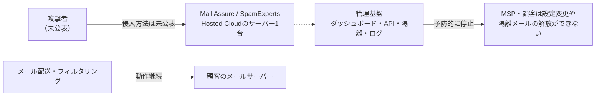

# N-able Mail Assure・SpamExperts ― 不正アクセスで管理画面を停止

## 要点

### 影響を受けるもの

- N-ableのクラウド型メールフィルタリングサービス、**Mail Assure**と**SpamExperts Hosted Cloud**の全リージョン（米州・アジア太平洋・欧州）（[N-able Uptime](https://uptime.n-able.com/event/202672/)）。
- 受信・送信メールの配送とフィルタリングは動き続けている。止まっているのは管理画面（ダッシュボード）、API、隔離（quarantine）、ログ、メールボックス同期（同）。
- 停止中は、管理画面へのログイン、隔離メールの確認・解放、ログの確認、ドメインの追加・削除などの設定変更ができない（同、11月18日 11:44 UTC）。
- 顧客データの侵害やテナントのメールボックスへのアクセスの証拠は、現時点で見つかっていないとN-ableは説明している（同、11月18日 03:05 UTC）。
- 侵入方法、攻撃者、期間、認証情報やAPIキーへの影響は公表されていない。

### 今すぐやること

- Mail Assure／SpamExpertsを使うMSPは、N-ableからパートナー宛てに届いた個別のメール（対応が必要かどうかが書かれている）を確認し、指示に従う。届いていなければN-ableのテクニカルサポートに問い合わせる（[N-able Uptime](https://uptime.n-able.com/event/202672/)）。
- 隔離されたメールを確認・解放できないことを顧客に伝え、急ぎのメールは送り主に別の手段で再送してもらう（考察）。
- APIを呼ぶ自動化（PSA連携、プロビジョニング、レポート）がエラーで再試行を繰り返したり、誤った警報を出したりしないよう一時停止する（考察）。
- 管理画面が戻ったら、管理者ユーザー、ドメイン一覧、配送先、送信リレーの設定、許可リストを、見覚えのない変更がないか確認し、N-ableの指示があれば管理者とAPIの認証情報を入れ替える（考察）。

## 概要

- N-ableは11月16日に、Mail AssureとSpamExperts Hosted Cloudの障害を顧客に知らせた。当初は原因を「プラットフォームの設定とサービス依存関係の組み合わせ」と説明し、修正したと考えていた（[N-able Uptime](https://uptime.n-able.com/event/202672/)）。
- その後の調査で、障害の原因がセキュリティ事案だと判明し、11月18日に「サーバーの1台への不正アクセス」を公表した。管理画面とAPIは予防のために止めている（同）。
- N-ableは、11月上旬に起きたN-central（リモート管理製品）の脆弱性公開とクラウド版停止とは関係ないとしている（同、[本サイトの記事](/security-notes/notes/2026-11-09-n-able-n-central-able2shell-zero-days-hosted-offline/)）。

> この記事では、N-ableの発表と報道で確認できた内容を「事実」、筆者の推測や意見を「考察」として分けて書いています。

## 何が起きたか（時系列）

N-ableのステータスページ（UTC表記）を日本時間（JST）に直したもの。

| 日時（JST） | 出来事 |
| --- | --- |
| 11月16日（日付のみ） | N-ableが障害を顧客に通知（後の11月18日の更新で言及） |
| 11月17日 12:00 | ステータスページで障害の調査開始。ダッシュボードにアクセスできず、フィルタリングは動作 |
| 11月17日 22:33 | 原因は「設定とサービス依存関係の組み合わせ」と説明。影響を受けた基盤の再構築と部品の更新が必要とした |
| 11月18日 12:05 | セキュリティ事案と判明したと公表。サーバー1台への不正アクセスを確認、UIとAPIを予防的に停止 |
| 11月18日 20:44 | 停止中はログイン、隔離メールの解放、ログ確認、ドメインの追加・削除ができないと説明 |
| 11月19日 05:18 | パートナーに、環境ごとの情報と対応の要否を直接メールしたと発表 |
| 11月19日 09:01〜11月20日 04:55 | 修復策のテストとセキュリティ強化を継続。各サービスはセキュリティ検証を通ったものから戻すと説明 |
| 11月20日 09:00 | 最新の更新。管理画面・API・隔離・ログは引き続き停止、メール配送とフィルタリングは通常どおり |

出典はすべて [N-able Uptime（イベント202672）](https://uptime.n-able.com/event/202672/)。

## 技術的な問題点（根本原因）

**事実**

- N-ableが公表しているのは「Mail AssureとSpamExperts Hosted Cloudのサーバーの1台に不正アクセスがあった」ことだけで、どのサーバーか、どう侵入されたかは明らかにしていない（[N-able Uptime](https://uptime.n-able.com/event/202672/)）。
- 当初の説明では、障害の原因を設定とサービス依存関係の問題とし、影響を受けた基盤を再構築したとしていた。この障害が不正アクセスによって起きたものだと、後から判明した（同）。
- 公開の更新では、パスワード、APIキー、トークンが漏れたかどうかには触れておらず、全員に一律の認証情報の入れ替えも求めていない（[The Hacker News](https://thehackernews.com/2026/11/n-able-confirms-hackers-accessed-cloud.html)、N-able Uptime）。

**考察**

- メールフィルタリングの管理基盤は、多数の顧客ドメインの配送先、許可リスト、隔離メールをまとめて扱う。メールの中身に触れなくても、配送先や許可リストを書き換えられれば、メールの横取りやフィルタの迂回ができる。N-ableが配送は止めずに管理画面とAPIだけを止めたのは、設定を変えられる入口をまず閉じる判断と読める。
- 障害として調べ始め、2日近く後にセキュリティ事案と判明した経緯から、最初の兆候は攻撃とは見えない形（設定の不整合やサービスの不調）で現れたと考えられる。

## 攻撃・侵入経路

侵入方法は公表されていない。影響範囲の構造を示す。

## なぜ防げなかったか・構造的要因の考察

**考察**

- **MSP向けサービスは1か所の侵害が多数の顧客に広がる**：Mail Assure／SpamExpertsはMSPが多くの顧客のメールをまとめて守るためのサービスで、基盤が侵害されると、MSPの全顧客の管理操作が一度に止まる。今月はN-centralでも、クラウド版の停止で多くのMSPが影響を受けた。
- **障害対応とセキュリティ対応の切り分け**：当初は設定の問題として修正済みと考えたと説明しており、攻撃の可能性に気づくまで時間がかかった。障害の原因調査の段階で、不正アクセスの可能性も並行して調べる手順が重要になる。
- **情報が少ない間の判断を利用者に委ねている**：N-ableはパートナーに個別に通知しているが、公開情報では侵入方法や認証情報への影響が分からない。利用者は個別の通知と自分の設定の確認で判断するしかない。

## 運用者向けの具体的な対策と検知ポイント

- **N-ableの個別通知に従う**：対応の要否は環境ごとに異なるとN-ableは説明している（[N-able Uptime](https://uptime.n-able.com/event/202672/)）。
- **復旧後に確認する設定**（考察）：
  - 管理者・サブ管理者のユーザー一覧（見覚えのないアカウントがないか）
  - ドメイン一覧と、各ドメインの配送先サーバー
  - 送信リレーのユーザー、スマートホスト、送信認証の設定
  - 許可リスト（送信者のホワイトリスト）とフィルタルール
  - ログが戻ったら、11月16日以降の設定変更の記録
- **N-ableの外で確認できること**（考察）：DNSで各顧客ドメインのMXレコードが想定どおりか確認する。顧客のメールサーバーが、フィルタの送信元アドレスからの受信だけを受け付ける設定になっているか確認する。
- **連携の認証情報**（考察）：PSA・RMM・請求システムに保存したMail Assure／SpamExpertsのAPI認証情報を洗い出し、入れ替えるときに漏れがないようにする。

## 参考リンク

- [N-able Uptime: Security Incident – Mail Assure and SpamExperts Hosted Cloud - All regions（イベント202672）](https://uptime.n-able.com/event/202672/)
- [The Hacker News: Hackers Breach N-able Cloud Server, Disrupting Email Security Management Across 3 Regions（2026年11月19日）](https://thehackernews.com/2026/11/n-able-confirms-hackers-accessed-cloud.html)
