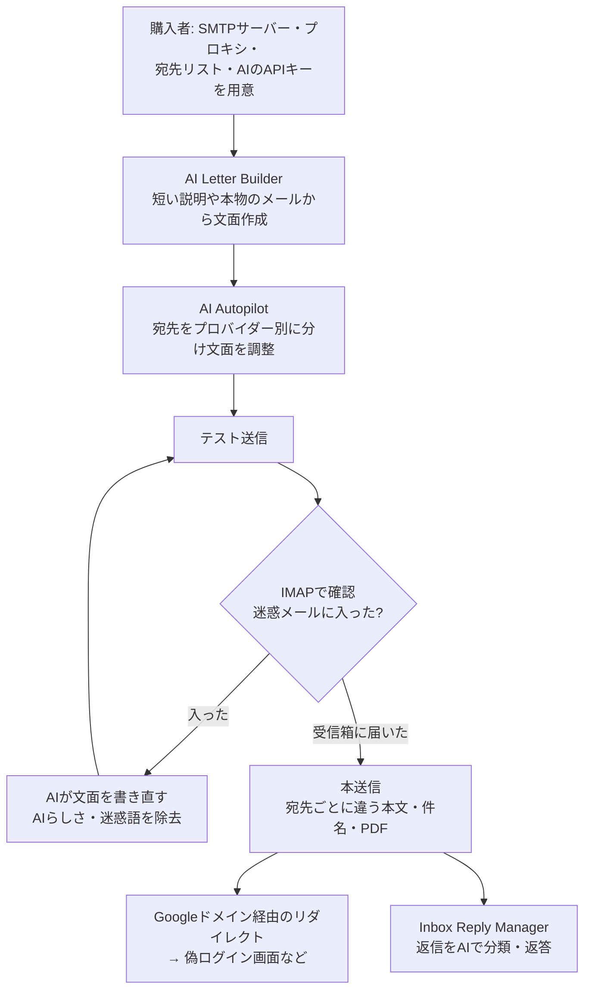

# TheMailer ― 迷惑メール判定を抜けるまでAIが書き直すフィッシングキット

## 要点

### 影響を受けるもの

- メールで攻撃される組織と個人全般。Varonisが確認した販売者のスクリーンショットには、プロバイダー別に振り分けられた**14万5,133件**の宛先リストがあり、ほぼすべてが日本の企業と大学のドメイン（`.co.jp`、`.ac.jp`）だった（[Varonis](https://www.varonis.com/blog/themailer-ai-phishing-kit)）。
- 文面の例は、Robinhood（米国の証券アプリ）を装う「不審なアクティビティ」通知、IONOS（ドイツのホスティング事業者）のカスタマーサービスを装うメール、金融サービスやアカウント保護、ホテル予約の折り返し電話を求めるものなど（同）。
- 宛先のメールプロバイダーとして、Gmail、Microsoft、GMX、フランスのISP、Yandexが挙がっている（同）。

### 今すぐやること

- 自社ドメインでSPF・DKIM・DMARCを設定し、DMARCは`p=reject`まで進める。似たドメインや新しく登録されたドメインを監視する（Varonis）。
- メール内のリンクは、Googleなど信頼されたドメインを経由するリダイレクトも含めて、クリック時に最終的な飛び先まで検査する仕組みを使う（Varonis）。
- 文面の不自然さや文法の誤りを見分け方として教えるのをやめ、「急がせる」「予想外の依頼」「ログインを求める」といった要求の内容で疑うよう教育を変える（Varonis）。
- 日本語の文面だから、あるいは迷惑メールフォルダーに入らなかったから安全、とは判断しない（考察）。

## 登場する組織・サービス

- **TheMailer**：攻撃者が自分のサーバーに置いて使う、フィッシングメールの作成・配信ツール。送信テストで迷惑メールに入ると、商用AIで文面を書き直して再送する機能を備える（[Varonis](https://www.varonis.com/blog/themailer-ai-phishing-kit)）。
- **Varonis**：データの保管場所や権限の管理を助けるセキュリティ企業。調査部門のVaronis Threat LabsがTheMailerを分析して公表した（[About Varonis](https://www.varonis.com/company/about-us)、[Varonisの分析](https://www.varonis.com/blog/themailer-ai-phishing-kit)）。

## 概要

- TheMailerは、攻撃者が自分のサーバーに置いて使う、フィッシングメールの作成・配信ツール。見た目はメールマーケティングツールに近い（[Varonis](https://www.varonis.com/blog/themailer-ai-phishing-kit)）。
- 2026年3月からサイバー犯罪のフォーラムで宣伝され、販売スレッドは2万4,000回以上閲覧されている。永久ライセンスで3,000〜6,000ドル（AI機能の有無などで変わる）、Telegramの自動販売ボットで暗号資産で支払う。導入とサポートは無料（同）。
- 購入者が用意するのは送信用のSMTPサーバー、プロキシ、宛先リストだけで、文面の作成から迷惑メール判定のすり抜けまでをAIが受け持つ（同）。

> この記事では、Varonisの分析で確認できた内容を「事実」、筆者の推測や意見を「考察」として分けて書いています。

## 何が起きたか（時系列）

| 時期 | 出来事 |
| --- | --- |
| 2026年3月 | TheMailerがサイバー犯罪のフォーラムで宣伝され始める（Varonis） |
| 2026年11月 | Varonis Threat Labsが分析を公開（[Varonis](https://www.varonis.com/blog/themailer-ai-phishing-kit)） |
| 11月19日 | The Hacker Newsの週刊まとめで紹介（[The Hacker News](https://thehackernews.com/2026/11/threatsday-gpt-62-jailbreak-flaws.html)） |

## 技術的な問題点（何が新しいのか）

脆弱性ではなく、AIで迷惑メールフィルタをすり抜ける仕組みが分析の中心になる。

**事実（Varonis）**

- **AIの接続**：Claude、ChatGPT、Grok、Gemini、Mistral、DeepSeek、OpenRouterに、利用者が自分のAPIキーを入れて使う。設定画面には「AnthropicとOpenAIはクラウドのIPアドレスからの要求を拒否する」と書かれ、SOCKS5や住宅用プロキシを経由するよう指示している。
- **Inbox Loop**：テスト用の受信箱に送り、IMAPで迷惑メールフォルダーに入ったかを確認する。入っていればAIが文面を書き直し、受信箱に届くまで繰り返す。書き直しの方向は「AI focus」欄で指定でき、例として「銀行らしい丁寧な口調」が入っている。
- **宛先ごとの文面**：短い説明からHTMLメールを作るAI Letter Builderで、宛先ごとに違う本文と件名を生成する。つないだ受信箱から本物の企業メールを取り込んでテンプレートにもできる。
- **プロバイダー別の調整**：AI Autopilotが宛先をメールプロバイダーごとに分け、各社のフィルタ向けの注意書きに沿って文面を変える。
- **AIらしさの除去**：テンプレート生成には「迷惑メール判定されやすい語を置き換える」「AIっぽい表現を消す（検出器を通す）」という選択肢がある。
- **その他の機能**：新しい送信アカウント同士で自動でやり取りして実績を作るAI WarmUP、SMTPアカウント・ヘッダー・エンコード・DKIM設定・本文の組み合わせを試すInbox Finder、返信をまとめてAIで分類・返答するInbox Reply Manager。リンクをGoogleのドメインの裏に隠す「trust redirects」、SOCKS5経由で宛先のMXサーバーに直接送る機能、ヘッダーや送信者の無作為化もある。
- **添付ファイル**：HTMLから宛先の名前入りのPDF（例：`Invoice_John.pdf`）を作り、リンクとメタデータを変えてファイルのハッシュが毎回違うようにする。SVGのリダイレクトや予定表の招待も作れる。

**考察**

- これまでのフィッシングは、同じテンプレートを大量に送るため、1つの文面やハッシュを見つければまとめて止められた。TheMailerは、宛先ごとに文面もファイルも違い、しかも主要なメールサービスで事前に試してから送るため、文面やハッシュで止める方式の効果が下がる。
- 14万件の日本の宛先リストは、販売者が機能を見せるための画面に写っていたもので、実際にどの組織に送られたかは分からない。ただ、日本語の文面の不自然さに頼った見分け方が、生成AIで通用しにくくなっている点には注意が要る。

## 攻撃の流れ

## なぜ防げなかったか・構造的要因の考察

**考察**

- **フィルタの判定結果が攻撃者の学習材料になる**：Inbox Loopは、受信箱に届いたか迷惑メールに入ったかという結果だけを見て文面を直す。Gmailなどのフィルタが公開している「判定」を、攻撃者が何度でも試せることを利用している。
- **商用AIの利用制限をプロキシで回避**：AI事業者はクラウドのIPアドレスからの要求を拒むなどの制限をしているが、住宅用プロキシを使うよう手順に書かれており、悪用防止がIPアドレスの制限に頼っていると回り込まれる。
- **技術の壁が下がった**：きれいなHTML、配信の調整、プロバイダーごとのテストは、以前は経験と時間が必要だった。それが数千ドルとAPIキーだけで手に入る（Varonisも同様の指摘）。

## 運用者向けの具体的な対策と検知ポイント

- **送信元の認証**：SPF・DKIM・DMARC（`p=reject`）を設定し、受信側でもDMARCの判定結果を使う（[Varonis](https://www.varonis.com/blog/themailer-ai-phishing-kit)）。
- **リンクと添付の動的検査**：Google・クラウドストレージなど信頼されたドメインのリダイレクトを最後までたどって検査する。宛先ごとにハッシュが変わるPDF・SVGを想定し、ハッシュの照合だけに頼らない（Varonis、考察）。
- **行動・意図での判定**（Varonis）：文面ではなく、初めての送信者、送信者の振る舞い、ログインや支払いを求める要求といった意図に注目する。
- **ドメイン監視**：自社や取引先に似たドメイン、新しく登録されたドメインからのメールを監視する（Varonis）。
- **利用者教育**：文法の誤りはもう目印にならない。急かす内容、予想外の依頼、ログインを求める内容、「不審なアクティビティ」や明細の通知を装うメールに注意するよう教える（Varonis）。
- **被害を広げない**：誰かがクリックした場合に備え、最小権限とデータの監視で被害を抑える（Varonis）。MFAはフィッシングに強い方式（FIDO2のセキュリティキーやパスキー）にする（考察）。

## 参考リンク

- [Varonis: Meet TheMailer: The AI Phishing Kit that Rewrites Emails and Taps Top Models](https://www.varonis.com/blog/themailer-ai-phishing-kit)
- [The Hacker News: ThreatsDay: GPT-6.2 Jailbreak Flaws, BubbleLoader PNG Malware, $500M Ransom Demands + 17 More Stories（2026年11月19日）](https://thehackernews.com/2026/11/threatsday-gpt-62-jailbreak-flaws.html)
