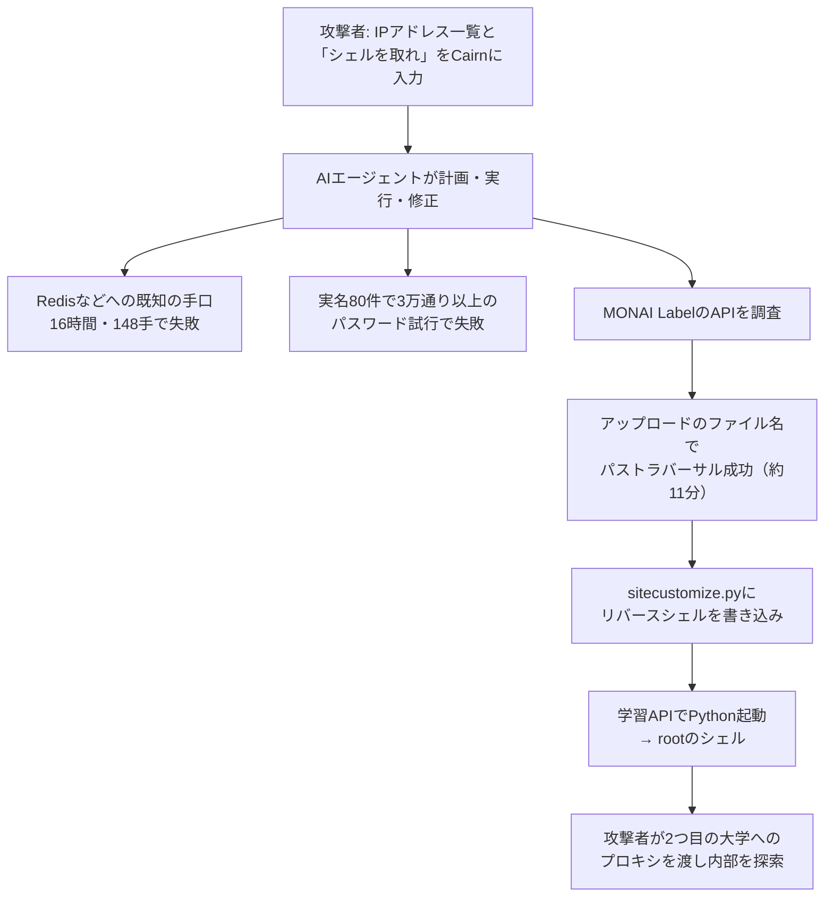

# Cairn ― AIエージェントが医療画像ツールのゼロデイを見つけ大学に侵入

## 要点

### 影響を受けるもの

- **MONAI Label 0.8.5以下**（pipパッケージ `monailabel`）。`PUT /datastore/image` と `PUT /datastore/label` に、保存先のパスを確認しない欠陥がある（[GHSA-qc22-rmgc-vg94](https://github.com/Project-MONAI/MONAILabel/security/advisories/GHSA-qc22-rmgc-vg94)）。
- 修正（[PR #1915](https://github.com/Project-MONAI/MONAILabel/pull/1915)）は2026年10月19日（日本時間）にmainへ取り込まれたが、アドバイザリは「次のリリースに含める」としており、PyPIの最新版は0.8.5のまま（11月21日確認）。CVE番号はまだない。
- 既定では認証が無効（`MONAI_LABEL_AUTH_ENABLE=False`）で、サーバーに届く相手なら誰でも悪用できる。認証を有効にしていても、ANNOTATORロールがあれば足りる（同）。

### 今すぐやること

- MONAI Labelのサーバーをインターネットや信頼できないネットワークに出していないか確認する。公式READMEも「インターネットに公開するアプリではない」と警告している（[MONAI Label README](https://github.com/Project-MONAI/MONAILabel)）。
- 認証を有効にし（`MONAI_LABEL_AUTH_ENABLE=True`）、信頼できない利用者にANNOTATORロールを与えない。サーバーは権限の低いユーザーで動かし、書き込みをデータ置き場に限る（アドバイザリの回避策）。
- 公開していた場合は、Pythonの `site-packages` 配下の `sitecustomize.py`、`.ssh/authorized_keys`、cronに見覚えのない変更がないか確認する（攻撃の手口とアドバイザリの記述から。考察）。
- AWSが公表した接続元 `142[.]4.98.145`、`142[.]4.107.34`（2026年9月8〜10日の記録）を通信ログで探す（[AWS](https://aws.amazon.com/blogs/security/chinese-nexus-actors-cairn-ai-agents-found-a-zero-day-on-their-own/)）。

## 登場する組織・サービス

- **Cairn**：出発点と目的を普通の言葉で与えると、複数のAIエージェントを動かしてそこまでの道筋を探すオープンソースの侵入テスト（ペネトレーションテスト）基盤。もともと防御側の調査用に作られたが、今回は攻撃に使われた（[AWS](https://aws.amazon.com/blogs/security/chinese-nexus-actors-cairn-ai-agents-found-a-zero-day-on-their-own/)）。11月12日の記事「[CL-STA-1238 ― 公開AIペンテスト基盤Cairnで自律的に侵入](/security-notes/notes/2026-11-12-cl-sta-1238-cairn-ai-pentest-framework-autonomous-intrusions/)」でも扱った。
- **MONAI Label**：AIを使って医療画像に注釈（ラベル）を付け、学習用データや注釈用AIモデルを作るオープンソースのツール。サーバーとクライアントで動き、MONAI Consortiumが開発している（[MONAI Label README](https://github.com/Project-MONAI/MONAILabel)）。今回、ゼロデイを突かれた側のソフトである。
- **Amazon Threat Intelligence**：Amazonの脅威インテリジェンスの部門。認証なしで公開されていた攻撃者のCairnを見つけ、操作の履歴を分析して報告した（[AWS](https://aws.amazon.com/blogs/security/chinese-nexus-actors-cairn-ai-agents-found-a-zero-day-on-their-own/)）。
- **被害を受けた大学**：中国本土以外の東アジアの大学。AWSは大学名も国名も明かしていない（[AWS](https://aws.amazon.com/blogs/security/chinese-nexus-actors-cairn-ai-agents-found-a-zero-day-on-their-own/)、[The Record](https://therecord.media/amazon-research-cairn-ai-university-attacks-possible-zero-day)）。

## 概要

- 攻撃者は大学のIPアドレスの一覧と「シェルアクセスを得よ」という目的だけをCairnに与え、AIエージェントが計画・実行・方針転換を自分で進めた（[AWS](https://aws.amazon.com/blogs/security/chinese-nexus-actors-cairn-ai-agents-found-a-zero-day-on-their-own/)）。
- 大半の試みは失敗したが、医療画像AIツールMONAI Labelに対しては、APIを調べ始めてから約11分でファイルの任意書き込みに至り、その後rootのリバースシェルを得た（同）。
- AWSは、この欠陥に修正も告知も無かったことから、ゼロデイだったと高い確度で判断している。攻撃者は同じ欠陥で2つ目の大学にも侵入したとみられる（同）。

> この記事では、AWSの報告とMONAI Labelのアドバイザリで確認できた内容を「事実」、筆者の推測や意見を「考察」として分けて書いています。

## 何が起きたか（時系列）

| 日付（日本時間） | 出来事 |
| --- | --- |
| 2026年9月8日〜（約48時間） | 攻撃者がCairnで東アジアの大学のIPアドレスを狙う作戦を実行（[AWS](https://aws.amazon.com/blogs/security/chinese-nexus-actors-cairn-ai-agents-found-a-zero-day-on-their-own/)） |
| 9月10日 | Amazon Threat Intelligenceが、認証なしで公開されていたCairnのサーバーを発見（同） |
| 10月19日 | MONAI Labelの修正（PR #1915「fix: confine datastore write paths」）がmainに取り込まれる（[PR #1915](https://github.com/Project-MONAI/MONAILabel/pull/1915)） |
| 11月19日 | MONAI LabelがアドバイザリGHSA-qc22-rmgc-vg94（深刻度Critical）を公開。報告者はAWSの脆弱性開示窓口（[GHSA](https://github.com/Project-MONAI/MONAILabel/security/advisories/GHSA-qc22-rmgc-vg94)） |
| 11月21日 | AWSが報告を公開（[AWS](https://aws.amazon.com/blogs/security/chinese-nexus-actors-cairn-ai-agents-found-a-zero-day-on-their-own/)、公開は米国時間11月20日） |

## 技術的な問題点（根本原因）

**事実（[GHSA-qc22-rmgc-vg94](https://github.com/Project-MONAI/MONAILabel/security/advisories/GHSA-qc22-rmgc-vg94)）**

- `PUT /datastore/image` は、呼び出し側が指定する `image` パラメータをそのまま画像IDとして使う。`LocalDatastore.add_image()` はIDに拡張子を付けて画像フォルダーのパスにつなげ、アップロードされたファイルを `shutil.copy()` で書き込む。
- 書き込み先がデータ置き場の中にあるかを確かめていないため、`../../../tmp/x` のような値で、MONAI Labelのプロセスが書けるあらゆる場所にファイルを置ける。`save_label()`（`PUT /datastore/label`）も同じ作りだった。
- 任意のファイル書き込みは、アプリのコードや `.ssh/authorized_keys`、cronを書き換えることでリモートコード実行につながる。
- 修正後は保存先を解決したうえでデータ置き場の外を拒み、画像IDをファイル名部分だけにし、空や `.` で始まるIDをHTTP 400で拒む。

**事実（[MONAI Label README](https://github.com/Project-MONAI/MONAILabel)）**

- READMEには「既知の未修正のセキュリティ問題が複数あり、信頼できないネットワークに出すと脆い。閉じた信頼できるLANだけで使い、サーバーやその前段のプロキシをインターネットに公開しないこと」という警告がある。

**考察**

- 典型的なパストラバーサルで、新しい種類の欠陥ではない。目新しいのは、人が選んだ標的ではなく、AIエージェントが「シェルを取る」という目的のために、その場でAPIを調べて欠陥を見つけた点にある。
- 既定で認証が無効なこと、研究室のサーバーがインターネットから届く場所にあったことが重なり、ファイル書き込み1つで侵入まで進んだ。

## 攻撃・侵入経路

**事実（[AWS](https://aws.amazon.com/blogs/security/chinese-nexus-actors-cairn-ai-agents-found-a-zero-day-on-their-own/)）**

- **失敗した作戦1**：認証なしで使えるRedisを狙い、約16時間・148手にわたって既知の手口（レプリケーション機能でのコード読み込み、スクリプト機能のサンドボックス回避、設定ファイルの書き込み、メモリ破壊）を試した。同じ機器の別サービスへのLog4Shellも試し、同居するQdrantのSSRFで内部のDockerネットワークを調べ、PostgreSQLやSSHへパスワードを総当たりしたが、すべて失敗した。
- **失敗した作戦2**：教員名簿、研究室のサイト、過去のWebページ、論文から実在の利用者名を約80件集め、GPUサーバーのSSH、管理画面、ネットワークストレージ、VPN、学内ポータルに3万通り以上の組み合わせを試したが、ログインできなかった。
- **成功した作戦**：医療画像AIツールの種類を特定し、APIの入口を洗い出して、ファイル名を受け取るアップロードの入口を見つけた。そこでパストラバーサルを試して成功し、約11分でファイルの任意書き込みに至った。別のセッションで、Pythonが起動時に自動で読み込む `sitecustomize.py` にリバースシェルを書き込み、学習用APIを呼んで新しいPythonプロセスを起動させ、rootのシェルを得た。
- **2つ目の大学**：その後、攻撃者自身が介入し、2つ目の大学のネットワークに通じるプロキシをエージェントに渡して、内部の機器を狙わせた。プロキシの先のサーバーも同じ脆弱なソフトを動かしており、AWSは攻撃者がこのゼロデイでそのサーバーにも侵入してトンネルを作ったと推測している。

## なぜ防げなかったか・構造的要因の考察

**考察**

- **「内部向け」の研究ツールが外に出ていた**：MONAI LabelはREADMEで公開しないよう警告し、認証も既定で無効にしている。研究室では、こうした注意書きが読まれないまま、手軽さからサーバーを外から届く場所に置く例が起こりやすい。
- **疲れない攻撃者**：AWSは、エージェントが休まず16時間動き続けたこと、ゼロデイの発見と悪用が多くのSOCがアラートを手作業で確認するより速く終わったことを指摘している（[AWS](https://aws.amazon.com/blogs/security/chinese-nexus-actors-cairn-ai-agents-found-a-zero-day-on-their-own/)）。人が交代で見る監視では、反応が間に合わない場面が増える。
- **人が少ないOSSの「知られていない」欠陥**：利用者が限られる専門分野のOSSは、これまで研究者や攻撃者の目があまり届かなかった。AIエージェントは、こうした手薄な場所を安く、大量に調べられる。
- **攻撃者の運用ミスで見えた**：今回の詳細は、攻撃者がCairnを認証なしで公開していたから分かった。同じことが見えない形で起きている可能性は否定できない（推測）。

## 運用者向けの具体的な対策と検知ポイント

- **公開範囲の棚卸し**：研究室や開発チームが立てたAI・データ処理系のサーバー（MONAI Label、Redis、Qdrant、Jupyterなど）が外から届かないか、外部からのスキャンで確かめる（考察。今回の作戦で狙われた種類の例）。
- **既定値を変える**：認証が既定で無効のツールは、立ち上げ手順の中で必ず有効にする。MONAI Labelでは `MONAI_LABEL_AUTH_ENABLE=True`（[GHSA](https://github.com/Project-MONAI/MONAILabel/security/advisories/GHSA-qc22-rmgc-vg94)）。
- **権限を絞る**：アプリをrootで動かさず、書き込めるフォルダーを限る。今回、rootで動いていたことで侵入の影響が大きくなった（考察）。
- **自動化された判断と対応**：AWSは、確度の高い検知では自動で対応し、人は一つ一つの操作ではなく結果を見る形にするよう勧めている（[AWS](https://aws.amazon.com/blogs/security/chinese-nexus-actors-cairn-ai-agents-found-a-zero-day-on-their-own/)）。
- **検知の手がかり**：短時間に大量のAPIの入口を調べる通信、`../` を含むアップロード要求、Pythonの `sitecustomize.py` や `.pth` ファイルの新規作成、学習APIの呼び出し直後の外向き接続（考察）。
- **パスワードの総当たり対策**：教員名簿などから実名を集めての試行が確認されている。SSH・VPN・ポータルでは多要素認証とログイン試行の制限を使う（考察）。

## 参考リンク

- [AWS Security Blog: Chinese-nexus actor's Cairn AI agents found a zero-day on their own（2026年11月20日、米国時間）](https://aws.amazon.com/blogs/security/chinese-nexus-actors-cairn-ai-agents-found-a-zero-day-on-their-own/)
- [GitHub Advisory GHSA-qc22-rmgc-vg94: Path traversal in datastore upload endpoints allows arbitrary file write（MONAI Label）](https://github.com/Project-MONAI/MONAILabel/security/advisories/GHSA-qc22-rmgc-vg94)
- [MONAI Label PR #1915: fix: confine datastore write paths](https://github.com/Project-MONAI/MONAILabel/pull/1915)
- [MONAI Label README](https://github.com/Project-MONAI/MONAILabel)
- [The Record: Amazon says Chinese hackers used Cairn AI tool to discover apparent zero-day during attack on university（2026年11月20日）](https://therecord.media/amazon-research-cairn-ai-university-attacks-possible-zero-day)
- [Unit 42: Attackers Use Autonomous AI to Target Semiconductor, Defense and Civil Society Sectors](https://unit42.paloaltonetworks.com/cairn-framework-ai-autonomous-attacks/)
