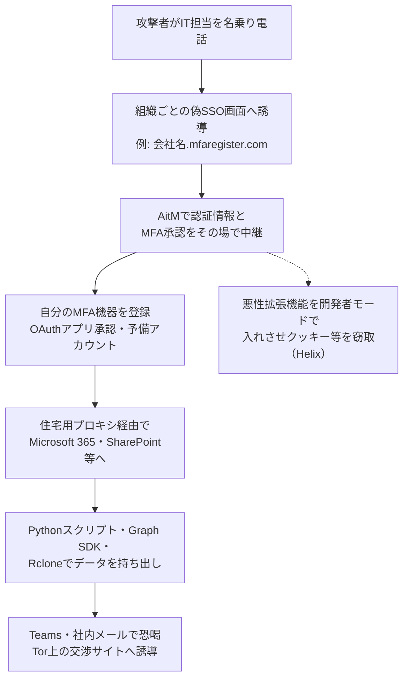

# Com系の攻撃者 ― IT担当を装う電話でSSOを奪いデータ窃取・恐喝

## 要点

### 影響を受けるもの

- 脆弱性ではなく、人をだます攻撃。狙われたのは金融、医療、法律など機密データを多く持つ業種で、主に米国・英国・オーストラリアの組織（[Unit 42](https://unit42.paloaltonetworks.com/com-affiliate-vishing-attacks/)）。
- 狙われやすいのは、社員が分散し、SSO（シングルサインオン）にまとめ、クラウドの共同作業基盤を広く使う組織。失敗した数週間後に同じ組織を再び狙う例もあった（同）。
- 2026年10月には、観測した偽ドメインのうちオーストラリアの組織を狙うものが約13%に増え、米国に次ぐ2番目になった（同）。

### 今すぐやること

- ヘルプデスクとIT部門の本人確認手順を見直し、「IT担当から電話が来て、指定のページでサインインやMFAの再登録を求められる」ことは無い、と社員に周知する（Unit 42の推奨と考察）。
- MFAをフィッシングに強い方式（FIDO2のセキュリティキーやパスキー）に移す（[Unit 42](https://unit42.paloaltonetworks.com/com-affiliate-vishing-attacks/)）。
- 新しいMFA機器の登録、知らないOAuthアプリの承認、`python-requests`・`python-httpx` などのスクリプトからのMicrosoft Graph・SharePoint・OneDriveへの大量アクセスを検知する（同）。
- ブラウザー拡張機能は許可したものだけにし、開発者モードでの読み込みを禁止する（同、考察）。

## 登場する組織・サービス

- **Com系の攻撃者（Com-affiliated threat actors）**：Unit 42が、電話でのなりすましから始まるデータ窃取と恐喝の一連の活動をまとめて呼ぶ言い方。名前の付いたグループBling Libra（別名ShinyHunters）と、複数の活動クラスター（Redact、Pink、Falcon、Helix、Vortex、Cinder）を含む（[Unit 42](https://unit42.paloaltonetworks.com/com-affiliate-vishing-attacks/)）。
- **Bling Libra（ShinyHunters）**：2019年から活動しているとUnit 42がみる恐喝グループ。2026年初めから多くのデータ窃取・恐喝の事案を起こしたとされ、メンバーとみられる人物の逮捕も報じられている（[Unit 42](https://unit42.paloaltonetworks.com/com-affiliate-vishing-attacks/)、[Krebs on Security](https://krebsonsecurity.com/2026/10/feds-suspect-ransom-negotiator-ran-shinyhunters-extortion-site/)）。
- **Unit 42**：セキュリティ企業Palo Alto Networksの脅威インテリジェンス・インシデント対応・コンサルティングの部門。自社の観測と対応事案から今回の報告をまとめた（[Palo Alto Networks](https://www.paloaltonetworks.com/unit42)、[Unit 42](https://unit42.paloaltonetworks.com/com-affiliate-vishing-attacks/)）。
- **Doko's Panel**：攻撃者が操作するAitM（中間者）型のフィッシングキット。Com系の複数の事案で共有されていた（[Unit 42](https://unit42.paloaltonetworks.com/com-affiliate-vishing-attacks/)）。Okta向けの変種はPush Securityが報告している（[Push Security](https://pushsecurity.com/blog/inside-criminal-phishing-panel)）。

## 概要

- 攻撃は電話から始まる。IT担当を名乗って「認証の問題を直す」と言い、標的の組織ごとに作った偽のサインイン画面へ社員を誘う（[Unit 42](https://unit42.paloaltonetworks.com/com-affiliate-vishing-attacks/)）。
- 偽画面はAitMの中継サーバーで、入力されたパスワードとMFAの承認をその場で攻撃者に渡す。攻撃者はすぐ自分のMFA機器を登録し、クラウドのデータを盗んで、社内のTeamsやメールで恐喝する（同）。
- 暗号化（ランサムウェア）は使わない。Unit 42は、暗号化を伴わない恐喝の増加が2026年も続いていると指摘する（同）。

> この記事では、Unit 42の報告で確認できた内容を「事実」、筆者の推測や意見を「考察」として分けて書いています。

## 何が起きたか（時系列）

| 時期 | 出来事 |
| --- | --- |
| 2026年初め | Unit 42がBling LibraとCom系の攻撃者による恐喝事案への対応を重ねる（[Unit 42](https://unit42.paloaltonetworks.com/com-affiliate-vishing-attacks/)） |
| 2026年8月ごろ | Com系の攻撃が大きく増える。8月は金融が医療の約2倍狙われた（同） |
| 9月 | 新しい活動クラスターVortex（CL-CRI-1264）とCinder（CL-CRI-1274）を確認。医療が金融を上回り最も狙われる業種に（同） |
| 9月 | 研究者Kevin Phamが、Helix（UNC6671）のブラウザー用インプラントを分析（[deoxy.net](https://deoxy.net/blog/inside-unc6671s-browser-implant/)、Unit 42が紹介） |
| 10月 | 医療と金融が引き続き上位。オーストラリアの組織を狙う偽ドメインが約13%に（Unit 42） |
| 11月20日（米国時間） | Unit 42が報告「Dialing for Data」を公開（[Unit 42](https://unit42.paloaltonetworks.com/com-affiliate-vishing-attacks/)） |

## 技術的な問題点（何が新しいのか）

脆弱性ではなく、電話でのなりすましと、MFAの「承認」を中継する仕組みが中心になる。

**事実（[Unit 42](https://unit42.paloaltonetworks.com/com-affiliate-vishing-attacks/)）**

- **Vortex（CL-CRI-1264）**：主に医療・製薬などを狙う。社内ITサポートを装って電話し、組織ごとのサブドメインのAitMサーバーへ誘導する。会社のPCだけでなく私物のスマートフォンも狙う。サインインから数分で不正なMFA機器を登録し、複数の乗っ取ったアカウントで「Pixel 10a」という同じ名前の機器を使い回していた。Pythonスクリプト（User-Agentは `python-httpx`）でMicrosoft 365のメールボックス、OneDrive、SharePointを自動で持ち出し、その後Teamsで社員に直接、窃取を伝えてTor上の交渉サイトへ誘導した。
- **Cinder（CL-CRI-1274）**：同じく電話で入り込み、「サインインしたままにする」で発行された長く使えるセッショントークンを再利用して、Duo MFAの再要求を避けた。そのトークンをプロキシ経由で使い、`python-requests/2.34.2` とMicrosoft Graph SDKでSharePointとOneDriveのデータを持ち出した。乗っ取ったアカウントから社内にメールとTeamsで恐喝文を送った。
- **悪性のブラウザー拡張機能**：Helix（CL-CRI-1192、GoogleのUNC6671と重なる）の事案で、「Google Chrome」という名前の拡張機能（バージョン1.6.111と1.6.112）を見つけた。Chromeウェブストアにはなく、攻撃者のサーバーから入手させ、開発者モードで手動で読み込ませる。名前を「Google Chrome」にすることで、デバッグ中を示すブラウザーの警告表示を目立たなくしている。キー入力の記録、全サイトのローカル／セッションストレージとIndexedDBの窃取、MicrosoftとGoogleの認証クッキーの窃取、ページ上のQRコードの読み取り、Webカメラの映像送信のほか、Chrome DevTools Protocol（`chrome.debugger`）による遠隔操作（隠れたスクリーンショット、入力の送り込み、クリップボードの窃取、ページ移動）ができる。
- **共通の手口**：独自のツールより、クラウドに元からある機能を主に使う。住宅用プロキシや商用VPNを経由してサインインし、不正なMFA機器や端末オブジェクトの登録、一時的なクラウド認証情報の発行、未承認のOAuthアプリやデータ同期ツールの承認、予備のアカウントの用意で居座る。メールボックスのルールや予定表の設定を変え、セキュリティアラートを消し、Rcloneやクラウド間転送、SaaSのAPIでデータを持ち出す。

**考察**

- MFAを入れていても、プッシュ承認や番号照合は、本人が偽画面の前で操作すればそのまま中継される。電話で「今これを承認してください」と言われれば、承認の操作自体は正規のものになる。
- Vortexのように、乗っ取り後すぐに自分のMFA機器を登録されると、パスワードを変えただけでは追い出せない。

## 攻撃・侵入経路

**事実（[Unit 42](https://unit42.paloaltonetworks.com/com-affiliate-vishing-attacks/)）**

- 偽ドメインはSSOポータル、ITサポート、パスキー設定サービスを装う。`{会社名}.mfaregister[.]com` のような、標的ごとの短命なサブドメインを使う。
- 登録の傾向として、`.claims`・`.report` などのTLD、`claims-`・`-report`・`-okta` を含む名前、`sso`・`mfa`・`passkey`・`helpdesk` などの語、NiceNIC・Cnobinなどのレジストラ、CloudflareのDNSが多い。
- Microsoftがパスキーを題材にしたソーシャルエンジニアリングの報告で挙げた `oskeyregister[.]com` について、Unit 42は `connect-pages-{会社名}.pages[.]dev`（Cloudflare Pages）から `{会社名}.oskeyregister[.]com` へ転送するURLも見つけた。
- 少なくとも1件の金融の事案では、認証情報の入力からMFAの番号照合までのAitMの流れが記録され、セッションが奪われた可能性が高いとしている。

## なぜ防げなかったか・構造的要因の考察

**考察**

- **SSOは「1つの扉」**：SSOにまとめると管理は楽になるが、そのサインインを1回だまし取られるだけで、メール、ファイル共有、データ基盤まで一度に届く。Unit 42が「SSOを集約した組織が狙われやすい」とするのはこのためとみられる。
- **ITサポートの電話は日常の一部**：在宅勤務や拠点の分散で、IT部門と顔を合わせずに電話やチャットでやり取りするのが当たり前になっている。本人確認の手順が「相手が名乗る」だけだと、だます側が圧倒的に有利になる。
- **暗号化しないので気づきにくい**：ファイルを暗号化しないため業務は止まらず、恐喝の連絡が来るまで被害に気づかないことがある。持ち出しは正規のAPIやSDKを使うため、量や送り先で見ないと普段の利用と区別しにくい。
- **私物スマホも入口**：Vortexは私物の端末も狙った。会社のPCの防御だけでは足りない。

## 運用者向けの具体的な対策と検知ポイント

Unit 42は、ヘルプデスクの本人確認の強化、フィッシングに強いMFA（FIDO2／パスキー）への移行、ブラウザー拡張機能の許可リスト化、IDに関する操作の可視化、不正なデータ書き出しへのアラートを挙げている（[Unit 42](https://unit42.paloaltonetworks.com/com-affiliate-vishing-attacks/)）。具体的には次の点を確認する。

- **MFAの方式**：プッシュ承認・番号照合・SMSは中継される。FIDO2のセキュリティキーやパスキーなど、ドメインに結び付いた方式にする（Unit 42の推奨と考察）。
- **MFA機器の登録を監視**：サインイン直後の新しいMFA機器の登録、複数アカウントでの同じ機器名（Unit 42の例では「Pixel 10a」）の登録にアラートを出す。登録には追加の確認を求める（同、考察）。
- **セッションの寿命**：「サインインしたままにする」で発行されるトークンの有効期間を見直し、IPアドレスや端末が変わったら再認証させる（Cinderの手口から。考察）。
- **スクリプトからの大量取得**：Microsoft Graph、SharePoint、OneDriveへの `python-requests`・`python-httpx` からの大量アクセス、Rcloneの利用、SaaS間の大量転送を検知する（Unit 42）。
- **OAuthアプリと設定の変更**：未承認のOAuthアプリやデータ同期ツールの承認、メールボックスのルール変更、セキュリティアラートの削除を監視する（Unit 42）。
- **ブラウザー拡張機能**：許可リストで管理し、開発者モードでの読み込みを管理ポリシーで禁止する。「Google Chrome」のように本体を名乗る拡張機能は特に疑う（Unit 42、考察）。
- **偽ドメインの監視**：自社名に `-okta`・`-report`・`.claims` などを付けたドメインや、`{自社名}.oskeyregister[.]com` のようなサブドメインを監視する。Unit 42はGitHubで指標を公開している（[Unit42-timely-threat-intel](https://github.com/PaloAltoNetworks/Unit42-timely-threat-intel/tree/main)）。

## 参考リンク

- [Unit 42: Dialing for Data: Inside the Com's High-Profile Heists（2026年11月20日、米国時間）](https://unit42.paloaltonetworks.com/com-affiliate-vishing-attacks/)
- [Push Security: 犯罪者向けフィッシングパネルの分析（Unit 42が引用）](https://pushsecurity.com/blog/inside-criminal-phishing-panel)
- [Kevin Pham（deoxy.net）: UNC6671のブラウザー用インプラントの分析（Unit 42が引用）](https://deoxy.net/blog/inside-unc6671s-browser-implant/)
- [Palo Alto Networks: Unit 42](https://www.paloaltonetworks.com/unit42)
- [Krebs on Security: Feds Suspect Ransom Negotiator Ran ShinyHunters Extortion Site（2026年10月）](https://krebsonsecurity.com/2026/10/feds-suspect-ransom-negotiator-ran-shinyhunters-extortion-site/)
