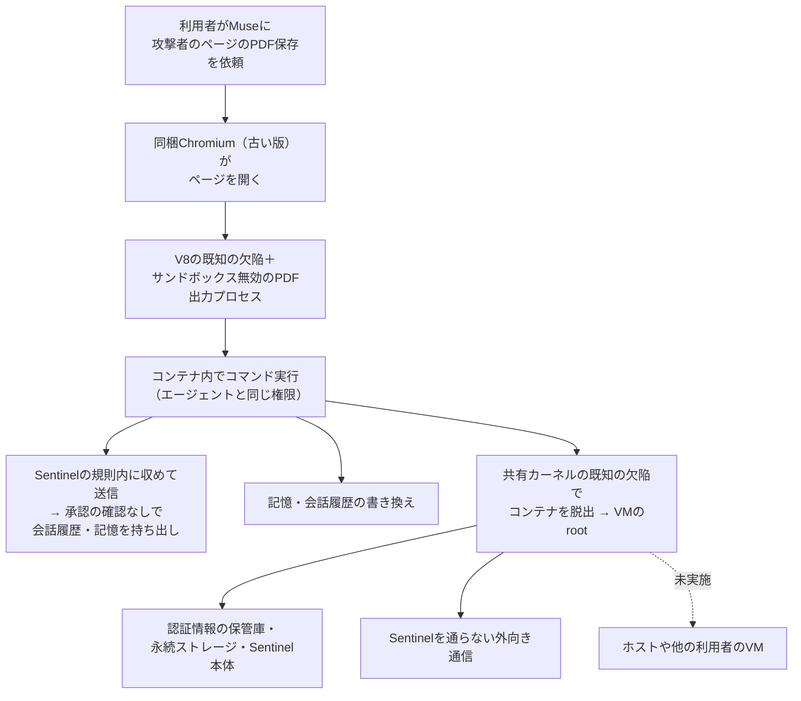

# Meta Muse ― 悪意あるページから会話を抜き出す攻撃を研究者が実証

## 要点

### 影響を受けるもの

- **Meta Muse（クラウドで動く個人向けAIエージェント）**。NebuSecの検証時点（2026年10月）では、悪意あるWebページ1つから、利用者の会話履歴と記憶（メモリー）の持ち出し・書き換え、さらに利用者ごとのVMの乗っ取りまで進めた（[NebuSec: Hacking Muse](https://nebusec.ai/research/meta-muse-credential-exposure/)、[NebuSec: Inside Meta Muse](https://nebusec.ai/research/inside-meta-muse/)）。
- NebuSecは、公開時点でMuseのチームが全ての指摘を把握し、記事中の攻撃はすべて修正済みとしている。実際の利用者が被害を受けたという報告はない（同、[The Hacker News](https://thehackernews.com/2026/11/a-single-malicious-webpage-let.html)）。

### 今すぐやること

- Museの利用者が自分で当てるパッチはない（サービス側の修正）。
- Museに見知らぬページの保存・要約・PDF化を頼むときは、そのページが攻撃の入口になりうると意識し、つないだアカウント（メール、カレンダーなど）の権限は必要な範囲に絞る（考察）。
- 自社でAIエージェントを作っている場合は、同梱ブラウザの更新の遅れ、コンテナとホストのカーネル共有、外部送信の監視をどこで行っているかを見直す（NebuSecの提言をもとにした考察）。

## 登場する組織・サービス

- **Meta Muse**：Metaが2026年9月8日に公開した個人向けAIエージェント。利用者ごとにクラウド上の専用VMで動き、メールやカレンダーなど利用者がつないだサービスを通じて作業し、代わりに買い物もできる。Web、iOS・Androidアプリ、WhatsAppから同じエージェントにつながる（[Muse公式ブログ](https://muse.ai/blog/security-and-safety-for-ai-agents-our-approach-with-muse)、[The Hacker News](https://thehackernews.com/2026/11/a-single-malicious-webpage-let.html)）。今回、攻撃の対象として検証されたサービス。
- **Sentinel**：Museの中で、エージェントの外部への通信とサービス連携の操作を許可・拒否・利用者への確認に振り分ける監視役。エージェントとは別の場所で動き、エージェントからは止められない設計とされる（[Muse公式ブログ](https://muse.ai/blog/security-and-safety-for-ai-agents-our-approach-with-muse)）。今回、承認の確認を出さずに通信を通されてしまった。
- **NebuSec**：コードとクラウドを常時監視するセキュリティサービスを提供し、ChromeやLinuxカーネルのゼロデイを見つけてきたとするセキュリティ企業（[NebuSec](https://nebusec.ai/)）。今回の研究を行い、Museのチームに報告した。

## 概要

- NebuSecは11月20日、MuseにWebページを「PDFとして保存」させる操作だけで、エージェントが動くコンテナの中でコマンドを実行できたと公表した。入口は、Museが同梱していた古いChromiumに残っていた、公開済みのV8の欠陥だった（[NebuSec: Inside Meta Muse](https://nebusec.ai/research/inside-meta-muse/)）。
- 外部送信を見張るSentinelの判定規則を調べ、承認の確認を出させない形で会話履歴と記憶を自分のサーバーへ送れた。記憶や会話履歴の書き換えもできた（同）。
- さらにLinuxカーネルの既知の欠陥でコンテナから抜け、利用者ごとのVMのrootを取った。そこからは認証情報の保管庫、永続ストレージ、Sentinel自体に届き、Sentinelを通らない外向き通信もできた。ほかの利用者の環境やホストへの脱出はしていない（同）。

> この記事では、NebuSecの2本の記事とMuseの公式ブログで確認できた内容を「事実」、筆者の推測や意見を「考察」として分けて書いています。Metaは今回の研究について公にコメントしていません（[The Hacker News](https://thehackernews.com/2026/11/a-single-malicious-webpage-let.html)）。

## 何が起きたか（時系列）

| 日付 | 出来事 |
| --- | --- |
| 2026年9月8日 | MetaがMuseを公開し、設計の考え方を説明するブログと、誰でも参加できるバグ報奨金制度（最大30万ドル）を公表（[Muse公式ブログ](https://muse.ai/blog/security-and-safety-for-ai-agents-our-approach-with-muse)） |
| 10月上旬 | NebuSecの観察で、Museの同梱ChromiumはまだM152（152.0.7977.82、9月3日リリース）のままだった（[NebuSec: Inside Meta Muse](https://nebusec.ai/research/inside-meta-muse/)） |
| 10月2日 | NebuSecが検証したVMのカーネルはMuse用にビルドされたLinux 7.0（同） |
| 11月20日 | NebuSecが2本の記事を公開。指摘は全て修正済みと記載（同、[NebuSec: Hacking Muse](https://nebusec.ai/research/meta-muse-credential-exposure/)） |

## 技術的な問題点（根本原因）

### Museの守りの設計（事実：[Muse公式ブログ](https://muse.ai/blog/security-and-safety-for-ai-agents-our-approach-with-muse)、[NebuSec](https://nebusec.ai/research/inside-meta-muse/)）

- 利用者ごとにCloud HypervisorのVM（2 vCPU、8GiB）を用意し、その中のsystemd-nspawnコンテナでエージェント（Hatchデーモン）を動かす。コンテナ内のrootはVMでは権限のない利用者（UID 131072）に対応付けられる。
- 安全に関わるサービスはコンテナの外に置く。入出力を検査する `hatch-safety`、外部通信の監視役 `Sentinel`、サービス連携の認証情報を保管する `hatch-authd` など。エージェントには本物の認証情報ではなく「代わりのトークン」だけが渡され、Sentinelが外へ出る直前に本物に差し替える。
- コンテナから外への通信は、プロキシ設定に加え、コンテナのcgroupにつないだeBPFプログラムで強制的にSentinel（`198.19.0.1:3128`）へ向けられる。

### 欠陥1：古い同梱Chromiumとサンドボックスの無効化（事実：[NebuSec](https://nebusec.ai/research/inside-meta-muse/)）

- Museはページの取得や操作に4種類のブラウザを使い分けている。うちコンテナ内に同梱された `/opt/meta-chromium/chrome` は、スクリーンショットの確認、サムネイル作成、PDF出力に使われていた。
- 同梱Chromiumの更新はChromeより遅れており、公開済みで使えるV8の欠陥が5件以上残っていたとNebuSecは見積もっている。実際の攻撃では、V8のサンドボックスを抜けるパーサーの欠陥（Chromium issue 554034656）を使った。
- PDF出力に使うChromiumのプロセスはIPCサンドボックスが無効だった。このため、レンダラーの欠陥1つ（NebuSecいわく約500ドル相当）で、エージェントと同じ権限でコンテナ内のシェルコマンドを実行できた。

### 欠陥2：Sentinelの判定のすき間（事実：[NebuSec](https://nebusec.ai/research/inside-meta-muse/)）

- Sentinelは通信を発した処理を特定し、規則（Rego）で判定する。本文のない `GET`・`HEAD`・`OPTIONS` は「読み取り」とされ、既定の設定では承認なしで出ていける場合がある。書き込みは原則承認が要る。
- 中身の検査は、URLの各部分を16進・Base64として復号してメールアドレス、`+` で始まる国際電話番号、`otp` などに付く6〜8桁の数字を探す、文字の種類ごとのエントロピーの閾値、疑わしい通信のAIモデルによる審査、1時間あたりの送信量（同じ送り元から同じドメインへ2MiB、全体で5MiB）の上限、という組み合わせだった。
- NebuSecはこれらの規則の範囲内に収まる形で送り、会話履歴と記憶を承認なしで自分のサーバーへ送れた。どう分割・符号化したかの細部は書かれていない。

### 欠陥3：コンテナとVMが同じカーネルを共有（事実：[NebuSec](https://nebusec.ai/research/inside-meta-muse/)）

- コンテナとVMは同じLinuxカーネル（Muse用に削り込んだ7.0）を使っていた。`RANDOMIZE_MEMORY`、`HARDENED_USERCOPY`、`INIT_ON_ALLOC_DEFAULT_ON` などの強化設定は無効だった。
- Linux 7.0は公開済みの複数のCVEの影響範囲に入っており、NebuSecは自動攻撃コード生成の仕組みで、カーネルイメージを見られない条件でも動く攻撃コードを作った。試行の99.9%超で成功したとしている。CVE番号は書かれていない。
- VMのrootを取ると、コンテナにはマウントされていない永続ストレージ（すでに解錠済みのLUKS2/Btrfsボリューム）、認証情報の保管庫、Sentinel自体に届いた。Sentinelの通信の振り分けはコンテナのcgroupにだけかかっていたため、VMで直接動く処理はSentinelを通らずに外へ通信でき、VMには公開IPv6アドレスもあった。

**考察**

- 個々の守り（コンテナ、送信の監視、認証情報の分離）はそれぞれ設計どおり動いていた。破られたのは、それぞれが「別の層が破られていない」ことを前提にしていた点である。NebuSec自身も「各制御は設計どおり動いたが、攻撃の連鎖は最後まで通った」とまとめている（[NebuSec: Hacking Muse](https://nebusec.ai/research/meta-muse-credential-exposure/)）。
- 特に、Sentinelがコンテナの外にあっても、コンテナと同じカーネルの上にある限り、カーネルの欠陥1つで「外」に出られてしまう。コンテナは境界として弱く、VMやサンドボックス用カーネル（gVisorなど）で分ける方が強い、という従来の議論が、AIエージェントの実行環境にもそのまま当てはまると考える。

## 攻撃・侵入経路

**事実（[NebuSec](https://nebusec.ai/research/inside-meta-muse/)）**

- NebuSecは利用者の操作を「0.5クリック」と表現している。利用者がページの保存を頼むだけで、それ以上の操作は要らない。
- 侵害は研究者自身の利用者VMの中にとどまり、Cloud Hypervisorを越えてホストやほかの利用者の環境に入ることはしていない。越えるにはホストのカーネルやVMM、内部サービスの欠陥が別に必要としている。

## なぜ防げなかったか・構造的要因の考察

**考察**

- **ブラウザはエージェントの最大の入口**：エージェントは利用者の代わりに知らないページを開くのが仕事であり、ブラウザの欠陥は常に入口になる。Chrome本体は自動更新でも、製品に同梱したChromiumは別の更新サイクルになりやすく、その遅れがそのまま「使える既知の欠陥」の窓になった。
- **「確認を出す回数」と「安全」の綱引き**：Museは、読み取りや低リスクの操作は承認なしで通し、確認は本当に必要なところに絞る方針をとっている（[Muse公式ブログ](https://muse.ai/blog/security-and-safety-for-ai-agents-our-approach-with-muse)）。利便性のための「承認なしで通る道」がある以上、攻撃者はそこに収まる形で情報を運ぼうとする。パターンやエントロピーによる検査は、符号化や分割で避けられやすい。
- **層を重ねても、共有部分が単一障害点になる**：コンテナ、Sentinel、認証情報の分離は、いずれも同じカーネルを信頼していた。カーネルの強化設定の一部が無効だったことも、攻撃コードを作りやすくした（NebuSecの記述からの考察）。
- **報奨金制度と公開設計が研究を呼んだ面もある**：Metaは設計を詳しく公開し、高額の報奨金制度を開いている。今回の研究はその設計を手がかりに進められており、隠すより公開して直す方針が機能した例とも読める（推測）。

## 運用者向けの具体的な対策と検知ポイント

AIエージェントを作る・運用する側向けの対策（NebuSecの提言をもとに、具体化した部分は考察）。

- **同梱ブラウザを最優先で更新する**：Chromium系を同梱するなら、Chromeの安定版から遅れない更新の仕組みを持つ。PDF出力やスクリーンショット用のプロセスでもサンドボックスを無効にしない（考察）。
- **信頼できないページは使い捨ての環境で開く**：ページの取得・描画は、エージェントや利用者データと同じコンテナではなく、別のVMや使い捨てのサンドボックスで行う。Museにも別VMのブラウザがあったが、PDF出力などはコンテナ内の同梱版を使っていた（事実はNebuSec、提言は考察）。
- **カーネルを共有しない分離**：利用者データや認証情報を扱うサービスと、信頼できない入力を処理するエージェントは、同じカーネルの上に置かない（VM分離、gVisorやKata Containersなど）。共有する場合は、カーネルの強化設定を有効にし、更新を早める（考察）。
- **送信の監視を「全経路」にかける**：コンテナのcgroupだけでなく、VM自体やほかのプロセスからの通信も同じ監視を通す。VMに不要な公開アドレスを持たせない（NebuSecの指摘からの考察）。
- **認証情報の範囲を小さくする**：保管庫まで届かれた場合に備え、つなぐサービスごとの権限（読み取りだけ、操作の種類の限定）と有効期限を絞る（[NebuSec: Hacking Muse](https://nebusec.ai/research/meta-muse-credential-exposure/)の提言）。
- **検知の手がかり**：PDF出力など補助的なブラウザ処理からの子プロセスの起動、コンテナ内からの承認不要の `GET` の連続や小分けの送信、カーネルの異常（Oops）の記録、VMで直接動く見慣れないプロセスの外向き通信（考察）。

## 参考リンク

- [NebuSec: Hacking Muse: Stealing Private Chats Through Browser Use（2026年11月20日）](https://nebusec.ai/research/meta-muse-credential-exposure/)
- [NebuSec: Inside Meta Muse: Browser, Sentinel and the Shared-Kernel Boundary（2026年11月20日）](https://nebusec.ai/research/inside-meta-muse/)
- [Muse: Security and safety for AI agents: our approach with Muse（2026年9月8日）](https://muse.ai/blog/security-and-safety-for-ai-agents-our-approach-with-muse)
- [The Hacker News: A Single Malicious Webpage Let Researchers Hijack Meta Muse and Access Private Chats（2026年11月21日）](https://thehackernews.com/2026/11/a-single-malicious-webpage-let.html)
- [NebuSec（会社のサイト）](https://nebusec.ai/)
