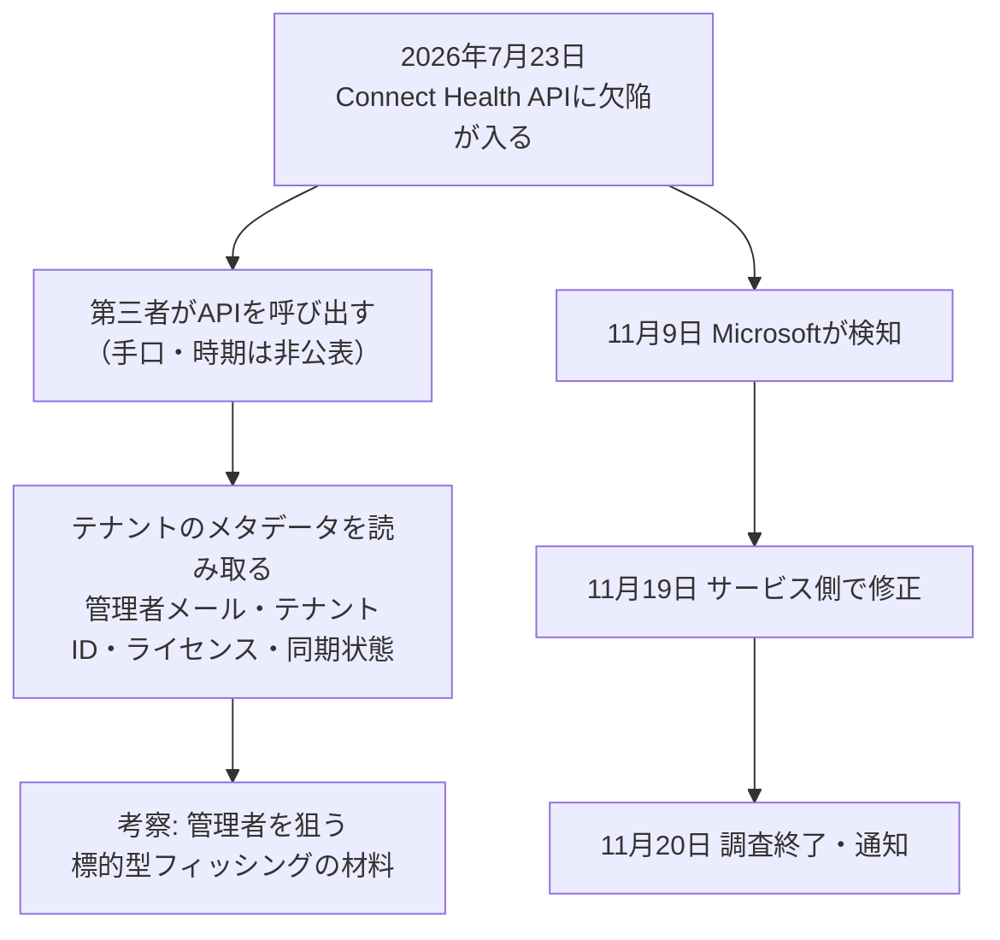

# Microsoft Entra Connect Health ― APIの欠陥でテナント情報が読み取られた

## 要点

### 影響を受けるもの

- **Microsoft Entra Connect Health を使っているテナントの一部**。Microsoftが通知した組織では、テナントの技術担当者と管理者アカウントのメールアドレス、テナントの設定情報（テナントID、表示名、初期ドメイン名など）が、権限のない第三者に読み取られた（Microsoftの通知。[r/sysadminに転載された全文](https://www.reddit.com/r/sysadmin/comments/1y1of2u/important_security_notification_regarding/)、[BleepingComputer](https://www.bleepingcomputer.com/news/security/microsoft-entra-connect-health-flaw-exploited-to-steal-tenant-data/)）。
- 欠陥はMicrosoftのクラウド側（Connect HealthのAPI）にあり、11月19日に修正済み。利用者がソフトを更新する必要はない（同）。

### 今すぐやること

- Azure PortalにURLを直接入力してサインインし、Azure Service Healthのセキュリティ勧告に自分のテナントが載っているか確かめる。メールのリンクからは開かない（Microsoftの通知）。
- グローバル管理者、SOC、IT運用担当、テナントの技術担当者に、テナント名やEntra、Connect Healthに触れた標的型のフィッシング・電話詐欺に注意するよう伝える（同）。
- 特権アカウントすべてにフィッシング耐性のある多要素認証を必須にし、可能ならPIM（必要なときだけ権限を有効にする仕組み）を使う（同）。
- Connect Healthの設定に見覚えのない変更がないか、Entraの監査ログ・サインインログ、Azureのアクティビティログを確認する（同）。
- 何が見えた可能性があるかは、Microsoftの読み取り専用スクリプト（[aka.ms/ConnectHealth/scripts](https://github.com/AzureAD/EntraIDGovernance/tree/main/ConnectHealth) のGetTenant）で確かめられる。ただし表示されるのは今の値で、実際に読み取られた当時の値ではない（同）。

## 登場する組織・サービス

- **Microsoft Entra Connect Health**：社内（オンプレミス）のID基盤、つまりMicrosoft Entra Connect Sync、AD FS、Active Directory Domain Servicesの状態を監視するクラウドサービス。各サーバーにエージェントを入れ、警告、性能、利用状況、同期エラーなどをMicrosoft Entra管理センターでまとめて見られる（[Microsoft Learn](https://learn.microsoft.com/en-us/entra/identity/hybrid/connect/whatis-azure-ad-connect)）。今回、このサービスのAPIに欠陥があった。
- **Microsoft Entra ID**：Microsoftのクラウドのアカウント・認証基盤（旧Azure AD）。Microsoft 365などのサインインに使われる。社内のActive Directoryと同期して使う「ハイブリッド」構成の組織が、Connect Healthの主な利用者である（[Microsoft Learn](https://learn.microsoft.com/en-us/entra/identity/hybrid/connect/whatis-azure-ad-connect)）。
- **Microsoft**：Entra IDとConnect Healthの提供元。欠陥を自ら検知して修正し、影響を受けたテナントにAzure Service Healthとメールで通知した（[BleepingComputer](https://www.bleepingcomputer.com/news/security/microsoft-entra-connect-health-flaw-exploited-to-steal-tenant-data/)）。

## 概要

- MicrosoftはEntra Connect HealthのAPIに欠陥があり、権限のない第三者がテナント単位のメタデータ（連絡先メールアドレスや設定情報）を読み取ったと、影響を受けた組織に通知した（Microsoftの通知）。
- 欠陥は2026年7月23日に入り込み、11月9日に検知、11月19日にサービス側で修正された。Microsoftは11月20日に調査を終え、読み取りはあったが設定の変更は見つからなかったとしている（同）。
- パスワード、パスワードハッシュ、認証トークン、有効な暗号鍵は含まれていないとされる。一方で、管理者の連絡先とテナントの構成が分かることで、標的型フィッシングの材料になりうる（同）。

> この記事では、Microsoftの通知（利用者が公開した全文）とMicrosoftの広報コメントで確認できた内容を「事実」、筆者の推測や意見を「考察」として分けて書いています。通知の日付には時間帯が書かれていないため、そのまま記載しています。

## 何が起きたか（時系列）

| 日付 | 出来事 |
| --- | --- |
| 2026年7月23日 | Connect HealthのAPIに欠陥が入り込む（Microsoftの通知） |
| 11月9日 | Microsoftが欠陥を検知（同） |
| 11月19日 | サービス側の修正を展開し、以後の不正なアクセスを止める（同、[BleepingComputer](https://www.bleepingcomputer.com/news/security/microsoft-entra-connect-health-flaw-exploited-to-steal-tenant-data/)） |
| 11月20日 | 調査を終え、影響を受けたテナントへの通知を始める（同） |
| 11月22日（日本時間3時ごろ） | BleepingComputerが報道。Microsoftは修正と通知を認め、それ以上の詳細は明かさなかった（同） |

## 技術的な問題点（根本原因）

**事実（Microsoftの通知）**

- 欠陥は「権限のない者がテナントとサービス監視のメタデータにアクセスでき、Connect Healthの監視設定を変更できた可能性がある」というもの。欠陥の種類（認証の欠落、認可の不備など）や、どのAPIの入口かは明らかにされていない。
- 読み取られたAPIの応答には、次の項目が含まれていた。
  - テナントの技術担当者と管理者アカウントのメールアドレス
  - テナントID、表示名、初期ドメイン名、国コード、リージョン
  - Entraのライセンス種別、ディレクトリ同期の有無と最終同期時刻、Connect Healthの導入状態
  - 2024年末に廃止した社内サービスへエージェントを登録するために使っていた、失効済みの古い証明書
- 古い証明書はもう使われていなかったが、Connect Healthの保存領域から消されておらず、APIの応答（GetTenant）に含まれ続けていた。Microsoftは「リスクはない」としている。
- 含まれていなかったもの：利用者のパスワード、パスワードハッシュ、認証トークン、有効な暗号鍵、社内サーバーやActive Directoryの構成、Azureのサブスクリプション情報。

**事実（[BleepingComputer](https://www.bleepingcomputer.com/news/security/microsoft-entra-connect-health-flaw-exploited-to-steal-tenant-data/)）**

- Microsoftは影響を受けた組織の数、悪用した者、攻撃が始まった時期を公表していない。Redditでは十数人の管理者が通知を受けたと書き込み、複数の顧客テナントを管理するMSPには、テナントごとに数時間おきに通知が届いた例もあった。

**考察**

- 返された項目の顔ぶれから見ると、テナント単位の情報を返すAPI（通知ではGetTenant）が、呼び出し元がそのテナントの正当な利用者かを十分に確かめずに応答していた、という種類の欠陥ではないかと推測する。ただしMicrosoftは仕組みを説明しておらず、断定はできない。
- 失効済みの証明書が2年近く応答に残っていた点は、実害がなくても、使わなくなった秘密情報を保存領域とAPIの応答から消す手順が無かったことを示している。

## 攻撃・侵入経路

**事実**

- 攻撃者はConnect HealthのAPIを呼び出し、影響を受けたテナントのメタデータを読み取った。設定の変更は見つかっていない（Microsoftの通知）。
- 攻撃者の身元、使った認証情報（あれば）、読み取りの期間は公表されていない（[BleepingComputer](https://www.bleepingcomputer.com/news/security/microsoft-entra-connect-health-flaw-exploited-to-steal-tenant-data/)）。

## なぜ防げなかったか・構造的要因の考察

**考察**

- **利用者からは見えない場所の欠陥**：欠陥はMicrosoftのクラウドの中にあり、利用者が設定やパッチで防ぐ手段は無かった。約4か月入り込んだままで、利用者ができるのは事後の通知を受けて二次被害に備えることに限られる。クラウドのID基盤では、自分の側の設定だけでは守れない部分があることを前提に、運用を組む必要がある。
- **「監視用」のサービスもID基盤の一部**：Connect Healthは監視のための補助サービスだが、テナントの構成や管理者の連絡先を持っている。主役のEntra IDほど注目されない周辺サービスの方が、APIの確認が手薄になりやすいのではないかと考える。
- **漏れた情報は「次の攻撃」の材料**：パスワードやトークンが含まれなくても、管理者のメールアドレス、ライセンス種別、社内ADと同期しているかが分かれば、それらしい「Microsoftからの警告」を装ったフィッシングを作りやすい。今回の通知そのものを装う偽メールが出ることも考えられ、Microsoftが通知内で「メールのリンクではなくポータルで確認を」と書いているのはこのためだと読める。
- **MSPは影響が重なる**：複数の顧客テナントを管理するMSPには通知が複数届いている。MSPの担当者の連絡先が多くのテナントに登録されていれば、その人が狙われやすくなる（推測）。

## 運用者向けの具体的な対策と検知ポイント

- **通知の真偽を確かめる**：Azure PortalのService Health → セキュリティ勧告で、自分のテナントが対象か確認する。メールのリンクは使わない（Microsoftの通知）。
- **連絡先の見直し**：テナントの技術担当者や通知の受け取り先が、今も正しく適切な人・アドレスか確かめる（同）。退職者や個人のアドレスが残っていれば直す（考察）。
- **特権アカウントの保護**：グローバル管理者などにフィッシング耐性のある多要素認証（FIDO2セキュリティキー、Windows Hello for Business、パスキーなど）を必須にし、PIMで常時の権限を減らす（同。認証方式の例は考察）。
- **ログの確認**：Entraの監査ログとサインインログで、管理者アカウントへの不審なサインイン試行、Connect Healthの設定変更、見慣れない管理操作を確認する。Azureのアクティビティログも見る（同）。
- **注意喚起の中身**：管理者宛てに「Entra」「Connect Health」「テナントID」などを含む不審なメールや電話、多要素認証の承認要求が来たら報告するよう、事前に伝えておく（同。具体例は考察）。
- **露出の確認**：GetTenantスクリプトで、現在どの値が返る状態かを確認する。`pksCertificate` が入っていれば、失効済みの古い証明書であることを GetTenantPksCertificateDetails で確かめられる（同）。

## 参考リンク

- [Microsoftの通知「Important security notification regarding Microsoft Entra Connect Health」（利用者がr/sysadminに転載した全文）](https://www.reddit.com/r/sysadmin/comments/1y1of2u/important_security_notification_regarding/)
- [BleepingComputer: Microsoft Entra Connect Health flaw exploited to steal tenant data（2026年11月21日、米国時間）](https://www.bleepingcomputer.com/news/security/microsoft-entra-connect-health-flaw-exploited-to-steal-tenant-data/)
- [Microsoft Learn: What is Microsoft Entra Connect and Connect Health](https://learn.microsoft.com/en-us/entra/identity/hybrid/connect/whatis-azure-ad-connect)
- [Microsoft: Connect Health scripts（aka.ms/ConnectHealth/scripts の転送先）](https://github.com/AzureAD/EntraIDGovernance/tree/main/ConnectHealth)
