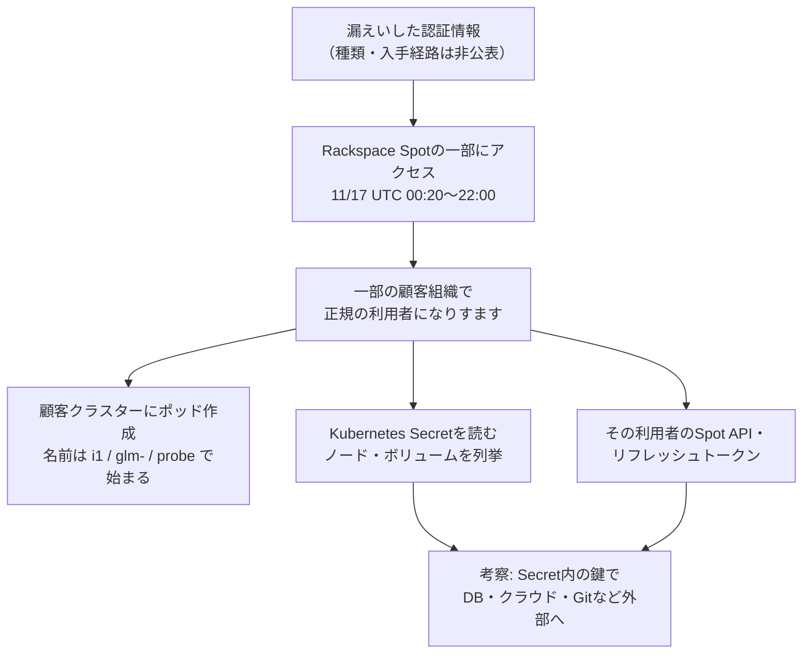

# Rackspace Spot ― 漏えいした認証情報で顧客クラスターのSecretに到達

## 要点

### 影響を受けるもの

- **Rackspace Spot の一部の顧客組織**。2026年11月17日の約00:20〜22:00（UTC。日本時間17日9時20分〜18日7時ごろ）に、第三者が漏えいした認証情報でSpotの一部にアクセスし、影響を受けた利用者になりすましてKubernetesのポッド作成、Secretの読み取り、ノードとボリュームの列挙ができた（Rackspaceの顧客向け通知。[BleepingComputer](https://www.bleepingcomputer.com/news/security/rackspace-spot-breach-let-hackers-access-customer-kubernetes-secrets/)が入手）。
- 影響を受けた利用者のクラスターにあるSecretはすべて、またその利用者のSpot APIトークンとリフレッシュトークンも、読まれた可能性がある（同）。
- 影響を受けた顧客の数、データが実際に持ち出されたかは公表されていない（同）。

### 今すぐやること

- Spot APIトークンを発行し直し、自動化ツールで使っているリフレッシュトークンを差し替え、kubeconfigを新しくダウンロードする（Rackspaceの通知）。
- クラスターのSecretに入っている認証情報（データベースのパスワード、クラウドのアクセスキー、APIキー、レジストリやGitのトークンなど）をすべて交換し、ワークロードを新しい値で動かし直す（同。中身の例は考察）。
- 11月17日以降の、データベース、コンテナレジストリ、Gitリポジトリ、クラウドストレージ、外部サービスのログを調べ、交換前の認証情報が使われていないか確かめる（同）。
- 名前が `i1`、`glm-`、`probe` で始まるポッドやオブジェクト、接続元 `23.224.79[.]106`（範囲 `23.224.0.0/15`）を探す（同）。

## 登場する組織・サービス

- **Rackspace Spot**：サーバーを入札（オークション）で借りられるクラウドサービス。利用者は入札額を決めてサーバーを借り、無料のマネージドなコントロールプレーンで、自分のkubeconfigとkubectlからKubernetesクラスターを使う（[Rackspace Spot](https://spot.rackspace.com/)）。今回、不正にアクセスされた基盤。
- **Rackspace（Rackspace Technology）**：25年以上、企業向けにクラウドなどのIT基盤を構築・運用してきた米国の企業（[Rackspace](https://www.rackspace.com/about)）。Spotの運営元で、顧客に今回の通知を出した。
- **Platform9**：仮想マシンとコンテナの管理基盤を提供する企業（[Platform9](https://platform9.com/)）。Rackspace Spotを共同開発しており、共同創業者がRedditで、全アクセスを止めて環境を一掃した判断を説明した（[BleepingComputer](https://www.bleepingcomputer.com/news/security/rackspace-spot-breach-let-hackers-access-customer-kubernetes-secrets/)）。

## 概要

- Rackspaceは、第三者が「漏えいした認証情報」でSpotの一部に入り込み、一部の顧客組織で正規の利用者として振る舞ったと顧客に通知した（[BleepingComputer](https://www.bleepingcomputer.com/news/security/rackspace-spot-breach-let-hackers-access-customer-kubernetes-secrets/)）。
- 侵入者は顧客のクラスターにポッドを作り、Secretを読むことができた。Secretにはデータベースやクラウドなど、クラスターの外のシステムに入るための秘密情報が置かれることが多く、被害はクラスターの外に広がりうる（同）。
- Rackspaceはトークンとセッションの失効、不正なポッドの削除、鍵の交換をしたうえで、顧客にも認証情報の交換とログ確認を求めた。対応のためSpotの管理画面は長く止まり、11月21日に全面復旧した（同、[r/rxt_spot](https://www.reddit.com/r/rxt_spot/comments/1y22b0d/service_fully_restored/)）。

> この記事では、Rackspaceの顧客向け通知（BleepingComputerが入手して引用した部分）、RackspaceのSpotコミュニティでの告知で確認できた内容を「事実」、筆者の推測や意見を「考察」として分けて書いています。通知の原文は公開されていません。

## 何が起きたか（時系列）

| 日付（日本時間） | 出来事 |
| --- | --- |
| 11月17日 9時20分ごろ〜18日 7時ごろ（UTC 17日 00:20〜22:00） | 第三者が漏えいした認証情報でSpotの一部にアクセス（Rackspaceの通知、[BleepingComputer](https://www.bleepingcomputer.com/news/security/rackspace-spot-breach-let-hackers-access-customer-kubernetes-secrets/)） |
| 11月18日（現地） | 顧客からの報告で侵入を知り、通知先の組織が影響を受けたことを同日確認（同） |
| 11月18日〜21日 | Spotの管理画面が長時間止まり、顧客はクラスターの管理や認証情報の交換ができない状態に。共同開発元Platform9の共同創業者は、意図的に全アクセスを止めたと説明（同） |
| 11月22日未明（米国時間21日） | Spotが全面復旧したと告知（[r/rxt_spot](https://www.reddit.com/r/rxt_spot/comments/1y22b0d/service_fully_restored/)） |
| 11月22日 8時ごろ | BleepingComputerが報道（[BleepingComputer](https://www.bleepingcomputer.com/news/security/rackspace-spot-breach-let-hackers-access-customer-kubernetes-secrets/)） |

## 技術的な問題点（根本原因）

**事実（Rackspaceの通知、[BleepingComputer](https://www.bleepingcomputer.com/news/security/rackspace-spot-breach-let-hackers-access-customer-kubernetes-secrets/)）**

- 入口は「漏えいした認証情報（leaked credentials）」とされている。どの認証情報か（顧客のものか、Rackspace・Platform9の従業員のものか、基盤自体のものか）、どこで漏れたかは明らかにされていない。
- 侵入者は一部の顧客組織で正規の利用者として振る舞い、その利用者の権限でKubernetesクラスターにポッドを作り、Secretを読み、ノードとボリュームを列挙できた。
- Rackspaceは、影響を受けた利用者のクラスターにあるSecretはどれでも、またその利用者のSpot APIトークンとリフレッシュトークンも、読まれた可能性があるとしている。

**考察**

- 「一部の顧客組織で正規の利用者として振る舞えた」ことから、侵入者は個々の顧客の認証情報を1つずつ手に入れたというより、複数の顧客の利用者になりすませる立場（Spotの管理機能や、利用者のトークンを扱う部分）に届いた可能性があると考える。ただしRackspaceは説明しておらず、推測にとどまる。
- KubernetesのSecretは、既定ではbase64で符号化されているだけで、ポッドを作れる権限やSecretを読む権限があれば中身をそのまま取り出せる。クラスターの管理者として振る舞えれば、Secretに置いた秘密情報はすべて見えると考えるべきである。今回、Rackspaceが「どのSecretも読まれた可能性がある」とした背景にはこの性質がある。

## 攻撃・侵入経路

**事実（Rackspaceの通知、[BleepingComputer](https://www.bleepingcomputer.com/news/security/rackspace-spot-breach-let-hackers-access-customer-kubernetes-secrets/)）**

- 漏えいした認証情報でSpotの一部にアクセスし、一部の顧客組織の利用者として振る舞った。
- 顧客クラスターにポッドを作り、Secretを読み、ノードとボリュームを列挙した。不正なポッドやオブジェクトの名前は `i1`、`glm-`、`probe` で始まるものが挙げられている。
- 接続元として `23.224.79[.]106` と範囲 `23.224.0.0/15` が示された。
- 不正なポッドが何をしたかは公表されていない。

## なぜ防げなかったか・構造的要因の考察

**考察**

- **マネージドKubernetesの「上」が奪われると、クラスター内の防御は効かない**：ネットワークポリシーやRBACをクラスター内で丁寧に設定していても、基盤の側で利用者になりすまされれば、その利用者の権限ですべてが通る。マネージドサービスを使う以上、提供元の管理基盤も自分の攻撃面に含まれる。
- **Secretは「クラスターの外の鍵束」**：Secretにはデータベース、クラウド、レジストリ、外部SaaSの鍵が集まりやすい。1つのクラスターへの侵入が、そこに置かれた鍵を通じて、多くの別システムへの侵入口になりうる。Rackspaceが外部サービスのログまで確認するよう求めたのはこのためと読める。
- **対応のための停止が、利用者の対応も止めた**：環境を一掃するために管理画面を止めた結果、利用者は漏れたかもしれない認証情報を交換できない時間が続いた。安全のための停止と、利用者が自分で被害を抑える手段の確保は両立が難しく、事前に「管理画面が使えないときにSecretの参照先の鍵をどう止めるか」を決めておく必要がある。
- **入口の情報が乏しい**：「漏えいした認証情報」というだけでは、利用者は同じ種類の弱点が自分の側にもあるのか判断できない。原因の詳しい説明が出るかが、今後の焦点になる（推測）。

## 運用者向けの具体的な対策と検知ポイント

- **認証情報の交換**：Spot APIトークンの再発行、リフレッシュトークンの差し替え、kubeconfigの再取得、Secret内の認証情報の交換（Rackspaceの通知）。交換は「Secretの値を変える」だけでなく、参照先（データベースやクラウド側）で古い鍵を無効にするところまで行う（考察）。
- **ログの確認**：11月17日以降の、データベース、コンテナレジストリ、Git、クラウドストレージ、外部サービスへのアクセスを確かめる（同）。クラウドのアクセスキーなら、普段使わない地域・IPからの呼び出しや、IAMの変更を重点的に見る（考察）。
- **IOCの照合**：名前が `i1`・`glm-`・`probe` で始まるポッドやオブジェクト、接続元 `23.224.79[.]106`・`23.224.0.0/15`（同）。Kubernetesの監査ログが残っていれば、Secretの `get`/`list` と、見覚えのないポッドの `create` を探す（考察）。
- **Secretに長期の鍵を置かない**：クラウドの長期アクセスキーの代わりにワークロードIDなど短期の認証情報を使う、外部のシークレット管理サービスから実行時に取りに行く、など、クラスターが奪われても長く使える鍵が残らない構成にする（考察）。
- **マネージド基盤の停止を想定する**：管理画面やAPIが止まっても、参照先の鍵を外から無効にできる手順（クラウド側でのキー無効化、DBのユーザー停止など）を用意しておく（考察）。

## 参考リンク

- [BleepingComputer: Rackspace Spot breach let hackers access customer Kubernetes secrets（2026年11月21日、米国時間）](https://www.bleepingcomputer.com/news/security/rackspace-spot-breach-let-hackers-access-customer-kubernetes-secrets/)
- [r/rxt_spot: Service fully restored（Rackspace Spotの告知）](https://www.reddit.com/r/rxt_spot/comments/1y22b0d/service_fully_restored/)
- [Rackspace Spot（サービスの説明）](https://spot.rackspace.com/)
- [Rackspace: About](https://www.rackspace.com/about)
- [Platform9](https://platform9.com/)
