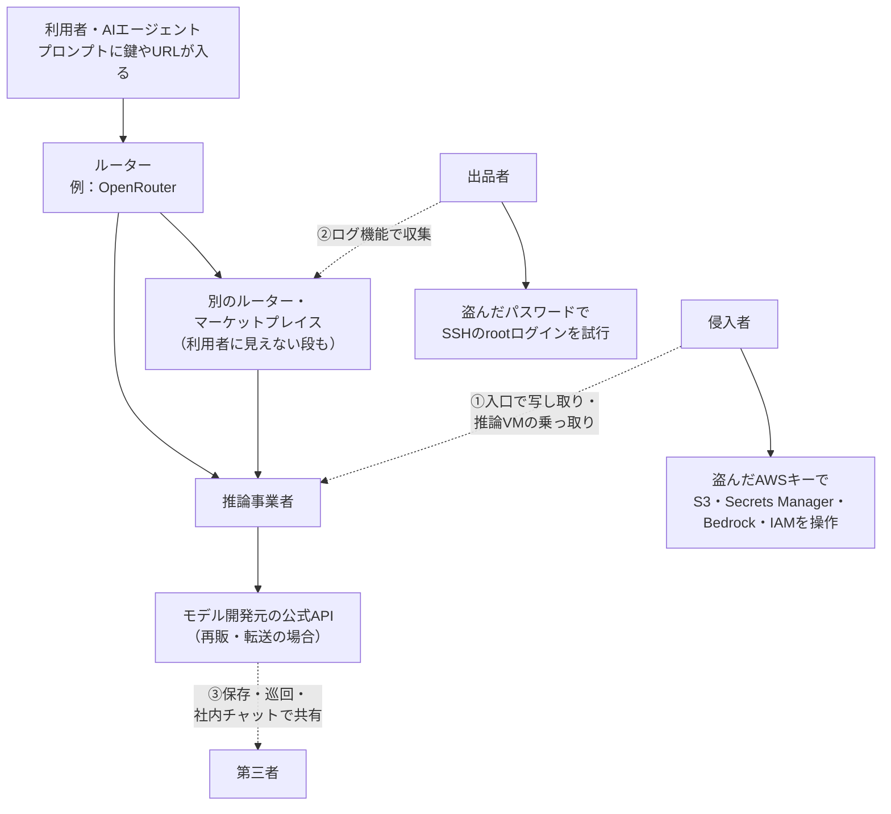

# AI推論事業者 ― 送られたプロンプトが侵入者や転売業者に読まれた

## 要点

### 影響を受けるもの

- **AIモデルの推論をAPIで提供する事業者や、それを束ねるルーター（OpenRouterなど）経由で、秘密情報を含むプロンプトを送っていた利用者**。Dragosの研究チームが、7月から11月に約200万件のプロンプトへ一度しか使わないURLや認証情報（カナリア）を仕込んで追跡し、①少なくとも3つの推論事業者が侵入されてプロンプトを盗まれていた、②推論マーケットプレイスの出品者がログ機能でプロンプトを集めていた、③プライバシー設定やゼロデータ保持（ZDR）の指定が守られていなかった、と公表した（[Dragos](https://www.dragos.com/blog/ai-supply-chain-security-canary-tokens)）。
- 侵入された3社の名前はDragosもOpenRouterも公表していない。自社の事案を公表したのはPhala、Together AI、Novita、Atlas Cloud（[OpenRouter](https://openrouter.ai/blog/announcements/data-processing-incidents-on-inference-providers/)の一覧と各社の告知）。
  - **Phala**：OpenRouter経由で同社の「DeepSeek V4 Flash 0731」に送られた、2026年10月21日 00:00〜11月8日 05:35（UTC）のリクエストは中身が漏れたものとして扱う（[Phala](https://phala.com/posts/phala-november-preliminary-incident-report)）。
  - **Together AI**：2026年6〜7月にMiniMax M3、GLM-5.2、Kimi K2.6へ送られたリクエストから試験用に保存していたプロンプトの一部が、第三者にダウンロードされた（[Together AI](https://www.together.ai/blog/security-event-prompt-leakage-for-requests-in-june-and-july-of-2026)）。
  - **Novita**：2026年5月28日〜11月11日にNovita上のMiniMaxモデルへ送られたリクエストの一部が、MiniMaxの公式APIへ転送されていた（[Novita](https://novita.ai/blog/minimax-requests-privacy-notice/)）。
  - **Atlas Cloud**：2026年第3四半期〜第4四半期の初めにAtlas Cloud経由でMiniMaxの公式APIに送られたMiniMax M3・M2.7のプロンプトから、第三者がリンクを開いていた（[Atlas Cloud](https://www.atlascloud.ai/blog/ai-updates/security-and-privacy-commitment)）。
- OpenRouter自身が侵害された証拠はないとされている（[OpenRouter](https://openrouter.ai/blog/announcements/data-processing-incidents-on-inference-providers/)）。

### 今すぐやること

- OpenRouterや各事業者から通知が来ていないか確かめる。OpenRouterは影響の可能性がある利用者全員に通知したとしている（[OpenRouter](https://openrouter.ai/blog/announcements/data-processing-incidents-on-inference-providers/)）。
- 上の期間・モデルに当てはまるリクエストに入っていたAPIキー、トークン、パスワード、非公開URLなどの秘密情報を失効・交換し、そのアカウントに見覚えのない操作がないか確かめる（[Phala](https://phala.com/posts/phala-november-preliminary-incident-report)、[Novita](https://novita.ai/blog/minimax-requests-privacy-notice/)、[Atlas Cloud](https://www.atlascloud.ai/blog/ai-updates/security-and-privacy-commitment)）。
- AWSのCloudTrailで、ユーザーエージェント `artex-agent`・`artex-judge-r121`（AIによる侵入テスト用フレームワークARTEX）や、Kaliを名乗る呼び出しを探す（[Dragos](https://www.dragos.com/blog/ai-supply-chain-security-canary-tokens)）。
- AIエージェントやパイプラインが送る文脈に、本物の秘密情報が入らないようにする。入れざるをえない場合は、自分でもカナリアを混ぜ、使われたら事故として扱う（同）。

## 登場する組織・サービス

- **Dragos**：制御システム（ICS/OT）のセキュリティを専門とする企業（[Dragos](https://www.dragos.com/about)）。研究責任者（Chief Research Officer）HD Mooreのチームが今回の調査を行い、事業者に通知した（[Dragos](https://www.dragos.com/blog/ai-supply-chain-security-canary-tokens)）。
- **OpenRouter**：1つのAPIで600以上のモデルにリクエストを振り分ける「AIゲートウェイ」（[OpenRouter](https://openrouter.ai/about)）。利用者のリクエストを外部の推論事業者に流す立場で、調査結果を受けて事業者の除外などをした。
- **Phala**：TEE（ハードウェアで隔離した実行環境）で守ったGPU上で、秘匿性の高いLLM推論などを提供するクラウド（[Phala](https://phala.com/)）。推論用サーバーを侵入者に乗っ取られた。
- **Together AI**：AIモデルの推論や学習のためのクラウド（AI Native Cloud）を提供する企業で、サーバーレス推論サービスを持つ（[Together AI](https://www.together.ai/blog/security-event-prompt-leakage-for-requests-in-june-and-july-of-2026)）。保存していたプロンプトの見本を第三者に持ち出された。
- **Novita AI**：200以上のモデルを1つのAPIで使えるようにする開発者向けクラウド（[Novita AI](https://novita.ai/)）。MiniMaxモデルへのリクエストの一部を、意図せずMiniMaxの公式APIに転送していた。
- **Atlas Cloud**：600以上のAIモデルをAPIで提供するサービス（[Atlas Cloud](https://www.atlascloud.ai/)）。MiniMaxの公式APIに送ったプロンプトが、MiniMax側に届いたあとで第三者に読まれていたと説明した（[Atlas Cloud](https://www.atlascloud.ai/blog/ai-updates/security-and-privacy-commitment)）。

## 概要

- 推論APIの経路は「利用者 → ルーター → （別のルーター） → 推論事業者 → モデルを動かすサーバー」と何段にもなりうる。各段はプロンプトと応答の全文を見られる（[Dragos](https://www.dragos.com/blog/ai-supply-chain-security-canary-tokens)）。
- Dragosは、プロンプトごとに一度しか使わないURL・DNS名・AWSキーなどを仕込み、それが使われた時点で「どこかでそのプロンプトが読まれた」と分かる仕組みで、約200万件を追跡した（同）。
- 見つかったのは、①事業者への侵入によるプロンプトの窃取（3社、最も早いものは7月半ば。3社とも通知されるまで気づいていなかった）、②マーケットプレイスの出品者によるプロンプトの収集、③ZDRなどの指定を無視した保存・共有・閲覧、の3種類だった（同）。
- OpenRouterは3事業者の除外、125エンドポイントのZDR対象からの除外、利用者への通知を行い、同じ試験を常時行う準備と、リクエストが第三者に転送されている経路の確認を進めている（[OpenRouter](https://openrouter.ai/blog/announcements/data-processing-incidents-on-inference-providers/)）。

> この記事では、Dragosの研究ブログ、OpenRouterの発表、各事業者の告知で確認できた内容を「事実」、筆者の推測や意見を「考察」として分けて書いています。The Hacker Newsの記事も参照しました。侵入された3社の名前と、自社で公表した事業者が3社と同じかは公表されていません。

## 何が起きたか（時系列）

| 日付（日本時間。UTCの表記がある場合は併記） | 出来事 |
| --- | --- |
| 5月28日〜11月11日 | Novita上のMiniMaxへのリクエストの一部が、設定の誤りでMiniMaxの公式APIへ転送されていた（[Novita](https://novita.ai/blog/minimax-requests-privacy-notice/)） |
| 6月24日・7月4日・8日・14日（主に） | Together AIが試験用に保存したプロンプトの見本の元になったリクエスト（[Together AI](https://www.together.ai/blog/security-event-prompt-leakage-for-requests-in-june-and-july-of-2026)） |
| 7月〜 | Dragosがカナリア入りのプロンプトを送り始める。7月半ばに最初の侵入事案を観測（[Dragos](https://www.dragos.com/blog/ai-supply-chain-security-canary-tokens)） |
| 10月21日 9時（UTC 21日 00:00） | Phala：侵入者が1台のサーバーの内部管理インターフェースに到達しマルウェアを入れる。ここから漏えい期間として扱う（[Phala](https://phala.com/posts/phala-november-preliminary-incident-report)） |
| 10月22日 14時41分（UTC 05:41） | Phala：盗まれたデータの悪用を初めて観測（同） |
| 10月下旬 | Dragosが仕込んだ約200個のAWSキーが、ある事業者で数回の短い時間帯にすべて盗まれる（[Dragos](https://www.dragos.com/blog/ai-supply-chain-security-canary-tokens)） |
| 11月1日 | 同じ攻撃者がARTEXを使い、手持ちのキーが有効か確かめる（同） |
| 11月5日〜8日 | Phala：侵入を検知し封じ込め（5日）、KMSのルート鍵を交換（6日）、研究者の証拠を受けて推論用サーバーを停止（8日 14時35分＝UTC 05:35に封じ込め完了）（[Phala](https://phala.com/posts/phala-november-preliminary-incident-report)） |
| 11月10日 | Phalaが暫定報告を公開（同） |
| 11月19日（米国時間） | Dragosが調査結果を公開（[Dragos](https://www.dragos.com/blog/ai-supply-chain-security-canary-tokens)） |
| 11月21日〜23日 | Together AI（21日）、OpenRouter・Novita（22日）、Atlas Cloud（23日付）が告知（各社） |

## 技術的な問題点（根本原因）

### ① 事業者への侵入（事実：[Dragos](https://www.dragos.com/blog/ai-supply-chain-security-canary-tokens)）

- 最大の事案では、1つの事業者に1回ずつ送った約200個のAWSキーが、10月下旬の数回の短い時間帯にすべて盗まれた。モデルが動く前に事業者が拒否したリクエストのキーまで盗まれており、攻撃者は事業者の「入口」でリクエストを写し取っていたとDragosはみている。
- 残る2つの事案では、盗まれたリクエストの一部がZDR指定だった。
- 盗んだキーは、早いものは数時間で使われ、S3バケットの一覧、Secrets Manager・Parameter Storeの検索、Bedrockのモデル有効化とAPIキー作成、IAMユーザーの追加が試みられた。仕込んだキー全体で数万回のAWS API呼び出しがあった。
- 1人の攻撃者が2つの事業者に同時に入り込んでいたとみられ、両社から得た秘密情報を1台の借りたサーバーからまとめて使った。道具は、Chromeを名乗るスクリプト、OrbStack内のBoto3、Kali LinuxのAWS CLI、ARTEXと変わっていった。
- 7月半ばの最初の事案の事業者は、社内ツールの設定ミス、提携先のデータ処理の問題と説明を変えた末に、内部の認証情報も奪われていたと分かった。この事業者は事案を公表していない。

**自社で公表した事業者の説明（事実）**

- **Phala**：侵入者は、インターネットに出ていた古いサービスと、ループバック（同じ機械の中）からの接続というだけで信用し、呼び出し元を別に認証しない管理インターフェースをつないで使い、無許可の秘匿VM（CVM）を作ってアプリケーションの認証情報を得た。さらに、本番と同じ堅牢化をしないまま本番の通信を処理していた新しいGPUサーバーで、同じような手口で推論用VMを乗っ取り、処理中のリクエストを見られる状態にした。2つの侵入は同じ攻撃者によるものとみている（[Phala](https://phala.com/posts/phala-november-preliminary-incident-report)）。研究者のカナリアのうち悪用されたのは10月21〜22日に送ったものだけだった（同）。時期はDragosの言う10月下旬の侵入と重なるが、同じ事案だと明言した記述はない（考察）。
- **Together AI**：試験のために保存したプロンプトの見本を非公開のHugging Faceリポジトリに置いていた。公開GitHubリポジトリ（xorl）の開発中に、**AIのコーディングエージェントがそのリポジトリへの認証情報をコミット**した。自動スキャンで見つけてコミットを取り消したが、その間に第三者が認証情報を手に入れ、見本をダウンロードし、中の認証情報を探して有効か試した。試されたうち5つはDragosのカナリアだった（[Together AI](https://www.together.ai/blog/security-event-prompt-leakage-for-requests-in-june-and-july-of-2026)）。

### ② マーケットプレイスの出品者（事実：[Dragos](https://www.dragos.com/blog/ai-supply-chain-security-canary-tokens)）

- 脆弱性は使われていない。出品者は人気モデルを最安値で出し、リクエストのログを有効にして待つだけでプロンプトを集められた。
- 同じモデルでも別の出品者を通したプロンプトは触られておらず、漏えいはマーケットプレイス全体ではなく出品者ごとに起きていた。家庭用回線から手作業でログインを試す個人が見られた。
- 別のルーターが、利用者に知らせずに一部の通信をこのマーケットプレイスへ流していた（そのルーターは止めたとDragosに回答）。約2,000経路を追跡したところ、数百の経路に正体の分からないシステムがあり、すべてのプロンプトに約1,000の隠しトークンを足す出品者もいた。

### ③ プライバシー指定が守られない（事実：[Dragos](https://www.dragos.com/blog/ai-supply-chain-security-canary-tokens)）

- ある中国のAIラボ（名前は非公表）のシステムは、7〜10月に同社モデルに送ったプロンプトの半数以上から秘密URLを取得した。「データ収集なし」やZDR指定のもののおよそ3分の2も含む。同社モデルを再販する米国の事業者に送ったプロンプトでも同じ収集が起き、プロンプトがラボに戻っていた。
- 米国の大手事業者の1社は、検索用のエンドポイントへの1回のリクエストから2か月以上たっても秘密URLを巡回していた。
- ZDR指定で米国の事業者に送ったプロンプトの秘密リンクが、24日後に中国のチャットアプリFeishu（海外名Lark）に貼られ、2分以内に北京と上海の6台の端末から開かれた。Dragosがその事業者に伝えたのはリンクの先頭8文字だけで、貼った人は保存されたプロンプトの全文を見ていたことになる。
- Novitaは、特定の顧客向けの転送経路が設定の誤りで広く適用され、MiniMaxへのリクエストがMiniMaxの公式APIへ送られていたと説明した（[Novita](https://novita.ai/blog/minimax-requests-privacy-notice/)）。Atlas Cloudも、MiniMaxの公式APIに届いたあとで第三者がリンクを開いていたと説明している（[Atlas Cloud](https://www.atlascloud.ai/blog/ai-updates/security-and-privacy-commitment)）。

### 考察

- 共通するのは「プライバシーの指定は最初の1段にしか効かない」という点で、Dragosも同じことを書いている。利用者が見ているのは最初のルーターとの約束だけで、その先が何段あり、誰がどう保存するかは見えない。ZDRは「保存しない」という約束であって、侵入者が経路の途中に入り込めば守りにならない。
- プロンプトに秘密情報が入るのは、人が貼り付ける場合だけではない。AIエージェントは読める範囲のもの（設定ファイル、環境変数、コードの中のキー）をそのまま文脈に入れて送る。Together AIの事案では、逆にAIエージェントが認証情報を公開リポジトリにコミットしたことが入口になっており、エージェントは秘密情報の漏れ口として双方向に働いている。

## 攻撃・侵入経路

## なぜ防げなかったか・構造的要因の考察

- **経路が見えない**：ルーターは通常、上流の事業者を1つしか示さず、その事業者がまた別のルーターであることが多い（[Dragos](https://www.dragos.com/blog/ai-supply-chain-security-canary-tokens)）。利用者は、自分のプロンプトがどの会社を通り、どこで保存されたかを確かめられない。OpenRouterが「経路の技術的な確認」を始めたのは、ルーター自身も把握しきれていなかったことを示していると読める（考察）。
- **安さを競う仕組みが、データを集めたい者に有利**：最安値の出品者にリクエストが流れる市場では、プロンプトを集めたい者が差額を払ってでも最安値を出せば、データが集まる（Dragos）。安さの理由（盗んだキーでの課金、個人向けプランの使い回しなど）は利用者からは見えない（考察）。
- **事業者自身が気づけなかった**：3社とも、Dragosが知らせるまで侵入に気づいていなかった（Dragos）。プロンプトは「処理したら終わり」のデータとして扱われ、誰が読んだかを記録・監視する対象になっていなかった可能性がある（推測）。
- **基盤の基本的な弱さ**：Phalaの入口は、古い公開サービスと、ループバックからの接続を信用する管理インターフェース、堅牢化前に本番に入れたGPUサーバーだった（[Phala](https://phala.com/posts/phala-november-preliminary-incident-report)）。秘匿計算をうたう基盤でも、周りの管理系が弱ければ処理中のデータは守れない（考察）。
- **プロンプトは秘密情報の束**：プロンプトには、ソースコード、社内のやりとり、顧客情報、認証情報が入りやすく、計算資源より価値がある（Dragos）。盗んだ側はまず認証情報を探し、すぐにクラウドを操作していた。プロンプトの漏えいは、そのまま別のシステムへの侵入につながる（考察）。

## 運用者向けの具体的な対策と検知ポイント

- **秘密情報の交換**：通知を受けた、または上の期間・モデルを使っていた場合は、プロンプトと応答に入っていたキー、トークン、パスワード、非公開URLを失効させ、使われた形跡を確かめる（Phala、Novita、Atlas Cloud）。
- **CloudTrailで探す**：見覚えのないS3の一覧取得、Secrets Manager・Parameter Storeの検索、Bedrockのモデル有効化・APIキー作成、IAMユーザーの追加。ユーザーエージェント `artex-agent`・`artex-judge-r121`、Kali Linuxを含むもの（[Dragos](https://www.dragos.com/blog/ai-supply-chain-security-canary-tokens)）。ただし道具を名乗る呼び出しはごく一部だった（同）。
- **経路を自分で選ぶ**：ルーターを使うなら既定の事業者プールに任せず、上流の事業者を指定し、プライバシー設定で実際に経路が変わるか確かめる。再販のマーケットプレイスは避ける。最も機密性の高い処理は、自前で動かすか、モデル開発元に直接送る（同）。
- **カナリアを仕込む**：エージェントやパイプラインが送る文脈に偽の認証情報を混ぜ、使われたら事故として扱う。無料のThinkst Canarytokensで始められる（同）。
- **秘密情報の除去**：既知の形式の認証情報をプロンプトから取り除く設定を使う。ただし鍵の形をしていない機密情報は残る（同）。
- **エージェントに長期の鍵を渡さない**：AIエージェントが読める場所に、長期のアクセスキーを置かない。短期の認証情報や範囲を絞った鍵にし、エージェントのコミットも秘密情報スキャンにかける（Together AIの対策を参考にした考察。[Together AI](https://www.together.ai/blog/security-event-prompt-leakage-for-requests-in-june-and-july-of-2026)）。
- 関連して、PaaSのRailwayは10月、自社への侵入がAI推論事業者を狙う一連の攻撃の一部とみられると説明していた（[The Hacker News](https://thehackernews.com/2026/11/openrouter-drops-3-providers-after.html)、当サイトの記事「[Railway ― ビルド基盤から環境変数の秘密情報が流出](/security-notes/notes/2026-10-24-railway-build-infrastructure-env-vars-ai-keys-distillation/)」）。

## 参考リンク

- [Dragos: Three breaches, endless leaks: Your AI supply chain needs canaries（2026年11月19日）](https://www.dragos.com/blog/ai-supply-chain-security-canary-tokens)
- [OpenRouter: Data Processing Incidents on Inference Providers（2026年11月22日）](https://openrouter.ai/blog/announcements/data-processing-incidents-on-inference-providers/)
- [Phala: November Preliminary Incident Report（2026年11月10日）](https://phala.com/posts/phala-november-preliminary-incident-report)
- [Together AI: Security event: Prompt leakage for requests in June and July of 2026（2026年11月21日）](https://www.together.ai/blog/security-event-prompt-leakage-for-requests-in-june-and-july-of-2026)
- [Novita AI: Privacy Notice Regarding MiniMax Requests on Novita（2026年11月22日）](https://novita.ai/blog/minimax-requests-privacy-notice/)
- [Atlas Cloud: Security notice: MiniMax's official API and how we protect your data（2026年11月23日）](https://www.atlascloud.ai/blog/ai-updates/security-and-privacy-commitment)
- [The Hacker News: OpenRouter Drops 3 Providers After Researchers Catch Months of Prompt Theft at AI Hosting Firms](https://thehackernews.com/2026/11/openrouter-drops-3-providers-after.html)
- [Dragos: About](https://www.dragos.com/about)
- [OpenRouter: About](https://openrouter.ai/about)
