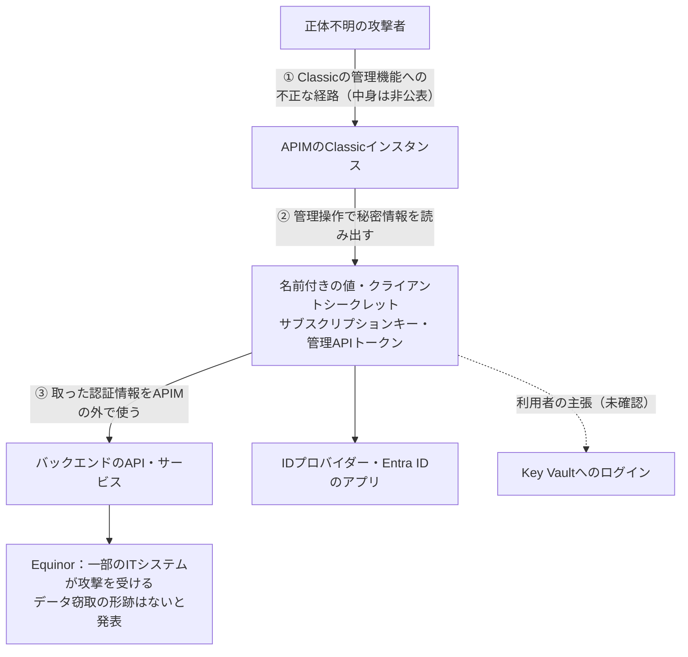

# Azure API Management ― 旧プランの欠陥を突かれ、保存された秘密情報が狙われた

## 要点

### 影響を受けるもの

- **Azure API Management（APIM）の旧来の料金プラン「Classic」のインスタンス**。Microsoftは顧客向けの非公開のアドバイザリ（Azure Service Health、Tracking ID: MZK9-GH0）で、2026年11月18日に欠陥を把握し、19日に不正なアクセス経路を塞いだと伝えた。それより前に、第三者がClassicのインスタンスに保存された秘密情報を読み出せた可能性がある（[BleepingComputer](https://www.bleepingcomputer.com/news/security/microsoft-azure-flaw-exploited-to-steal-customers-api-credentials/)、[The Register](https://www.theregister.com/security/2026/11/23/norway-links-energy-firm-cyberattacks-to-critical-azure-api-management-flaw/5311598)。どちらもアドバイザリを見た報道）。
- Microsoftは報道機関に対し、Developer・Basic・Standard・Premiumの各プランが対象だったと説明している。v2のプランは影響を受けない（[The Record](https://therecord.media/norway-microsoft-cyberattack-equinor)、[BleepingComputer](https://www.bleepingcomputer.com/news/security/microsoft-azure-flaw-exploited-to-steal-customers-api-credentials/)）。
- 漏れた可能性があるもの（Microsoftのアドバイザリ、[BleepingComputer](https://www.bleepingcomputer.com/news/security/microsoft-azure-flaw-exploited-to-steal-customers-api-credentials/)）：名前付きの値（Named Values）に入れた秘密情報、IDプロバイダーとOpenID Connectプロバイダーのクライアントシークレット、サブスクリプションキー、直接管理API用のトークン。
- 実際に悪用されている。ノルウェーの国家安全保障局（NSM）は、正体不明の攻撃者がAPIMのアクセストークン・秘密情報・名前付きの値を狙っていたとし、被害を受けた組織としてEquinorとSkagerak Energiを挙げた。ノルウェー国外や他の業種にも被害が及んでいる（[NSM](https://nsm.no/aktuelt/nsm-deler-tiltak-mot-sarbarhet-i-azure-api-management)）。被害を受けた組織の数は公表されていない。
- 欠陥の中身、CVE番号は公表されていない（11月24日時点）。

### 今すぐやること

- APIMを使っているなら、**秘密情報とトークンはすべて漏れたものとして作り直す**（[NSM](https://nsm.no/aktuelt/nsm-deler-tiltak-mot-sarbarhet-i-azure-api-management)）。Microsoftの修正は攻撃の経路を塞いだだけで、修正前に取られた認証情報は無効にならない（Microsoftのアドバイザリ、[BleepingComputer](https://www.bleepingcomputer.com/news/security/microsoft-azure-flaw-exploited-to-steal-customers-api-credentials/)）。手順はMicrosoftのガイド「[Rotating credentials in Azure API Management](https://techcommunity.microsoft.com/blog/integrationsonazureblog/rotating-credentials-in-azure-api-management/4575478)」にある。
- 作り直しは**発行元から**行う。APIM側の値を書き換えても、発行元（バックエンドのサービスやIDプロバイダー）にある古い認証情報は取り消されない（同）。
- 修正が入ったかを確かめる。`https://<ゲートウェイのホスト名>/internal-status-0123456789abcdef` を開き、RuntimeVersionが0.52系なら末尾が31936以上、0.53系なら31938以上であれば修正済み。`0.53.4608.0` のような別の形はv2かConsumptionのプランで、対象外。これより小さい番号なら未修正なので、Microsoftに連絡する（[NSM](https://nsm.no/aktuelt/nsm-deler-tiltak-mot-sarbarhet-i-azure-api-management)）。
- 取られたかもしれない認証情報で入れる先（APIMの後ろのバックエンド、Key Vault、Entra IDのアプリなど）のログを調べる（Microsoftのアドバイザリ、[BleepingComputer](https://www.bleepingcomputer.com/news/security/microsoft-azure-flaw-exploited-to-steal-customers-api-credentials/)、[NSM](https://nsm.no/aktuelt/nsm-deler-tiltak-mot-sarbarhet-i-azure-api-management)）。忘れられた開発・検証用のインスタンスも洗い出す（[The Register](https://www.theregister.com/security/2026/11/23/norway-links-energy-firm-cyberattacks-to-critical-azure-api-management-flaw/5311598)の取材に応じた利用者の指摘）。

## 登場する組織・サービス

- **Azure API Management（APIM）**：MicrosoftのクラウドAzureのサービスで、組織が自社のAPIを公開・保護・監視・管理するための仕組み（[Microsoft Learn](https://learn.microsoft.com/en-us/azure/api-management/api-management-key-concepts)、[BleepingComputer](https://www.bleepingcomputer.com/news/security/microsoft-azure-flaw-exploited-to-steal-customers-api-credentials/)）。APIの手前に立ってバックエンドを呼ぶため、バックエンドに入るための鍵やトークンを中に持つ。今回、欠陥があったサービス。
- **Microsoft**：Azureを運営する企業。欠陥を把握して塞ぎ、顧客に通知した当事者。
- **Equinor**：ノルウェーに本社を置く国際的なエネルギー会社で、石油・ガス・再生可能エネルギーを手がけ、欧州への主要なエネルギー供給者（[Equinor](https://www.equinor.com/about-us)）。11月17日に攻撃を検知し、NSMから早期発見と情報共有を評価された（[NSM](https://nsm.no/aktuelt/nsm-deler-tiltak-mot-sarbarhet-i-azure-api-management)）。
- **Skagerak Energi**：ノルウェーの電力会社で、電気などの発電・販売・送電を事業にしている（[Skagerak Energi](https://www.skagerakenergi.no/om-oss/)）。国営の再生可能エネルギー会社Statkraftが過半数を持つ（[The Record](https://therecord.media/norway-microsoft-cyberattack-equinor)）。攻撃を受けたと公表した。
- **ノルウェー国家安全保障局（NSM、Nasjonal sikkerhetsmyndighet）**：ノルウェーの予防的セキュリティの専門機関で、国家安全保障法に基づく安全保障当局（[NSM](https://nsm.no/om-oss/)）。今回の欠陥と被害を公表し、対策を示した。

## 概要

- Microsoftの説明では、推奨の構成に従っていないClassicのインスタンスで、第三者が一部の管理機能に認証なしで触れられた。管理の操作ができるので、保存された秘密情報の読み出しもできた（Microsoftのアドバイザリ、[BleepingComputer](https://www.bleepingcomputer.com/news/security/microsoft-azure-flaw-exploited-to-steal-customers-api-credentials/)）。
- Microsoftは、主に影響を受けたのはネットワークのセキュリティの推奨に従っていない顧客と、秘密情報をKey Vaultから参照せずAPIMに直接入れていた顧客だとしている（[The Register](https://www.theregister.com/security/2026/11/23/norway-links-energy-firm-cyberattacks-to-critical-azure-api-management-flaw/5311598)、[The Record](https://therecord.media/norway-microsoft-cyberattack-equinor)）。
- 最初に見つけたのはノルウェーのエネルギー業界で、Equinorが中心的な役割を果たした（[NSM](https://nsm.no/aktuelt/nsm-deler-tiltak-mot-sarbarhet-i-azure-api-management)）。Equinorが攻撃を公表したのは、Microsoftが欠陥を把握したとする日の前日だった（[BleepingComputer](https://www.bleepingcomputer.com/news/security/microsoft-azure-flaw-exploited-to-steal-customers-api-credentials/)）。
- EquinorもSkagerak Energiも、データが盗まれた形跡はなく、生産や電力供給にも影響はないとしている（[Equinor](https://www.equinor.com/news/20261711-equinor-detected-cyber-attack)、[Skagerak Energi](https://www.skagerakenergi.no/presse/pressemeldinger/oppdatering-pa-forsok-pa-cyberangrep)）。

> この記事では、NSM・Equinor・Skagerak Energiの公表と、Microsoftが公開した手順書で確認できる内容を「事実」としています。Microsoftのアドバイザリは公開されていないため、それを見た報道機関（BleepingComputer、The Register、The Record）の記述を出典にしています。Redditに投稿された利用者の主張は、確認されていないものとして区別します。筆者の推測や意見は「考察」として分けます。

## 何が起きたか（時系列）

| 日付（日本時間） | 出来事 |
| --- | --- |
| 11月17日（現地） | Equinorが一部のITシステムへの攻撃を検知。18日2時55分ごろ公表（[Equinor](https://www.equinor.com/news/20261711-equinor-detected-cyber-attack)）。社内のアプリやITサービスが使いにくくなった（[The Record](https://therecord.media/norway-equinor-cyberattack-energy)） |
| 11月18日（現地） | Skagerak Energiが攻撃の試みを公表（[SecurityWeek](https://www.securityweek.com/azure-flaw-exploited-to-target-secrets-at-norwegian-energy-firms/)）。Microsoftが欠陥を把握（アドバイザリ、[BleepingComputer](https://www.bleepingcomputer.com/news/security/microsoft-azure-flaw-exploited-to-steal-customers-api-credentials/)） |
| 11月19日（現地） | Microsoftが不正なアクセス経路を塞ぎ、Microsoft側の鍵や認証情報を必要に応じて入れ替え（同）。Skagerak Energiが状況を把握できたと更新（[Skagerak Energi](https://www.skagerakenergi.no/presse/pressemeldinger/oppdatering-pa-forsok-pa-cyberangrep)） |
| 11月20日 16時55分ごろ | Equinorが攻撃を止めたと発表（[Equinor](https://www.equinor.com/news/20261711-equinor-detected-cyber-attack)） |
| 11月21日 0時25分ごろ | NSMが欠陥と対策を公表（23日に更新）（[NSM](https://nsm.no/aktuelt/nsm-deler-tiltak-mot-sarbarhet-i-azure-api-management)） |
| 11月21日（現地） | Microsoftが認証情報の作り直し手順を公開。欠陥やノルウェーの件には触れていない（[Microsoft](https://techcommunity.microsoft.com/blog/integrationsonazureblog/rotating-credentials-in-azure-api-management/4575478)、[The Record](https://therecord.media/norway-microsoft-cyberattack-equinor)） |
| 11月23日〜24日 | The Register、BleepingComputer、The Recordなどが報道 |

## 技術的な問題点（根本原因）

### Microsoftが説明していること（事実：アドバイザリを見た報道による）

- 推奨の構成になっていないClassicのインスタンスで、一部の管理機能に不正にアクセスできた。この経路を使うと、秘密情報の管理を含む管理操作ができた（[BleepingComputer](https://www.bleepingcomputer.com/news/security/microsoft-azure-flaw-exploited-to-steal-customers-api-credentials/)）。
- 11月19日の修正は「管理プレーンへの不正なアクセス経路を塞ぐ」もので、すでに取られた認証情報は自動では無効にならない（同）。
- 修正は顧客の操作なしに自動で入った（[The Register](https://www.theregister.com/security/2026/11/23/norway-links-energy-firm-cyberattacks-to-critical-azure-api-management-flaw/5311598)、[BleepingComputer](https://www.bleepingcomputer.com/news/security/microsoft-azure-flaw-exploited-to-steal-customers-api-credentials/)）。一方NSMは、インスタンスごとにランタイムの版を確かめるよう求めている。両者の関係ははっきりしない（同）。

### 利用者の主張（未確認）

- Redditに投稿したある管理者は、正規の管理者トークンを使ってKey Vaultにふだんと違う形でログインされていたことから気づいたと書いている。攻撃者は廃止予定の古いAPIの認証回避のゼロデイを使ってAPIMの特権的なシステムアカウントを得ており、その古いAPIは利用者が見られるログを残さなかった、とも主張している（[BleepingComputer](https://www.bleepingcomputer.com/news/security/microsoft-azure-flaw-exploited-to-steal-customers-api-credentials/)の紹介。BleepingComputerは検証していない）。

### APIMが何を持っているか（事実：[Microsoft](https://techcommunity.microsoft.com/blog/integrationsonazureblog/rotating-credentials-in-azure-api-management/4575478)、[Microsoft Learn](https://learn.microsoft.com/en-us/azure/api-management/api-management-howto-properties)）

- 名前付きの値は、インスタンス全体で使う名前と値の組で、秘密情報も入れられる。秘密の値はAPIMの中に暗号化して持つか、Key Vaultの秘密情報を参照するかを選べ、Microsoftは後者を勧めている。
- 手順書が作り直しの対象に挙げるのは、サブスクリプションキー、名前付きの値、バックエンドの認証情報（ヘッダー・クエリ・クライアント証明書）、OAuth 2.0／OpenID Connectのクライアントシークレット、開発者ポータルのIDプロバイダーのシークレット、資格情報マネージャー、Event HubsやApplication Insightsの接続文字列、ポリシーに直接書いた認証情報、古い直接管理APIのキー。

### 考察

- 欠陥そのものは「Classicの管理機能に、本来なら届かない経路で触れられた」というクラウド側の問題で、利用者の側で防げたものではない。Microsoftが挙げる「推奨構成に従っていない」「Key Vaultを使っていない」は、被害の大きさを左右した条件であって、原因ではないと読むのが自然だと思う。
- Key Vaultを参照する形にしていても安全だったとは言い切れない。Redditの主張どおりなら、Key Vault自体に管理者トークンで入られている。APIMが持つ「Key Vaultを読める権限」まで攻撃者の手に渡ったのかどうかは、公表された情報からは分からない。

## 攻撃・侵入経路

公表された情報から組み立てた流れ。①の中身はMicrosoftが明かしていない。

- 取られた認証情報は、APIMを通さずに、その認証情報が守るサービスに直接使える。どこまで届くかは、その認証情報の権限と、まだ有効かどうかで決まる（研究者Anders Kristiansenの指摘、[The Register](https://www.theregister.com/security/2026/11/23/norway-links-energy-firm-cyberattacks-to-critical-azure-api-management-flaw/5311598)）。
- Equinorは、今回の攻撃はウイルスではないので広がる恐れはない、また自社を狙ったものではないようだと説明している（[Equinor](https://www.equinor.com/news/20261711-equinor-detected-cyber-attack)）。EquinorへのつながりがAPIMの件だと公式に示したのはNSMで、Equinor自身は侵入の方法を明らかにしていない（[NSM](https://nsm.no/aktuelt/nsm-deler-tiltak-mot-sarbarhet-i-azure-api-management)、[The Record](https://therecord.media/norway-microsoft-cyberattack-equinor)）。同じ攻撃者がノルウェーの2社を狙ったのかも分かっていない（[The Record](https://therecord.media/norway-microsoft-cyberattack-equinor)）。

## なぜ防げなかったか・構造的要因の考察

- **APIの玄関が鍵束を持っている**：APIMはバックエンドを呼ぶために、多くのサービスの鍵を一か所に集める。玄関の管理機能が破られると、玄関を通らずに奥の部屋へ直接入れる鍵がまとめて取られる。今回はクラウドの運営者側の欠陥で、その一か所が一度に多くの利用者で開いた（考察）。
- **修正と後始末が別物**：経路は11月19日にMicrosoftが塞いだが、取られた鍵はそのまま使える。利用者が自分で鍵を作り直すまで危険は続く。Microsoftの公開した手順書は欠陥に触れておらず、非公開のアドバイザリを受け取っていない担当者には、急ぐ理由が伝わりにくい（考察。手順書の内容は[The Record](https://therecord.media/norway-microsoft-cyberattack-equinor)も同様に指摘）。
- **見えない管理操作**：利用者の主張では、使われた古いAPIは利用者が見られるログを残さなかった（未確認）。もしそうなら、利用者は「APIMで何をされたか」ではなく、「取られた鍵で後ろのどこに入られたか」から調べるしかない（考察）。
- **最初に気づいたのは利用者**：Equinorが攻撃を公表したのは、Microsoftが欠陥を把握したとする日の前日だった。クラウド側の欠陥でも、最初の兆候は利用者側の異常として表に出る（考察）。

## 運用者向けの具体的な対策と検知ポイント

- **インスタンスを全部洗い出す**：サブスクリプションをまたいで `microsoft.apimanagement/service` を一覧にする（Azure Resource Graphの例が[Microsoftの手順書](https://techcommunity.microsoft.com/blog/integrationsonazureblog/rotating-credentials-in-azure-api-management/4575478)にある）。忘れられた開発・検証用のインスタンスも対象（[The Register](https://www.theregister.com/security/2026/11/23/norway-links-energy-firm-cyberattacks-to-critical-azure-api-management-flaw/5311598)）。
- **作り直す順番**：発行元で新しい鍵を作る → APIMに入れて動作を確かめる → 発行元で古い鍵を消す。サブスクリプションキーは呼び出し側をセカンダリーに移してからプライマリーを作り直し、戻してからセカンダリーを作り直す（[Microsoft](https://techcommunity.microsoft.com/blog/integrationsonazureblog/rotating-credentials-in-azure-api-management/4575478)）。
- **ポリシーの中も見る**：グローバル・API・操作・製品の各ポリシーに、パスワード・トークン・接続文字列・ヘッダーの認証情報が直接書かれていないか探す。ポリシーのXMLをそのままログに出さない（同）。
- **後ろ側のログを見る**：取られたかもしれない鍵で入れる先（バックエンドのAPI、Key Vault、Entra IDのアプリ、Event Hubsなど）で、11月19日より前を含めて、ふだんと違う送信元や時間帯からのアクセスを探す（Microsoftのアドバイザリ、[BleepingComputer](https://www.bleepingcomputer.com/news/security/microsoft-azure-flaw-exploited-to-steal-customers-api-credentials/)。期間の取り方は考察）。研究者Anders Kristiansenが調査用のクエリを公開している（同）。
- **自分で作っていないものを探す**：身に覚えのないサブスクリプション・ユーザー・ポリシー・バックエンドがないか確認する（[Microsoft](https://techcommunity.microsoft.com/blog/integrationsonazureblog/rotating-credentials-in-azure-api-management/4575478)）。
- **持たせ方を変える**：キーや接続文字列の代わりにマネージドIDを使い、秘密情報はKey Vaultに置いて名前付きの値から参照する。作り直しは定期的に、できれば自動で（同）。
- **ノルウェーの組織**：侵害の兆候があればNSMに連絡する（[NSM](https://nsm.no/aktuelt/nsm-deler-tiltak-mot-sarbarhet-i-azure-api-management)）。

## 参考リンク

- [NSM: NSM deler tiltak mot sårbarhet i Azure API Management（2026年11月20日、23日更新）](https://nsm.no/aktuelt/nsm-deler-tiltak-mot-sarbarhet-i-azure-api-management)
- [Microsoft Community Hub: Rotating credentials in Azure API Management](https://techcommunity.microsoft.com/blog/integrationsonazureblog/rotating-credentials-in-azure-api-management/4575478)
- [Microsoft Learn: Use named values in Azure API Management policies](https://learn.microsoft.com/en-us/azure/api-management/api-management-howto-properties)
- [Microsoft Learn: About API Management](https://learn.microsoft.com/en-us/azure/api-management/api-management-key-concepts)
- [Equinor: Equinor detected cyber-attack（11月20日更新）](https://www.equinor.com/news/20261711-equinor-detected-cyber-attack)
- [Skagerak Energi: Oppdatering på forsøk på cyberangrep](https://www.skagerakenergi.no/presse/pressemeldinger/oppdatering-pa-forsok-pa-cyberangrep)
- [BleepingComputer: Microsoft Azure flaw exploited to steal customers' API credentials（2026年11月23日、米国時間）](https://www.bleepingcomputer.com/news/security/microsoft-azure-flaw-exploited-to-steal-customers-api-credentials/)
- [The Register: Norway links energy firm cyberattacks to critical Azure API Management flaw（2026年11月23日）](https://www.theregister.com/security/2026/11/23/norway-links-energy-firm-cyberattacks-to-critical-azure-api-management-flaw/5311598)
- [The Record: Norway says hackers exploited Microsoft security flaw to attack energy firms Equinor, Skagerak Energi](https://therecord.media/norway-microsoft-cyberattack-equinor)
- [The Record: Cyberattack hits Norwegian energy giant Equinor, disrupting internal services](https://therecord.media/norway-equinor-cyberattack-energy)
- [SecurityWeek: Azure Flaw Exploited to Target Secrets at Norwegian Energy Firms](https://www.securityweek.com/azure-flaw-exploited-to-target-secrets-at-norwegian-energy-firms/)
