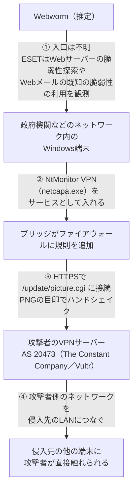

# SoftEther VPN改造版 ― 検知の目印を消した遠隔接続ツールが見つかる

## 要点

### 影響を受けるもの

- **SoftEther VPNを使った侵入の検知に頼っている組織、特に政府機関**。Rapid7は2026年11月19日（米国時間）、SoftEther VPN Bridgeを作り替えて検知されにくくしたツール「NtMonitor VPN」の分析を公開した（[Rapid7](https://www.rapid7.com/blog/post/tr-spying-on-governments-no-malware-custom-webworms-toolkit-softether-bridge/)）。
- Rapid7は、これを中国系のAPTグループWebwormのものと**中程度の確度**で推定している。根拠は、ESETが報告したWebwormの手口との一致と、Rapid7が持つ復号済みの設定に含まれる接続先などの指標（同）。
- 公開されている検体は1つだけで、2026年1月中ごろにVirusTotalに上げられた（同、[The Hacker News](https://thehackernews.com/2026/11/webworm-suspected-of-modifying.html)）。分析の時点で、これを検知したウイルス対策製品は1社だけだった（[Rapid7](https://www.rapid7.com/blog/post/tr-spying-on-governments-no-malware-custom-webworms-toolkit-softether-bridge/)）。
- どこの組織で見つかったか、侵入の入口、被害の範囲は、Rapid7の分析には書かれていない。
- SoftEther VPN自体の脆弱性の話ではない。正規のソフトを作り直して、侵入後の通路として使っている。

### 今すぐやること

- Rapid7が公開した[IoC](https://github.com/rapid7/Rapid7-Labs/tree/main/IOCs/Webworm_NtMonitor_IOCs.txt)と[YARAルール](https://github.com/rapid7/Rapid7-Labs/tree/main/Yara/Webworm_NtMonitor.yar)で、Windows端末とサーバーを調べる（[Rapid7](https://www.rapid7.com/blog/post/tr-spying-on-governments-no-malware-custom-webworms-toolkit-softether-bridge/)）。
- TLSの中身を見られる環境なら、`/update/picture.cgi` への `Content-Type: image/jpeg` のPOSTで、本文が `89 50 4e 47 0d 0a 1a 0a 00 00 00 0d 49 48 44 52` で始まるものを探す。Rapid7が「今すぐ使える最も確かな検知の一つ」としている（同）。
- 名前・URL・目印はすぐ変えられるので、IoCだけに頼らない。SoftEther VPNが本来どう動くか（サービス、ファイアウォール規則、ブリッジ動作）を理解しておくよう、Rapid7は政府部門の防御側に勧めている（同）。

## 登場する組織・サービス

- **SoftEther VPN**：筑波大学の学術プロジェクトとして開発・配布されているオープンソースのVPNソフト（Apache License 2.0）（[SoftEther VPN Project](https://www.softether.org/)）。VPN Bridgeは、離れたネットワーク同士をつなぐための部品。今回、攻撃者に作り替えられたソフト。
- **Webworm**：中国系とされるAPTグループ。2022年にSymantecが初めて報告し、当初はアジアを、最近は欧州の政府機関などを狙っているとESETは報告している（[ESET](https://www.welivesecurity.com/en/eset-research/webworm-new-burrowing-techniques/)）。今回のツールの使い手とRapid7が推定するグループ。
- **Rapid7**：セキュリティ企業で、検知と対応の運用サービス（MDR）などを提供し、MetasploitやVelociraptorといったオープンソースの開発でも知られる（[Rapid7](https://www.rapid7.com/about/company/)）。今回の分析を公開した。
- **ESET**：セキュリティ企業。Webwormの2025年の活動を分析した報告で、WebwormがSoftEther VPNなど正規の道具へ移ってきたことを報告している（[ESET](https://www.welivesecurity.com/en/eset-research/webworm-new-burrowing-techniques/)）。

## 概要

- Webwormは、侵入した政府機関のネットワークにSoftEther VPNを入れ、目立たない形で長く出入りする手口で知られていた。これが公に報告され、防御側が目を光らせるようになったあと、攻撃者はさらに見つかりにくくする方法を考えたとみられる、とRapid7は書いている（[Rapid7](https://www.rapid7.com/blog/post/tr-spying-on-governments-no-malware-custom-webworms-toolkit-softether-bridge/)）。
- NtMonitor VPNは、SoftEther VPN Bridge 4.44（build 9807）をソースから作り直したもの。Rapid7がGitHub上の公式ソースと比べた限り、バックドアなどの新しい機能は足されておらず、変更は見つかりにくくするためのものだけだった（同）。
- Rapid7はこれを「トロイの木馬化していない正規のSoftEtherを、検知の手がかりを消すように作り直した、独自マルウェアと正規ツールの中間」と表現している（同）。

> この記事では、Rapid7の分析とIoCファイル、ESETの分析、SoftEther VPN Projectの公式サイトで確認できる内容を「事実」とし、筆者の推測や意見は「考察」として分けます。Webwormへの帰属は、Rapid7自身が「中程度の確度」としている推定です。

## 何が起きたか（時系列）

| 日付 | 出来事 |
| --- | --- |
| 2022年 | SymantecがWebwormを初めて報告（[ESET](https://www.welivesecurity.com/en/eset-research/webworm-new-burrowing-techniques/)） |
| 2024年 | ESETが、Webwormが従来のバックドアから、SoftEther VPNなどの正規・準正規のツールへ移り始めたのを観測（同） |
| 2025年 | ベルギー、イタリア、セルビア、ポーランドの政府機関を狙った攻撃をESETが観測（同） |
| 2025年4月16日 | SoftEther VPN 4.44 build 9807が公開（[SoftEther VPN Project](https://www.softether.org/)）。NtMonitorの元になった版 |
| 2026年1月中ごろ | NtMonitorの検体がVirusTotalに上がる（[The Hacker News](https://thehackernews.com/2026/11/webworm-suspected-of-modifying.html)。Rapid7は「1月から公開」） |
| 2026年11月19日（米国時間） | Rapid7が分析、IoC、YARAルール、設定の復号スクリプトを公開（同） |
| 2026年11月24日 | The Hacker Newsが報道（[The Hacker News](https://thehackernews.com/2026/11/webworm-suspected-of-modifying.html)） |

## 技術的な問題点（何を変えたか）

この件は脆弱性ではなく、検知をすり抜けるための改造なので、「根本原因」の代わりに、変えられた点と残った点を整理する。

### 変えられた点（事実：[Rapid7](https://www.rapid7.com/blog/post/tr-spying-on-governments-no-malware-custom-webworms-toolkit-softether-bridge/)）

| 本来のSoftEther VPN | NtMonitor VPN | 狙い |
| --- | --- | --- |
| ファイル名 `vpnbridge_x64.exe`、SoftEtherの製品情報 | 元のファイル名 `netcapa.exe`、「Network Systems Solutions Inc.」の「Network Monitor Software」を名乗る | 一般的なシステムサービスに見せかける |
| 画面や内部の文字列に「SoftEther VPN」 | デバッグ表示、サービス名、レジストリ、HTTP 401のエラーページ、ファイアウォール規則名を「NtMonitor VPN」に置き換え | 名前での検索をかわす |
| HTTPの接続先 `/vpnsvc/vpn.cgi`、`/vpnsvc/connect.cgi` | `/update/alive.cgi`、`/update/picture.cgi` | ふつうのWebアプリの通信に見せる |
| 接続時の目印（ウォーターマーク）はGIF | Windowsのロゴの、途中で切れたPNG | 既知のGIFの目印で見つからないようにする。本家のSoftEtherとはつながらなくなる |
| 実行ファイルの隣に付属ファイル `hamcore.se2` | 中身を最小限にして実行ファイルの中に埋め込み、実行時に読み出す（ファイルが約1.5MB大きくなる） | 「hamcore.se2があればSoftEther」という検知をかわす |
| 設定ファイル `vpn_bridge.config` は平文 | `setting.conf` を独自のRC4に似た方式で暗号化。先頭は `RCEN` | 設定の中身（接続先など）を読まれないようにする |

- 接続の目印は、相手が本当にVPNのプロトコルを話しているかを確かめるためのもので、合わなければサーバーはおとりのHTTP応答を返す。NtMonitorはこの目印を変えたので、標準のSoftEtherとは互いにつながらない（同）。
- 暗号化された設定ファイルには鍵も入っており、Rapid7は復号用の[Pythonスクリプト](https://github.com/rapid7/Rapid7-Labs/tree/main/Malware%20Config%20Extractors/webworm_rcen_decrypt.py)を公開している（同）。

### 残った点（事実：同）

- 実行ファイルの中に、開発者の環境を示すPDBのパス（`C:\Users\Administrator\Desktop\SoftEtherVPN_Stable\...\vpnbridge.pdb`）が残っている。外から見たときの姿は隠すが、解析する人に対しては正体を隠していない。
- 版情報（4, 44, 0, 9807）は本家のまま。サービス名は `SEVPNBRIDGE` のままで、レジストリの多くも「SoftEther Project」を指している。名前の置き換えは徹底されていない。

### 設定から分かったこと（事実：同）

- Rapid7が手に入れた復号済みの設定では、どれも遠くのネットワークを手元のネットワークにつなぐ（カスケード）形で使われていた。
- テストとみられるもの以外では、遠い側のIPアドレスはThe Constant Company, LLC（子会社Vultrを含む）のAS 20473にあった。この事業者はこれまで何度もWebwormと結びつけられている。公開された設定の接続先として `216.238.108[.]22` が挙げられている（[Rapid7 IoC](https://github.com/rapid7/Rapid7-Labs/tree/main/IOCs/Webworm_NtMonitor_IOCs.txt)）。

### 考察

- 攻撃者が手を入れたのは、防御側が書きそうな検知ルールの対象（ファイル名、付属ファイル、設定ファイル、通信の目印、URL）をちょうど一つずつ潰す形になっている。Rapid7の「SoftEtherの検知面を系統立てて調べた」という見立てに、筆者も同意する。
- 逆に、作り直しても動作そのもの（ブリッジとして外のネットワークを中につなぐ、ファイアウォールに規則を足す、サービスとして常駐する）は変えていない。変えにくい部分で見るほうが長持ちする。

## 攻撃・侵入経路

Rapid7の分析とESETの報告から組み立てた流れ。入口（①）はどちらの報告でも特定されていない。

- ESETによると、Webwormはオープンソースのツールで標的のWebサーバーのファイルやディレクトリを洗い出して脆弱性を探しており、セルビアのWebメールに対してSquirrelMailの既知の脆弱性（CVE-2017-7692、認証後のRCE）のPoCを実行した記録がある。ESETは、何らかの方法で認証情報を手に入れたうえでこれを入口に使った可能性があるとみている（[ESET](https://www.welivesecurity.com/en/eset-research/webworm-new-burrowing-techniques/)）。NtMonitorの件と同じ入口かは分からない。
- ブリッジは、感染した端末のLANと攻撃者のネットワークを一つにつなぐ。攻撃者は感染端末を中継にして、ネットワーク内の他の端末に触れられる（[Rapid7](https://www.rapid7.com/blog/post/tr-spying-on-governments-no-malware-custom-webworms-toolkit-softether-bridge/)）。

## なぜ防げなかったか・構造的要因の考察

- **「マルウェアがない」侵入**：NtMonitorには、コマンドを実行するバックドアのような機能がない。遠隔操作ができるのは、つないだLANに対してWindowsの標準の仕組み（リモートデスクトップや共有など）が使えるからで、悪いことをする部分は手元のコードではなく、つながったネットワークそのものにある（考察）。ESETも、Webwormが正規の道具に移ったため、操作にはcmd.exeやPowerShellを使うしかないと書いている（[ESET](https://www.welivesecurity.com/en/eset-research/webworm-new-burrowing-techniques/)）。
- **正規ソフトの「名前」で探す検知は弱い**：オープンソースのソフトは誰でも作り直せる。ファイル名や付属ファイル、既知の通信パターンで探すルールは、ソースを数か所変えるだけで外れる（考察）。1月から公開されていたのに1社しか検知していなかったことがそれを示している（事実：[Rapid7](https://www.rapid7.com/blog/post/tr-spying-on-governments-no-malware-custom-webworms-toolkit-softether-bridge/)）。
- **VPNの通信は外から見分けにくい**：HTTPSの中でVPNのやり取りをするため、TLSの中身を見られない組織では、URLや目印での検知はそもそも使えない（考察）。
- **公表が攻撃者の改良を促す**：Rapid7自身、名前・URL・目印は次に簡単に変えられるとしている（同）。IoCは今ある検体を見つけるのには役立つが、次の版には効かないと考えておくほうがよい（考察）。

## 運用者向けの具体的な対策と検知ポイント

- **IoC**（[Rapid7 IoC](https://github.com/rapid7/Rapid7-Labs/tree/main/IOCs/Webworm_NtMonitor_IOCs.txt)）：
  - 実行ファイルのSHA-256 `90e70c0b04ecb9dfa1d5c60fe7de901846ebf0b54754ea12dde1ccb77623a6e8`
  - 設定ファイル `setting.conf`（先頭が `RCEN`）、平文の設定 `%TEMP%\@setting.conf`
  - URLのパス `/update/picture.cgi`・`/update/alive.cgi`
  - レジストリ `Software\SoftEther Project\NtMonitor VPN`、文字列「NtMonitor VPN」
  - 接続先 `216.238.108[.]22`、AS 20473への接続
- **変えにくい特徴で見る**（考察）：
  - 製品名が何であれ、サービス名 `SEVPNBRIDGE` や、「SoftEther Project」を含むレジストリを持つ実行ファイルを探す（変わらずに残っていた点。[Rapid7](https://www.rapid7.com/blog/post/tr-spying-on-governments-no-malware-custom-webworms-toolkit-softether-bridge/)）。
  - 版情報4.44.0.9807で、署名がない、または署名者がSoftEtherでないVPNらしきバイナリ。
  - サーバーや一般の端末に、ネットワーク監視を名乗る見慣れないサービスが入り、ファイアウォールの受信規則が増えていないか。
  - 端末から海外のVPSへの長時間続くHTTPS接続。特に、ふつう業務で使わないクラウド事業者（今回はAS 20473）への接続。
- **SoftEther VPN自体を棚卸しする**：業務で使っていないなら、SoftEther VPN（本家・改造版を問わず）の実行を、アプリケーション制御で止めることも考える（考察）。
- **入口側を固める**：ESETが観測したように、Webwormは公開Webサーバーの脆弱性探索や、Webメールの古い脆弱性を使う（[ESET](https://www.welivesecurity.com/en/eset-research/webworm-new-burrowing-techniques/)）。外向きのWebアプリとWebメールの更新状況と、認証情報の漏れを確認する。

## 参考リンク

- [Rapid7: Spying on Governments with Zero Lines of Malware: A Custom SoftEther Bridge in Webworm’s Toolkit（2026年11月19日）](https://www.rapid7.com/blog/post/tr-spying-on-governments-no-malware-custom-webworms-toolkit-softether-bridge/)
- [Rapid7 Labs（GitHub）: Webworm_NtMonitor_IOCs.txt](https://github.com/rapid7/Rapid7-Labs/tree/main/IOCs/Webworm_NtMonitor_IOCs.txt)
- [Rapid7 Labs（GitHub）: Webworm_NtMonitor.yar](https://github.com/rapid7/Rapid7-Labs/tree/main/Yara/Webworm_NtMonitor.yar)
- [Rapid7 Labs（GitHub）: webworm_rcen_decrypt.py](https://github.com/rapid7/Rapid7-Labs/tree/main/Malware%20Config%20Extractors/webworm_rcen_decrypt.py)
- [ESET WeLiveSecurity: Webworm: New burrowing techniques](https://www.welivesecurity.com/en/eset-research/webworm-new-burrowing-techniques/)
- [SoftEther VPN Project](https://www.softether.org/)
- [The Hacker News: Webworm Suspected of Modifying SoftEther VPN to Evade Detection and Hide Remote Access](https://thehackernews.com/2026/11/webworm-suspected-of-modifying.html)
