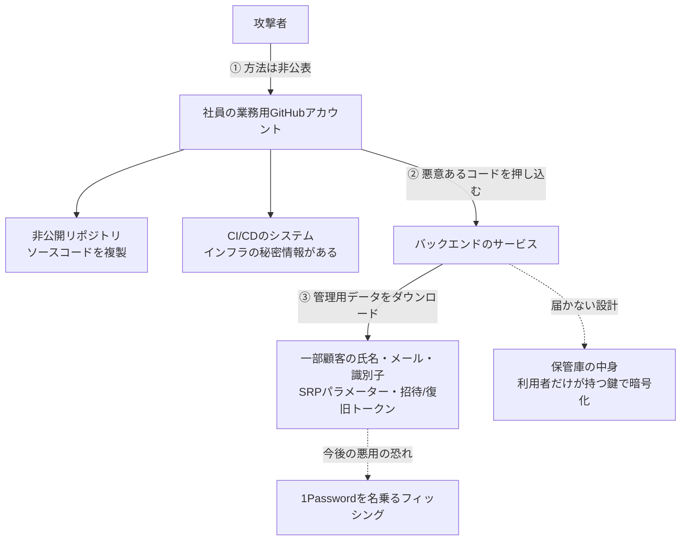

# 1Password ― 社員のGitHubアカウント経由で顧客情報が盗まれた

## 要点

### 影響を受けるもの

- **1Passwordの一部の顧客のアカウント情報**。1Passwordは2026年11月25日（米国時間）、攻撃者が社員の業務用GitHubアカウントを使ってバックエンドのサービスに悪意あるコードを入れ、顧客の管理用データをダウンロードしたと発表した（[1Password](https://1password.com/blog/update-on-nov-2026-security-incident)）。
- 持ち出されたもの（同）：氏名とサインイン用のメールアドレス、アカウントとユーザーの識別子、アカウント作成日時と最終サインイン日時、公開鍵、Secure Remote Password（SRP）プロトコルのパラメーター、招待・プロビジョニング・アカウント復旧のメールに含まれるリンクのトークン、内部構造に関する秘密でないメタデータ。
- 攻撃者は非公開リポジトリのソースコードを複製し、CI/CDのシステムにも入った。CI/CDには製品を動かすためのインフラの秘密情報がある（同）。
- 影響を受けていないとされるもの（同）：保管庫（Vault）とその中のアイテム、保管庫を守る鍵、アカウント復旧キー、1Passwordのアプリとブラウザー拡張機能。アカウントパスワードとSecret Keyは1Passwordがそもそも保存していない。
- 影響を受けた顧客の数、GitHubアカウントが乗っ取られた方法は公表されていない（11月28日時点）。1Passwordは、詳しい根本原因分析（RCA）を数週間以内に出すとしている（同）。

### 今すぐやること

- 1Passwordは、利用者がアカウントの設定を変える必要はないとしている（[1Password](https://1password.com/blog/update-on-nov-2026-security-incident)）。
- **1Passwordを名乗るメール・SMS・電話を疑う**。身に覚えのない招待やアカウント復旧の依頼には応じない。1Passwordがアカウントパスワードや Secret Key を尋ねることはない。入力するのは公式アプリか、自分でアドレスを打って開いた公式サイトだけにする（同）。
- 怪しい連絡は support@1password.com に知らせる（同）。
- 組織の管理者は、自社のメンバーに「1Passwordの漏えいを口実にしたフィッシング」が来る前提で周知しておく（[BleepingComputer](https://www.bleepingcomputer.com/news/security/1password-customer-data-stolen-after-employee-github-account-breach/)が同様の注意を呼びかけている。周知の提案は考察）。

## 登場する組織・サービス

- **1Password**：2005年創業のパスワード管理サービスの会社で、人とAIエージェントのための「信頼できるアクセス」を提供するとしている（[1Password](https://1password.com/company)）。本社はカナダのトロント（[The Hacker News](https://thehackernews.com/2026/11/1password-hacked-customer-data-and.html)）。今回、侵入を受けて発表した当事者。
- **GitHub**：ソースコードを置いて共同開発するためのサービス。1Passwordの社員の業務用アカウントが乗っ取られ、侵入の足がかりになった（[1Password](https://1password.com/blog/update-on-nov-2026-security-incident)）。
- **SCIM Bridge／Hosted Provisioning**：1Passwordの組織向けのプロビジョニング（メンバーのアカウントを用意して招待する）の仕組み。この招待メールに入るトークンも、今回持ち出されたものに含まれる（[1Password](https://1password.com/blog/update-on-nov-2026-security-incident)）。

## 概要

- 1Passwordは11月19日、社員の業務用GitHubアカウントに攻撃者が入った兆候の調査を始めた。攻撃者はそのアカウントでソースコードに触れ、バックエンドのサービスに悪意あるコードを押し込み、そのコードが顧客の管理用データをダウンロードした（[1Password](https://1password.com/blog/update-on-nov-2026-security-incident)）。
- 持ち出されたトークンは、招待や復旧を完了させるためのもの。完了にはSSOでのサインインか、登録メールアドレスに届く6桁のコードが別に要るので、トークンだけではアカウントに入れない、と1Passwordは説明している（同）。
- 1Passwordは念のため、招待・復旧のメールで使うコードを6桁の数字から10文字の英数字に延ばした（同）。
- 漏えいした招待トークンを使ったアカウント乗っ取りの痕跡は、社内の調査では見つかっていない（同）。
- アプリ、サービス、製品のセキュリティに影響はないとしている（同）。

> この記事では、1Passwordの公式ブログで確認できる内容を「事実」としています。1PasswordはBleepingComputer・The Register・TechCrunchの質問に答えておらず、侵入の方法や件数は分かっていません。筆者の推測や意見は「考察」として分けます。

## 何が起きたか（時系列）

| 日付 | 出来事 |
| --- | --- |
| 11月19日（現地） | 1Passwordが、社員の業務用GitHubアカウントに攻撃者が入った兆候の調査を始める（[1Password](https://1password.com/blog/update-on-nov-2026-security-incident)） |
| 不明 | 攻撃者が非公開リポジトリのソースコードを複製し、CI/CDに入り、バックエンドのサービスに悪意あるコードを入れて顧客データをダウンロード（同。それぞれの日時は非公表） |
| 11月25日（米国時間） | 1Passwordが公式ブログで発表（同）。対象のユーザーには個別に通知（同） |
| 11月26日 | The Register、The Hacker Newsなどが報道。1Passwordは報道機関の質問に答えていない（[The Register](https://www.theregister.com/security/2026/11/26/hackers-help-themselves-to-1passwords-source-code-and-customer-data/5312317)、[TechCrunch](https://techcrunch.com/2026/11/25/1password-said-hackers-broke-into-its-internal-systems-but-customer-passwords-are-safe/)） |

## 技術的な問題点（根本原因）

### 1Passwordが説明していること（事実：[1Password](https://1password.com/blog/update-on-nov-2026-security-incident)）

- 入口は社員の業務用GitHubアカウント。攻撃者はこのアカウントでソースコードに触れ、バックエンドのサービスにコードを押し込めた。
- 対応として、そのGitHubアカウントを無効にし、「盗まれたトークン」を失効させ、攻撃者が作ったアクセスを消した。影響を受けたサービスはきれいな版に戻し、漏れた可能性のある社内の認証情報はすべて作り直すか失効させた。
- GitHub・CI/CD・端末の管理を強め、この種の攻撃の検知を足した。

### 分かっていないこと

- GitHubアカウントがどう乗っ取られたか（フィッシング、端末のマルウェア、トークンの流出など）は公表されていない（[TechCrunch](https://techcrunch.com/2026/11/25/1password-said-hackers-broke-into-its-internal-systems-but-customer-passwords-are-safe/)）。
- 1Passwordの言う「盗まれたトークン」が、GitHubの個人アクセストークンなのか、別の種類のものなのかも書かれていない。
- GitHubアカウントへのアクセスが、なぜ本番のバックエンドへのコード反映につながったのか、ビルドと配布の仕組みにどこまで入られたのかも説明されていない（[The Register](https://www.theregister.com/security/2026/11/26/hackers-help-themselves-to-1passwords-source-code-and-customer-data/5312317)）。

### 保管庫が守られた理由（事実：[1Password](https://1password.com/blog/update-on-nov-2026-security-incident)）

- 保管庫の秘密は、利用者だけが持つ鍵で暗号化されている。1Passwordも、サーバーに入った攻撃者も中身を読めない設計になっている。アカウントパスワードとSecret Keyはサーバーに保存されない。
- 漏れたSRPのパラメーターは、それだけではアカウントに入れないと1Passwordは説明している。

### 考察

- サーバー側の侵入でも保管庫の中身が守られたのは、鍵を利用者側にだけ置く設計のおかげで、今回それが働いたことになる（1Passwordの説明どおりなら）。
- 一方で、**本番に入るコードを誰が反映できるか**は設計とは別の話だった。社員1人のGitHubアカウントから本番のバックエンドにコードが届いたなら、レビューや承認、デプロイの権限の分け方のどこかに抜けがあった可能性がある。どこが抜けたのかはRCAを待つ必要がある。
- 本番で動くコードを入れ替えられると、そのサービスが扱えるデータは何でも持ち出せる。今回持ち出されたのは管理用データだったが、そこに招待・復旧のトークンが含まれていた。6桁のコードを10文字に延ばした対応は、攻撃者がトークンを持っていても、もう一つの鍵を当てずっぽうで破られないようにするためと読める。

## 攻撃・侵入経路

公表された情報から組み立てた流れ。①の方法と、②から③への経路の詳細は公表されていない。

- 招待・復旧のトークンを使うには、SSOでのサインインか登録メールに届くコードが別に要る（[1Password](https://1password.com/blog/update-on-nov-2026-security-incident)）。
- 1Password利用者だと分かっているメールアドレスの一覧は、フィッシングに使いやすい。今回の漏えい自体がもっともらしい口実になる（[The Register](https://www.theregister.com/security/2026/11/26/hackers-help-themselves-to-1passwords-source-code-and-customer-data/5312317)、[BleepingComputer](https://www.bleepingcomputer.com/news/security/1password-customer-data-stolen-after-employee-github-account-breach/)）。

## なぜ防げなかったか・構造的要因の考察

- **開発者アカウントは本番への鍵**：GitHubのアカウントは、ソースコードを読むだけでなく、CI/CDを通じて本番に何を動かすかを決められる。社員の端末やアカウントは、本番サーバーと同じくらい守る対象になる（考察）。
- **CI/CDに秘密情報が集まる**：1Passwordは、CI/CDには製品を動かすためのインフラの秘密情報があると認めている（[1Password](https://1password.com/blog/update-on-nov-2026-security-incident)）。CI/CDに入られると、ソースコードより先に、そこにある鍵が問題になる（考察）。
- **同じ週の似た事件**：SAPも同じ週、GitHub上の開発環境で不審な動きを見つけたと認めた。報道によれば、社員の認証トークンを取られてソースコードを複製・改変された疑いがあり、SAPはGitHubへのアクセスを絞って自動の開発プロセスを止め、ソフトウェアの真正性を確かめる鍵を入れ替えた（[The Record](https://therecord.media/sap-germany-cyberattack-github)。いずれも報道ベース）。2件がつながっているかは分からない。開発基盤のアカウントやトークンを狙う攻撃は、[Gheistの件](/security-notes/notes/2026-10-27-gheist-stolen-github-tokens-actions-log-secret-dump/)でも見た流れで、狙いが「ソースコード」から「本番に入れる経路」へ広がっている（考察）。
- **ソースコードの流出は後から効く**：The Registerは、2022年のLastPassで、最初に開発環境から盗まれた情報がのちの保管庫バックアップの流出につながったことを挙げている（[The Register](https://www.theregister.com/security/2026/11/26/hackers-help-themselves-to-1passwords-source-code-and-customer-data/5312317)）。1Passwordのソースコードに利用者の秘密は含まれないとされるが、内部構造の情報が次の攻撃の材料になる可能性はある（考察）。

## 運用者向けの具体的な対策と検知ポイント

### 1Passwordを使う組織・個人

- 1Passwordを名乗る招待・復旧・「アカウントの保護」を求める連絡には、リンクから入らない。アプリか、自分で打ったアドレスから確認する（[1Password](https://1password.com/blog/update-on-nov-2026-security-incident)、[BleepingComputer](https://www.bleepingcomputer.com/news/security/1password-customer-data-stolen-after-employee-github-account-breach/)）。
- 組織の管理者は、身に覚えのない招待やアカウント復旧の申請がないか、1Passwordの管理画面で確認する（考察）。
- 1PasswordのRCAが出たら、侵入の方法と影響の範囲を見直す（考察）。

### 開発基盤を持つ組織（今回の教訓として。考察）

- **本番に届く経路を1人で通れないようにする**：本番へのデプロイにつながるブランチは保護し、別の人のレビューと承認を必須にする。CI/CDの設定ファイルやワークフローの変更も同じ扱いにする。
- **GitHubの認証を強くする**：組織として2要素認証（できればパスキーやセキュリティキー）を必須にし、個人アクセストークンは期限付き・権限を絞った形にする。組織の監査ログで、ふだんと違う場所からのクローンやトークンの作成、ワークフローの変更を見張る。
- **CI/CDの秘密情報を減らす**：長く使える鍵を置く代わりに、OIDCによる一時的な認証情報を使い、使える範囲を環境ごとに絞る。
- **本番で動いているものと、レビューされたものを照らし合わせる**：ビルドの来歴（どのコミットから誰の承認で作られたか）を記録し、デプロイ時に確かめる。
- **侵入されたらまず鍵**：1Passwordの対応順（アカウントの無効化 → トークンの失効 → 攻撃者が作ったアクセスの削除 → サービスをきれいな版に戻す → 社内の認証情報の作り直し）は、そのまま自社の手順の見本になる（[1Password](https://1password.com/blog/update-on-nov-2026-security-incident)）。

## 参考リンク

- [1Password: Update on a security incident involving 1Password's backend systems（2026年11月25日、米国時間）](https://1password.com/blog/update-on-nov-2026-security-incident)
- [1Password: Company](https://1password.com/company)
- [BleepingComputer: 1Password customer data stolen after employee GitHub account breach](https://www.bleepingcomputer.com/news/security/1password-customer-data-stolen-after-employee-github-account-breach/)
- [The Register: Hackers help themselves to 1Password's source code and customer data（2026年11月26日）](https://www.theregister.com/security/2026/11/26/hackers-help-themselves-to-1passwords-source-code-and-customer-data/5312317)
- [TechCrunch: 1Password said hackers broke into its internal systems, but customer passwords are safe（2026年11月25日）](https://techcrunch.com/2026/11/25/1password-said-hackers-broke-into-its-internal-systems-but-customer-passwords-are-safe/)
- [The Hacker News: 1Password Hacked, Customer Data and Source Code Stolen in GitHub Account Breach](https://thehackernews.com/2026/11/1password-hacked-customer-data-and.html)
- [The Record: Software giant SAP confirms cyber incident amid reports of source code breach（2026年11月27日）](https://therecord.media/sap-germany-cyberattack-github)
