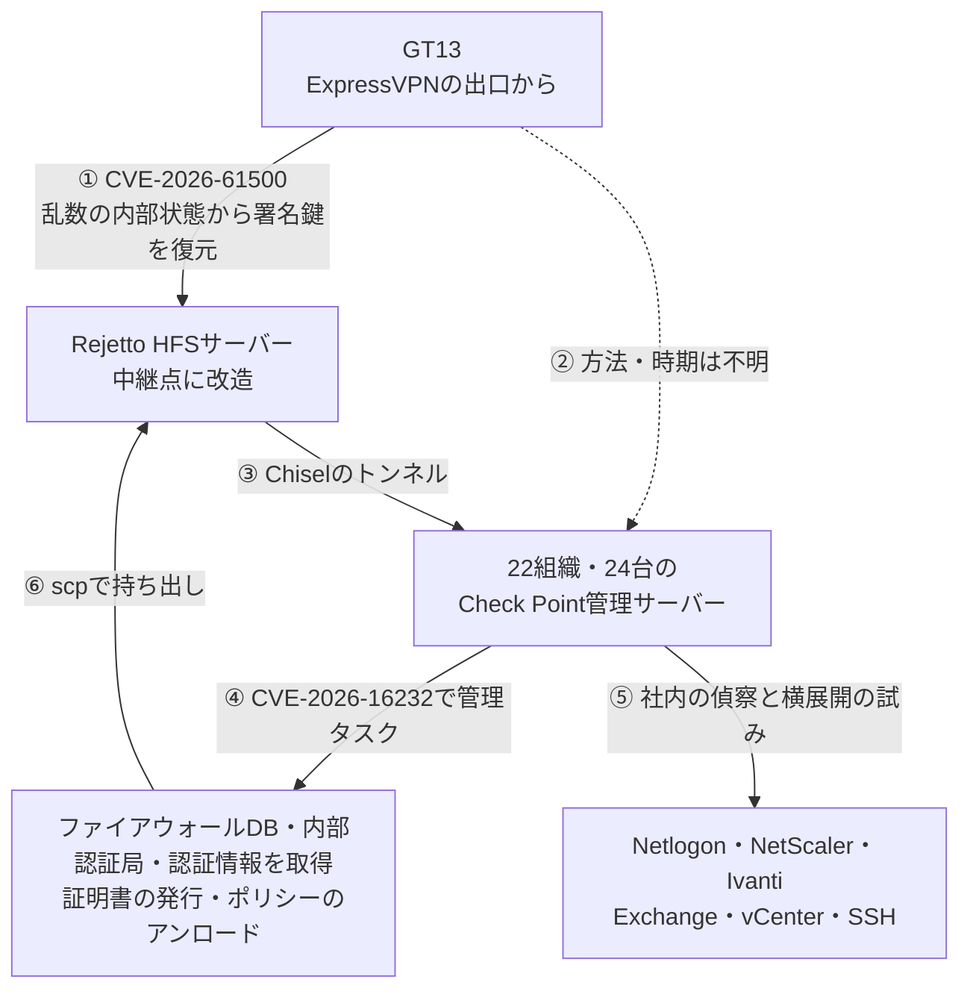

# Check Point管理サーバー ― 侵入され、設定や内部認証局のファイルを盗まれた

## 要点

### 影響を受けるもの

- **Check Point Security Management Server（管理サーバー）**。GreyNoiseは、攻撃者GT13が少なくとも22組織・24台の管理サーバーに入り込んでいたと報告した。被害組織は英国・アイルランド・フランス・オランダ・ギリシャ・ドイツ・オーストリア・ブルガリア・ポーランド・インド・タイ・ベトナム・韓国・香港・中国・オーストラリア・米国に資産を持ち、業種は金融・エネルギー・政府・運輸・鉱業・エンジニアリング・製造にわたる。特定の地域や業種を狙った様子はない（[GreyNoise](https://www.greynoise.io/blog/check-point-security-management-servers-intrusion-campaign)）。
- 被害組織への攻撃として確認できたのは2026年10月17日〜11月2日。GreyNoiseの観測は11月2日で途切れたが、攻撃者が管理サーバーへのアクセスを持ち続けているため、**攻撃は今も続いているとみている**（同）。
- 管理サーバー上の操作に使われたのは **CVE-2026-16232**（SmartConsoleのログイン処理の認証回避）。認証なしで管理者権限のトークンを得て、ポリシーや設定を変えられる。インターネットから管理サーバーに届き、接続元を「Trusted Clients」で絞っていない構成が条件（[CVE](https://www.cve.org/CVERecord?id=CVE-2026-16232)）。Check Pointは2026年7月22日に修正を出し、当時から悪用を確認していた（[Check Point](https://blog.checkpoint.com/security/security-advisory-action-required-active-exploitation-of-check-point-smartconsole-authentication-bypass-cve-2026-16232/)）。
- CVE-2026-16232の影響を受ける版（[CVE](https://www.cve.org/CVERecord?id=CVE-2026-16232)）：Security ManagementとMulti-Domain Managementの、R82.10（Jumbo Hotfix Take 36以下）、R82（Take 118以下）、R81.20（Take 158以下）、R81.10・R81・R80.30・R80.20・R80.10・R80・R77.30。なお、R81.20のTake 158のリリースノートにはこの欠陥の修正が載っており、CVEの記録と食い違うので、[sk185169](https://support.checkpoint.com/results/sk/sk185169)で確かめる（[Check Point](https://sc1.checkpoint.com/documents/Jumbo_HFA/R81.20/Take_158.html)）。
- **最初にどうやって管理サーバーに入ったかは分かっていない**。GreyNoiseは「いつ、どうやって入ったかは特定できなかった」としている（[GreyNoise](https://www.greynoise.io/blog/check-point-security-management-servers-intrusion-campaign)）。

### 今すぐやること

- **管理サーバーにJumbo Hotfixを入れる**：R82.10はTake 37以上、R82はTake 119以上、R81.20はTake 159以上（[CVE](https://www.cve.org/CVERecord?id=CVE-2026-16232)の影響範囲から。正確な版はsk185169で確認）。R81.10以前は修正の対象外の版にあたるので、サポートされる版へ上げる（考察）。
- **管理サーバーをインターネットから直接触れないようにする**：Trusted Clients（SmartConsoleで接続できる端末）を信頼できるIPアドレスに絞り、管理サーバーへのアクセスをファイアウォールで信頼できる送信元に限る（[Check Point](https://blog.checkpoint.com/security/security-advisory-action-required-active-exploitation-of-check-point-smartconsole-authentication-bypass-cve-2026-16232/)）。
- **修正済みでも侵入済みを疑う**：攻撃者は修正前に入っていた可能性がある。GreyNoiseの指標（下記）と、管理サーバーの監査ログで身に覚えのない管理タスク、証明書の発行、ポリシーのアンロード、`/etc/ld.so.preload` の不審な登録を調べる（[GreyNoise](https://www.greynoise.io/blog/check-point-security-management-servers-intrusion-campaign)。調べ方は考察を含む）。
- 侵害が見つかったら、管理サーバーにある認証情報と内部認証局（ICA）を作り直す前提で動く。攻撃者はファイアウォールのDB、内部認証局のファイル、認証情報を持ち出している（同。作り直しの判断は考察）。

## 登場する組織・サービス

- **Check Point Software Technologies**：企業や政府向けのサイバーセキュリティ製品の会社で、ネットワーク・クラウド・働く環境のセキュリティ製品を提供している（[Check Point](https://www.checkpoint.com/about-us/company-overview/)）。今回狙われた管理サーバーの開発元で、CVE-2026-16232を7月に修正した。
- **Security Management Server／SmartConsole**：Check Pointのファイアウォールのセキュリティポリシーや設定を管理するサーバーと、管理者がそこにログインするためのGUI（[CVE](https://www.cve.org/CVERecord?id=CVE-2026-16232)）。ここを乗っ取られると、管理下のファイアウォールのポリシーを書き換えられる。
- **GreyNoise**：インターネット上の攻撃の偵察や悪用を集めるセンサー網（Global Observation Grid）を運営し、攻撃者の基盤や手口を分析する会社（[GreyNoise](https://www.greynoise.io/blog/check-point-security-management-servers-intrusion-campaign)）。今回の攻撃を見つけて報告し、各国政府やCERTを通じて被害組織に知らせた。
- **GT13（GreyNoise Threat 13）**：GreyNoiseが今回の攻撃者の基盤・道具・侵入後の行動につけた呼び名。既知の攻撃グループとは結びつけておらず、動機や出身国も評価できないとしている（同）。
- **Rejetto HFS（HTTP File Server）**：ファイルをウェブ経由で共有するための、公開されているソフト（[Horizon3](https://horizon3.ai/attack-research/disclosures/anthropic-mythos-rejetto-hfs-rce/)）。今回は、GT13が[CVE-2026-61500](/security-notes/notes/2026-10-04-rejetto-hfs-cve-2026-61500-mythos-math-random/)で乗っ取り、作業の中継点（ホップ）にしたサーバーのソフト（[GreyNoise](https://www.greynoise.io/blog/check-point-security-management-servers-intrusion-campaign)）。

## 概要

- GT13は99のIPアドレスを使った。いずれもExpressVPNの出口か、侵害された被害組織のCheck Point機器だった。GreyNoiseは1,400以上の通信、800以上のコマンド、1,200以上のファイル操作を観測した（[GreyNoise](https://www.greynoise.io/blog/check-point-security-management-servers-intrusion-campaign)）。
- 中継点として、乗っ取ったHFSサーバーを使った。24台の管理サーバーから盗んだデータやコマンドの結果は、ここに集められた（同）。
- 使った道具はNmap・Chisel・Impacket・Paramikoと、少なくとも30のPythonスクリプト（同）。
- GreyNoiseは、キーボードを操作する人の動きも見えたとしつつ、脆弱性探し・悪用・道具作り・侵害した機器の操作にLLMとエージェントの仕組みを使っていたと考えている（同）。この見立ては確定していない（[BleepingComputer](https://www.bleepingcomputer.com/news/security/hackers-compromise-check-point-servers-in-22-organizations/)）。Cloud Security Allianceも、自動化されたループや道具の不自然な動きは従来のスクリプトによる攻撃でも説明でき、AIの関与は「ありうるが実証されていない」と評価している（[CSA](https://labs.cloudsecurityalliance.org/research/csa-research-note-gt13-ai-driven-checkpoint-management-compr/)）。
- Check Pointは、今回の件は7月に公表し悪用も明記した既知の欠陥で、手口も公開済みのMetasploitモジュールを改造したものだから新しくはない、と説明している（[BleepingComputer](https://www.bleepingcomputer.com/news/security/hackers-compromise-check-point-servers-in-22-organizations/)、[The Hacker News](https://thehackernews.com/2026/11/hackers-compromise-24-check-point.html)）。

> この記事では、GreyNoiseの報告とCheck Pointのアドバイザリ・CVEの記録・同社の報道機関への説明で確認できる内容を「事実」としています。AIの関与はGreyNoiseの見立てとして区別します。筆者の推測や意見は「考察」として分けます。

## 何が起きたか（時系列）

日時はGreyNoiseの報告（UTC）を日本時間に直したもの（[GreyNoise](https://www.greynoise.io/blog/check-point-security-management-servers-intrusion-campaign)）。

| 日時（日本時間） | 出来事 |
| --- | --- |
| 3月13日（UTC） | GT13が使うドメイン newpayapp[.]com が登録される（登録者の地域はベトナムのハイフォン。GreyNoiseは偶然かもしれないとしている） |
| 7月22日（現地） | Check PointがCVE-2026-16232などの修正を公開。少数の顧客で悪用を確認と明記（[Check Point](https://blog.checkpoint.com/security/security-advisory-action-required-active-exploitation-of-check-point-smartconsole-authentication-bypass-cve-2026-16232/)） |
| 不明 | GT13が被害組織のCheck Point管理サーバーに入る（方法も時期も不明。HFSサーバーより前） |
| 10月2日 22時ごろ | GT13の自動化された仕組みがHFSサーバーを探して悪用。数分後に偽造したセッションで管理者として操作 |
| 10月5日 21時ごろ | HFSの仕組みでコマンドを実行し、rootのSSH鍵に自分の鍵を足す |
| 10月19日 23時ごろ | SSHがあるのに、HFS経由でLinux向けの不正プログラム「ZULT」を入れようとして失敗。翌日、原因が分からないままSSHで作業を続ける |
| 10月20日 | HFSサーバーに受信用のHTTPサーバーを立て、最初の盗んだデータ（侵害済みの管理サーバーで取った経路情報）を受け取る。NmapとChiselを入れる |
| 10月20日〜26日 | 被害組織Aの環境で、CVE-2026-16232のスクリプトを使って複数の管理サーバーに100以上の管理タスクを実行。社内の偵察と横展開を試みる |
| 10月26日 11時ごろ | 24台の管理サーバーにまとめて証明書の管理タスクを実行（すべて失敗）。結果のファイルからGreyNoiseが被害組織を特定 |
| 11月2日 11時ごろ | 他の攻撃者が中継点を狙い始めたため、Linuxの欠陥CVE-2026-98432を自分で確かめ、nftablesで塞ぐ |
| 11月23日（米国時間） | GreyNoiseが報告を公開 |

## 技術的な問題点（何が使われたか）

### HFSの乗っ取り（事実：[GreyNoise](https://www.greynoise.io/blog/check-point-security-management-servers-intrusion-campaign)）

- HFSのログイン用エンドポイント（loginSrp1）は、POSTのたびに署名付きのセッションクッキーを返す。中の「sid」はJavaScriptの `Math.random()` で作られている。GT13は続けてログインして出力を集め、V8の乱数生成器の内部状態を割り出してクッキーの署名鍵を取り戻し、管理者のクッキーを偽造した。パスワードなしで管理者としてログインできる（CVE-2026-61500。この欠陥の詳細は[過去の記事](/security-notes/notes/2026-10-04-rejetto-hfs-cve-2026-61500-mythos-math-random/)）。
- 偽造したクッキーには `allow_session_ip_change:true` が入っていた。送信元のIPアドレスが変わっても使えるので、VPNの出口を切り替えながら動く攻撃者に都合がよい。

### 管理サーバーでの操作（事実：同）

- 被害組織Aの機器にChiselを入れてトンネルを作り、その中からCVE-2026-16232のスクリプト（exploit.py）で管理サーバーに命令を送った。GreyNoiseによると、このスクリプトはMetasploitの同じ欠陥のモジュールを改造したものとされる。
- 100以上の管理タスクで行ったこと：ファイアウォールのDBと内部認証局（ICA）のファイルのコピー、新しい証明書（pivot.p12）の発行、セキュリティポリシーのアンロード（ファイアウォールが無効になる）。
- 2台目の管理サーバーが中継点に結果を返せなかったときは、1台目を経由して2台目から認証情報・内部認証局のファイル・ファイアウォールの設定を吸い上げるスクリプトを作った。
- 別のCheck Pointのポータルには、よくある弱いパスワードと、被害組織に合わせたパスワードを試すスクリプト（spray_portal.py）を使った。

### 社内の他の機器へ（事実：同）

- 被害組織Aの環境で、Netlogon（CVE-2020-1472）、Citrix NetScaler（CVE-2023-4966）、Ivanti Connect Secure（CVE-2024-21893）、Exchange（CVE-2021-26855／34473）、vCenter（CVE-2021-21972／CVE-2023-34048）の悪用スクリプトを走らせ、Oracle TNSやドメインコントローラーも調べた。
- SSHでも、被害組織に合わせたユーザー名とパスワードで総当たりを試した。

### 侵入済みの痕跡（事実：同）

- 24台の証明書タスクの結果の1つに、`/etc/ld.so.preload` に登録された `/usr/lib/.libproc.so` の読み込みエラーがあった。管理サーバーに不正プログラムが仕込まれている可能性を示す。
- 24台はすべて、中継点に置かれた公開鍵に対応するSSHの秘密鍵を持っていた（結果のファイルが各被害機器から直接届いていたことから）。

### 考察

- 管理サーバーは「ファイアウォールの設定を変えられる場所」であり、同時に内部認証局で「信頼される証明書を作れる場所」でもある。ここを取られると、守りを外すことも、正規の機器や管理者になりすますことも、どちらもできてしまう。新しい証明書の発行を試みたのは、後者を狙った動きと読める（推測）。
- 最初の侵入の方法は分からない。7月の時点でCVE-2026-16232がすでに悪用されていたことを考えると、修正前に同じ欠陥で入られた機器が含まれている可能性はあるが、確認されていない。

## 攻撃・侵入経路

- 中継点（HFSサーバー）はGT13の持ち物ではなく、乗っ取った第三者のサーバー。被害組織から見た通信の相手は、どこかの普通のサーバーに見える（[GreyNoise](https://www.greynoise.io/blog/check-point-security-management-servers-intrusion-campaign)。見え方は考察）。
- 24台への一括タスクの命令は、GreyNoiseが見ていた中継点からではなく、攻撃者の別の基盤から出ていた（同）。GreyNoiseが見えたのは攻撃の一部にとどまる。

## なぜ防げなかったか・構造的要因の考察

- **修正から4か月**：CVE-2026-16232は7月に悪用込みで公表されたが、10月になっても24台が操られていた。管理サーバーは止めにくく、ファイアウォール本体ほど更新が優先されない傾向があると考えられる（考察）。修正しても、それ以前に入られていれば攻撃者は残る。
- **管理画面がインターネットに出ている**：Check Pointは、影響を受けるのは管理サーバーがIPの制限なしにインターネットへ直接出ている構成だとしている（[Check Point](https://blog.checkpoint.com/security/security-advisory-action-required-active-exploitation-of-check-point-smartconsole-authentication-bypass-cve-2026-16232/)）。守るための機器の管理画面が、攻撃者からいちばん届きやすい場所にあった（考察）。
- **自動化と並行作業**：GT13は24台に同じタスクをIPアドレス順に流し、自分の中継点を他の攻撃者から守るために脆弱性を塞ぐ、という手際を見せた（[GreyNoise](https://www.greynoise.io/blog/check-point-security-management-servers-intrusion-campaign)）。AIの関与が確かでないとしても、少ない人手で多くの組織を同時に扱える攻撃者がいる前提で、パッチまでの猶予を短く見積もる必要がある（考察）。
- **手口は既知の欠陥の寄せ集め**：社内で試された欠陥は2020〜2024年の古いものが多い（同）。周辺の境界機器の古い欠陥が残っていれば、管理サーバーからさらに奥へ進まれる（考察）。

## 運用者向けの具体的な対策と検知ポイント

- **管理サーバーを更新し、アクセスを絞る**：上の「今すぐやること」のとおり。Smart-1 Cloudの顧客はCheck Pointの側ですでに守られている（[Check Point](https://blog.checkpoint.com/security/security-advisory-action-required-active-exploitation-of-check-point-smartconsole-authentication-bypass-cve-2026-16232/)）。
- **GreyNoiseの指標で調べる**（[GreyNoise](https://www.greynoise.io/blog/check-point-security-management-servers-intrusion-campaign)）
  - ドメイン：newpayapp[.]com と、そのサブドメイン（data-zt・api-zt・2ev5）。
  - User-Agent：`Mozilla/5.0 (X11; Linux x86_64) research`、`Mozilla/5.0 research`。
  - ExpressVPN（AS206092）からの管理サーバーへのアクセス。GreyNoiseは使われたIPアドレスの一覧と使用時期を公開している。
  - SSHのHASSH `eeca2460550b9ded084ecf2f70a75356`（OpenSSH 10でよくある値なので、他の手がかりと組み合わせる）。
- **管理サーバーの中を見る**：`/etc/ld.so.preload` と `/usr/lib/.libproc.so` の有無、`/root/.ssh/authorized_keys` に知らない鍵がないか、Chiselなどのトンネルの道具や見覚えのないPythonスクリプトがないか（同。確認先の選び方は考察）。
- **監査ログで管理タスクを見る**：身に覚えのない時間帯のスクリプト実行、証明書の発行、ポリシーのアンロード、データベースのエクスポートを探す（同の観測内容から。考察）。
- **ポリシーのアンロードに気づける仕組み**：ゲートウェイでポリシーが外れたら即座に通知が上がるよう、監視側で設定する（考察）。
- **Check Point以外も**：同じ環境のNetscaler・Ivanti・Exchange・vCenter・ドメインコントローラーに、上記の古い欠陥が残っていないか確かめる（同）。社内のHFSのような小さなファイル共有サーバーが、外から中継点に使われていないかも確認する（考察）。

## 参考リンク

- [GreyNoise: 99 IPs but a C2 ain't one: An Active Intrusion Campaign Against Check Point Security Management Servers（2026年11月23日、米国時間）](https://www.greynoise.io/blog/check-point-security-management-servers-intrusion-campaign)
- [Check Point: Security Advisory – Action Required – July 2026 Security Update（2026年7月22日）](https://blog.checkpoint.com/security/security-advisory-action-required-active-exploitation-of-check-point-smartconsole-authentication-bypass-cve-2026-16232/)
- [Check Point: sk185169 - CVE-2026-16232](https://support.checkpoint.com/results/sk/sk185169)
- [Check Point: R81.20 Jumbo Hotfix Take 158](https://sc1.checkpoint.com/documents/Jumbo_HFA/R81.20/Take_158.html)
- [CVE Record: CVE-2026-16232](https://www.cve.org/CVERecord?id=CVE-2026-16232)
- [Check Point: Company Overview](https://www.checkpoint.com/about-us/company-overview/)
- [BleepingComputer: Hackers compromise Check Point Servers in 22 organizations](https://www.bleepingcomputer.com/news/security/hackers-compromise-check-point-servers-in-22-organizations/)
- [The Hacker News: Hackers Compromise 24 Check Point Management Servers in Suspected AI-Driven Attack Campaign（2026年11月25日）](https://thehackernews.com/2026/11/hackers-compromise-24-check-point.html)
- [Horizon3: Rejetto HFS（CVE-2026-61500）の開示](https://horizon3.ai/attack-research/disclosures/anthropic-mythos-rejetto-hfs-rce/)
- [Cloud Security Alliance: GT13: Suspected AI-Driven Intrusions Against Security Management Planes](https://labs.cloudsecurityalliance.org/research/csa-research-note-gt13-ai-driven-checkpoint-management-compr/)
