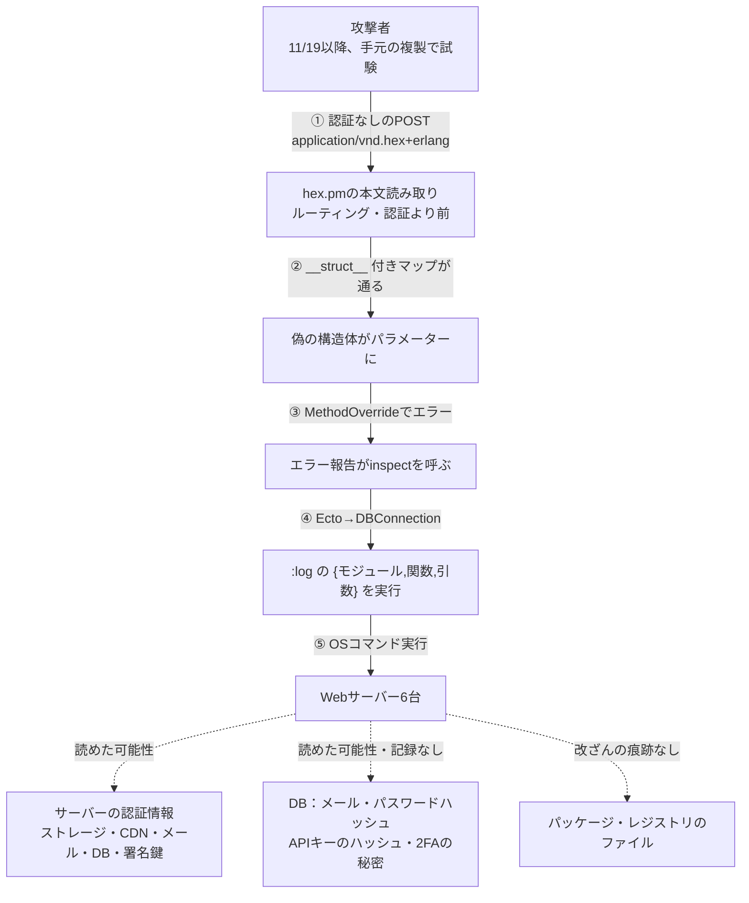

# Hex.pm ― 認証前の脆弱性を突かれ、Webサーバーでコマンドを実行された

## 要点

### 影響を受けるもの

- **Hex.pm（hex.pm）のWebサーバー6台**。2026年11月23日18時16分〜29分（UTC、日本時間24日3時16分〜29分）、攻撃者が69回の悪意あるリクエストを送り、6台でコマンドを実行した（[Hex](https://hex.pm/blog/security-incident-on-hexpm)）。
- 突かれた欠陥は **CVE-2026-129514**。リクエスト本文をErlangの形式で読む処理が、認証の前にどのURLでも動き、細工したデータからOSコマンドの実行までつながった。CVSS 4.0で10.0（[CVE](https://www.cve.org/CVERecord?id=CVE-2026-129514)、[GitHub Advisory](https://github.com/hexpm/hexpm/security/advisories/GHSA-9pmm-hf4r-27pg)）。
- 影響範囲は hexpm（Hex.pmのサーバーのコード）の2016年2月23日のコミットから2026年11月23日の修正コミット `379b0a2` の手前まで（[GitHub Advisory](https://github.com/hexpm/hexpm/security/advisories/GHSA-9pmm-hf4r-27pg)、[Hex](https://hex.pm/blog/security-incident-on-hexpm)）。Hexのクライアント（`mix hex` など）ではなくサーバー側の欠陥なので、**hexpmを自前で動かしている組織**は修正を入れるまで影響を受ける（[The Hacker News](https://thehackernews.com/2026/11/hackers-exploited-cvss-100-hexpm-rce.html)）。
- パッケージの改ざん、DBの書き換え、攻撃者が居座った痕跡は見つかっていない。ただしDBの読み取りは記録されないため、メールアドレス・パスワードハッシュ・APIキーのハッシュ・2FAの秘密・セッション・監査ログを読まれた可能性は否定できない（[Hex](https://hex.pm/blog/security-incident-on-hexpm)）。
- 攻撃者は不明。

### 今すぐやること

- **hex.pmのアカウントを持っている人**（[Hex](https://hex.pm/blog/security-incident-on-hexpm)）
  - hex.pmでパスワードを変える。
  - hex.pm/dashboard/security の「Authenticator App」で「Setup New App」を選び、2FAを作り直す。新しい秘密と復旧コードが発行されるので、復旧コードを保管し直す。
  - 全員がログアウトされているので、`mix hex.user auth`（rebar3なら `rebar3 hex user auth`）でクライアントにログインし直す（[The Hacker News](https://thehackernews.com/2026/11/hackers-exploited-cvss-100-hexpm-rce.html)）。
  - APIキーは作り直さなくてよいとHexは説明している（後述）。
- **パッケージを取得するだけの人・CI**：新しい署名の仕組みを入れたHexクライアントが出るまでは、**repo.hex.pm からだけ取得し、第三者のミラーを使わない**。リポジトリの署名鍵はまだ入れ替えられておらず、攻撃者が読めた可能性があるため（[Hex](https://hex.pm/blog/security-incident-on-hexpm)、[The Hacker News](https://thehackernews.com/2026/11/hackers-exploited-cvss-100-hexpm-rce.html)）。新版が出たら `mix local.hex --force` で更新し、rebar3やGleamも更新する。
- **Hexを名乗るメール**は、リンク先が hex.pm かを確かめる。怪しいものは security@hex.pm に転送する（[Hex](https://hex.pm/blog/security-incident-on-hexpm)）。
- **hexpmを自前で動かしている組織**：修正コミット `379b0a2` 以降に上げる（[GitHub Advisory](https://github.com/hexpm/hexpm/security/advisories/GHSA-9pmm-hf4r-27pg)）。
- 同じ種類の欠陥が見つかった ash（3.38.0）、db_connection（2.10.3）、flop（0.26.7／0.27.3／0.28.1／0.29.2）を使っているなら更新する（[The Hacker News](https://thehackernews.com/2026/11/hackers-exploited-cvss-100-hexpm-rce.html)）。

## 登場する組織・サービス

- **Hex／Hex.pm**：BEAM（Erlangの仮想マシン）で動く言語、つまりErlangやElixirなどのためのパッケージマネージャーとパッケージ置き場（[Hex](https://hex.pm/about)）。開発者はここから依存パッケージを取得する。2014年にオープンソースとして始まり、今はスウェーデンの会社Six Colors ABが運営している（同）。今回、侵入を受けて報告した当事者。
- **Elixir**：Erlangの仮想マシンの上で動く関数型のプログラミング言語で、スケールしやすいアプリケーション向け（[Elixir](https://elixir-lang.org/)）。Hex.pmの利用者の多くがこの言語の開発者で、Hex.pm自体もElixirで書かれている（[Hex](https://hex.pm/blog/security-incident-on-hexpm)のコード解説から）。
- **Ecto／DBConnection**：Elixirでデータベースを扱うためのライブラリ（Ectoについては[Elixir](https://elixir-lang.org/)、両者については[The Hacker News](https://thehackernews.com/2026/11/hackers-exploited-cvss-100-hexpm-rce.html)）。今回は中のコードが、攻撃者のデータをコマンド実行まで運ぶ「中継点」として使われ、db_connectionには関連する欠陥としてCVE-2026-133555が付いた（[Hex](https://hex.pm/blog/security-incident-on-hexpm)）。

## 概要

- Hexチームは、攻撃を受けてから20分以内に通信を遮断して修正を入れた。その直後、まさに同じ欠陥を報告するメールが届いた（[Hex](https://hex.pm/blog/security-incident-on-hexpm)）。
- 攻撃者のコマンドは、サーバーが使う認証情報を読めたため、Hexはストレージ・CDN・メール・DBの認証情報と、セッションとアクセストークンに署名する鍵を作り直した。これで全員がhex.pmとHexクライアントからログアウトされた（同）。
- まだ作り直していないのは、リポジトリの署名鍵と影響の小さい一部の秘密だけ。署名鍵は入れ替えの仕組みがないため、入れ替えに対応した新しい署名の仕組みと新しいクライアントを数日以内に出すとしている（同）。
- 攻撃者の2つのアドレスは11月19日以降、Hex.pm自身の依存パッケージを繰り返しダウンロードしていた。Hexは、攻撃者が手元にhex.pmの複製を作って試していたと見ている（同）。

> この記事では、Hexの事故報告とGitHubのアドバイザリ、CVEの記録で確認できる内容を「事実」としています。筆者の推測や意見は「考察」として分けます。

## 何が起きたか（時系列）

時刻はHexの報告（UTC）を日本時間に直したもの（[Hex](https://hex.pm/blog/security-incident-on-hexpm)）。

| 日時（日本時間） | 出来事 |
| --- | --- |
| 2016年2月23日 | リクエスト本文を読む処理から安全確認が外される（欠陥の始まり） |
| 11月19日以降 | 攻撃者の2つのアドレスがHex.pmの依存パッケージを繰り返しダウンロード（手元の複製で試していたとHexは推定） |
| 11月24日 3:14 | 攻撃者のアドレスから最初のリクエスト |
| 3:16〜3:29 | 69回の悪意あるリクエスト。6台のWebサーバーでコマンドが実行される。最初のファイルは、要求から3ミリ秒後に作られていた。エラー監視のSentryが最初の要求からエラーを記録 |
| 3:23 | Hex側がサーバー上で最初の対応 |
| 3:27 | 攻撃者の通信を止めるファイアウォールのルールを追加（3:30〜3:33に完全に有効） |
| 3:28 | 再起動で、修正前の版のサーバーが3台新たに立ち上がり、攻撃を受ける（6台のうち3台） |
| 3:30〜3:31 | 全サーバーを修正済みの版に入れ替え |
| 3:49 | 侵害されたサーバーが使っていたAWSのアクセスキーを無効化（3:47に新しいキーを作成） |
| 4:07 | 同じ欠陥を報告するメールが届く |
| 5:21 | 大半のインフラ認証情報を作り直し |
| 7:58〜8:26 | スウェーデンのデータ保護当局（IMY）に個人データ侵害を届け出、米CISAに報告、欧州ENISAに早期警告 |
| 19:42まで | 署名鍵などを除き、攻撃者が読めたすべての認証情報（DBのパスワードを含む）を作り直し |
| 22:48 | CVE-2026-129514を公開 |

## 技術的な問題点（根本原因）

### 攻撃の流れ（事実：[Hex](https://hex.pm/blog/security-incident-on-hexpm)）

1. **入口**：hex.pmは `application/vnd.hex+erlang` という種類の本文を、`Plug.Crypto.non_executable_binary_to_term/2`（`[:safe]` 付き）で読んでいた。この読み取りはルーティングと認証より前に動くので、認証なしのPOSTがどのURLでも届いた。
2. **偽の構造体が通る**：この読み取り関数は関数や新しいアトムを拒むが、マップを確かめていなかった。Elixirの構造体（struct）は「`__struct__` というキーでモジュール名を指定したマップ」にすぎないので、攻撃者は中身を好きに決めた「本物に見える構造体」を送れた。
3. **わざとエラーを起こす**：読み取った構造体はリクエストのパラメーターになる。`Plug.MethodOverride` が `body_params["_method"]` を読むと、構造体のモジュールの `fetch/2` が呼ばれるが、存在しないのでエラーになり、スタックトレースに攻撃者の構造体が残る。
4. **エラー報告が `inspect` を呼ぶ**：Sentry、Webサーバー（Bandit）のエラーログ、JSONのログ整形は、リクエストのデータと引数に `inspect` をかける。`inspect` は構造体のモジュールごとの実装を呼ぶので、攻撃者が次に動くコードを選べた。攻撃者は `Ecto.Query.DynamicExpr` を選んだ。
5. **Ectoを経由**：`Ecto.Query.DynamicExpr` の `inspect` の実装は、`binding` という項目をリストかどうか確かめずに数え上げた。数え上げも構造体ごとの実装に振り分けられる。
6. **DBConnectionを経由**：`binding` に入っていたのは `DBConnection.Stream` で、その数え上げが `DBConnection.reduce/3` → `declare/4` と進む。クエリの変換はDB接続の前に失敗するが、エラーの処理でストリームの `:log` オプションが実行される。この値はリクエストから来た `{モジュール, 関数, 引数}` の組で、db_connectionはそれをそのまま呼んだ。
7. **コマンド実行**：任意の関数を呼べるので、BEAMの実行ユーザーの権限でOSコマンドを実行できた。

### 修正（事実：同）

- 修正コミット `379b0a2` で、`__struct__` キーを持つマップを含むデータを拒み、400を返すようにした。この形式の本文はこの1か所で読むので、すべてのURLが守られる。
- さらに関係するライブラリ側でも、何段かで止める強化を進めている：plug_cryptoは「この関数は認証済みのデータにだけ安全」と明記し、構造体を拒むオプションを足す。plugは本文のパラメーターで構造体を受け付けない。ectoは `binding` がリストか確かめる。db_connectionはストリームの構造体から来た `:log` を呼ばない（CVE-2026-133555）。
- 調査の途中で、同じ種類の欠陥をAshのページ送り機能にも見つけ、ash 3.38.0で修正された（CVE-2026-124283）。

### 考察

- 一つひとつの部品は、単体では「危険な関数を拒む読み取り」「エラーを記録するだけのログ」「デバッグ用の表示」で、どれも致命的には見えない。危険だったのは、**信頼できないデータが、型を偽ったまま、エラー処理という目立たない道を通って、汎用の処理に届いた**という組み合わせだと読める。Javaなどの「デシリアライズの連鎖（ガジェットチェーン）」と同じ形が、Elixirの構造体とプロトコルの仕組みで起きた。
- 欠陥は約10年間あった。読み取りが認証の前に、しかも全URLで動いていたため、入口を見つけた攻撃者にとっては、どこに送っても届く状態だった。

## 攻撃・侵入経路

### パッケージが改ざんされていないと言える根拠（事実：[Hex](https://hex.pm/blog/security-incident-on-hexpm)）

- 最初の攻撃の直前（18:13:59 UTC）のDBの複製を戻し、今のDBの全テーブルの全行と比べた。違いはすべて、他のアドレスからの監査ログ、裏で動く処理、Hex自身の対応で説明がついた。ただし「書き換えて元に戻した行」や「後の正当な更新で上書きされた行」は、この比較では見つからない。
- 攻撃中に公開された23のリリースはすべて監査ログと一致し、それ以前のリリースは変わっていない。18時以降に書かれた62のパッケージファイルはDBのチェックサムと、186のレジストリのファイルはDBの内容と一致した。ドキュメントのアーカイブはチェックサムを持たないので比べられない。
- ストレージのアクセスログでは、本番の認証情報によるリクエストはすべて自分たちのノード3台からで、削除やバケットの一覧取得はなかった。
- 侵害されたサーバーでシェルが残っていないこと、クラウドの監査ログに新しい鍵・アカウントや攻撃者アドレスからのAPI呼び出しがないことも確かめた。

### 確かめられないこと（事実：同）

- DBの読み取り、環境変数の読み取り、シェルのコマンドは記録されていない。通信量は、1台のワーカーサーバーが通常の最大0.29MB/sに対し0.47MB/sまで上がった以外は、ふだんどおりだった。
- 非公開パッケージの読み取りは自分たちのサーバーからで、同じ組織のリリースの時刻と重なる。ただ、侵害されたサーバーからの読み取りは自分たちのものと見分けがつかない。非公開ドキュメントの読み取りは記録されない。該当する組織には個別に連絡する。

### APIキーを作り直さなくてよい理由（事実：同）

- APIキーは128ビットのランダムな値で、HMAC-SHA256のハッシュとしてだけ保存している。総当たりで戻すのは現実的でないとHexは判断している。パスワードはbcryptでハッシュしているが、弱いパスワードなら当てられるので変更を求めている。

## なぜ防げなかったか・構造的要因の考察

- **言語の安全装置を信じすぎた**：使われた関数は名前に「non_executable」とあり、`[:safe]` も付いていた。Hexは今後、この関数は認証済みのデータにだけ安全だと文書に書くとしている（[Hex](https://hex.pm/blog/security-incident-on-hexpm)）。「安全版の関数を使っているから大丈夫」という思い込みが、10年間の見落としにつながったと考えられる（考察）。
- **エラー処理とログは攻撃面になる**：今回の連鎖は、エラー報告がリクエストの中身を `inspect` する、という当たり前の動きから始まった。ログや監視の部品は、外から来たデータに触れる場所として扱う必要がある（考察）。
- **攻撃者は先に手元で練習した**：攻撃者は数日前からHex.pmの依存パッケージを取得し、手元に複製を作っていたとHexは見ている（[Hex](https://hex.pm/blog/security-incident-on-hexpm)）。オープンソースのサービスは、攻撃者が本番と同じものを手元で動かして試せる。攻撃が13分で終わり、6台中3台は再起動で立ち上がった古い版だったことからも、準備した上での短時間の攻撃だったと読める（考察）。
- **署名鍵を入れ替えられない設計**：入れ替えの仕組みがないため、読まれたかもしれない署名鍵をすぐには替えられず、「ミラーを使わない」という運用でしのいでいる（[Hex](https://hex.pm/blog/security-incident-on-hexpm)）。パッケージ置き場の署名鍵は、いつか入れ替える前提で作っておくべきものだと分かる（考察）。
- **対応の速さ**：最初の攻撃から15分ほどで全サーバーが修正版になり、その日のうちに当局へ届け出、翌日にCVEを公開した。改ざんがないと言える根拠と、言えないことを分けて書いた報告は、事故報告の見本になる（考察）。

## 運用者向けの具体的な対策と検知ポイント

- **Elixir／Erlangでパッケージを使う組織**
  - 新しいHexクライアントが出るまで、CIでも `HEX_MIRROR` などのミラー設定を外し、repo.hex.pm から取得する（[Hex](https://hex.pm/blog/security-incident-on-hexpm)の「ミラーを信用しない」を受けた具体策。設定名は利用環境に合わせる）。
  - 新しいクライアントが出たら更新し、ロックファイル（mix.lock）のチェックサムが変わっていないか確かめる（考察）。
  - Hexの組織アカウントで非公開パッケージを置いているなら、Hexからの個別連絡を確認する（[Hex](https://hex.pm/blog/security-incident-on-hexpm)）。
- **自社のElixirアプリ**
  - 外から来たデータを `:erlang.binary_to_term` や `Plug.Crypto.non_executable_binary_to_term` で読んでいないか探す。読むなら認証済みのデータに限り、構造体（`__struct__` を持つマップ）を拒む（[Hex](https://hex.pm/blog/security-incident-on-hexpm)の修正と強化方針から）。
  - ash・db_connection・flopを使っているなら修正版に上げる。特にページ送りのカーソルをクライアントから受け取る作りは確認する（[The Hacker News](https://thehackernews.com/2026/11/hackers-exploited-cvss-100-hexpm-rce.html)）。
- **自前のhexpm**：修正コミット `379b0a2` 以降に上げ、11月以前のログに `application/vnd.hex+erlang` の認証なしPOSTや `UndefinedFunctionError` が急に増えた時間帯がないか見る（[GitHub Advisory](https://github.com/hexpm/hexpm/security/advisories/GHSA-9pmm-hf4r-27pg)。ログの見方は今回の攻撃の流れからの考察）。
- **検知の考え方**：今回、最初に攻撃を知らせたのはエラー監視（Sentry）だった（[Hex](https://hex.pm/blog/security-incident-on-hexpm)）。ふだん起きないエラーが特定のアドレスから続けて出たら、攻撃の試行として扱う（考察）。

## 参考リンク

- [Hex: Security incident on hex.pm（2026年11月24日）](https://hex.pm/blog/security-incident-on-hexpm)
- [GitHub Advisory GHSA-9pmm-hf4r-27pg: Unauthenticated remote code execution through struct values in Erlang term request bodies](https://github.com/hexpm/hexpm/security/advisories/GHSA-9pmm-hf4r-27pg)
- [CVE Record: CVE-2026-129514](https://www.cve.org/CVERecord?id=CVE-2026-129514)
- [Hex: About](https://hex.pm/about)
- [Elixir](https://elixir-lang.org/)
- [The Hacker News: Hackers Exploited CVSS 10.0 Hex.pm RCE Flaw to Compromise 6 Package Registry Servers（2026年11月25日）](https://thehackernews.com/2026/11/hackers-exploited-cvss-100-hexpm-rce.html)
- [SecurityWeek: Hex Package Manager Warns of Potential Data Breach](https://www.securityweek.com/hex-package-manager-warns-of-potential-data-breach/)
